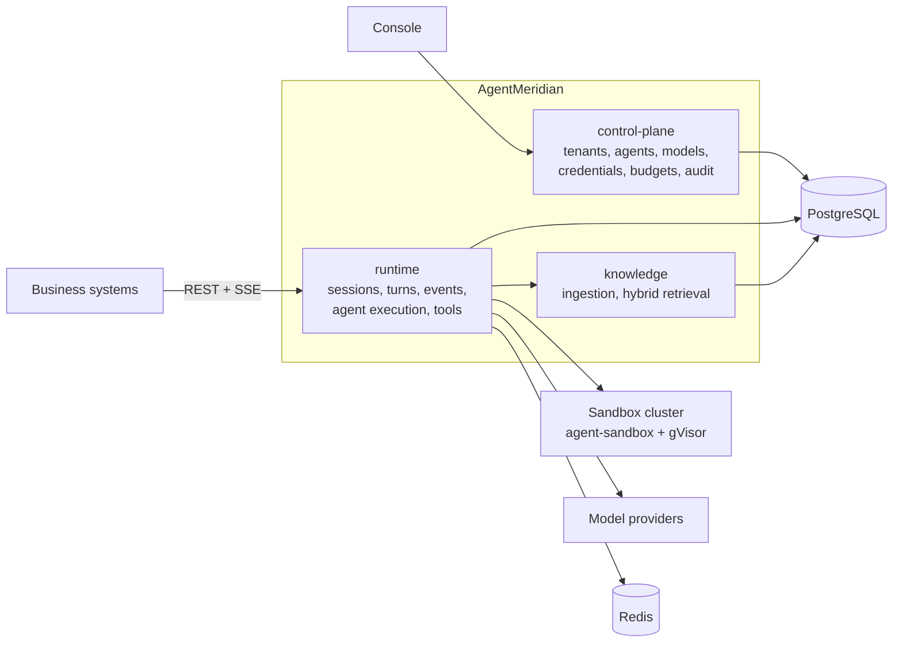

# AgentMeridian

**English** | [简体中文](README.zh-CN.md)

Enterprise agent platform on the JVM: production-grade agent harness, sandboxed multi-agent runtime, RAG knowledge base, model and budget governance, admin console, and a standard Sessions/Events API with SSE.

> [!IMPORTANT]
> **Status: architecture baseline, pre-M0.** The architecture is finalized and reviewed; there is no runnable code yet. Everything below describes the target design defined in the [architecture document](docs/architecture/architecture.md).

## What it is

AgentMeridian runs inside your company and serves many business systems at once. A business system gets a base URL and an API key, then drives fully capable agents through one Sessions/Events API: sessions, subagents, tools, sandboxed code execution, approvals, memory, skills, and knowledge bases. Administrators configure agents, models, credentials, and budgets in the console, and every run is audited and metered.

Typical workloads: chat assistants, knowledge-base Q&A, document drafting and editing, and natural-language data analysis.

## API at a glance

Three calls cover a knowledge-base assistant. The agent and environment are configured once in the console.

```bash
# 1. Create a session
curl -X POST $MERIDIAN_BASE_URL/v1/sessions \
  -H "Authorization: Bearer $MERIDIAN_API_KEY" \
  -d '{"agent": "agt_policy_qa", "environment": "env_default", "end_user_id": "u_1024"}'

# 2. Send a message
curl -X POST $MERIDIAN_BASE_URL/v1/sessions/ses_01JC.../events \
  -H "Authorization: Bearer $MERIDIAN_API_KEY" \
  -d '{"events": [{"type": "user.message", "content": [{"type": "text", "text": "What is the hotel allowance for business trips?"}]}]}'

# 3. Stream events over SSE (reconnect with Last-Event-ID)
curl -N $MERIDIAN_BASE_URL/v1/sessions/ses_01JC.../stream \
  -H "Authorization: Bearer $MERIDIAN_API_KEY" -H "Accept: text/event-stream"
```

While the agent works, the stream carries `agent.message`, `agent.tool_use`, `agent.tool_result`, and status events. When a tool needs approval, the session moves to `requires_action`, and you answer with a `user.tool_confirmation` event. You can also steer the agent mid-run, queue follow-up messages, or interrupt it.

## Capabilities

| Area | Capability | Milestone |
|---|---|---|
| Sessions | Event log, SSE with resume, queued and steering messages, interrupts, crash recovery across nodes | M1 |
| Harness | Context compaction, large tool result offloading, plan mode, skills, subagents | M1 |
| Tools | File, shell, web search and fetch, knowledge search, MCP servers with per-tenant credentials, client-side custom tools | M1 |
| Safety | Layered permission rules with approvals, per-session gVisor sandboxes, egress allowlists, credentials kept out of model context | M1 |
| Knowledge | Document ingestion, hybrid vector and full-text retrieval, rerank, per-user ACL filtering, exposed as a tool, REST, and MCP | M1 |
| Models | Multi-provider routing, rate limiting, fallback, OpenAI-compatible endpoints | M1 |
| Governance | Multi-tenant RBAC, API keys, usage ledger, four-level budgets, audit log, admin console | M1 |
| Extended | Long-term memory, background subagents, A2A, web terminal, session fork and rewind, text-to-SQL | M2 |
| Ecosystem | Structured judgment layer, external agent workers, browser sandbox, IM channels, scheduled runs | M3 |

## Architecture



The platform owns session semantics: events, queues, approvals, leases, and recovery live in platform code and PostgreSQL. [AgentScope Java](https://github.com/agentscope-ai/agentscope-java) executes one turn at a time behind an adapter layer, and only one module may depend on it. The runtime is stateless and scales horizontally; PostgreSQL holds the turn queue and leases, and Redis carries real-time streams and rate limits.

Read the [architecture document](docs/architecture/architecture.md) for module boundaries, data model, state machines, API contracts, and the constraints that CI enforces.

## Tech stack

| Layer | Choice |
|---|---|
| Language and framework | Java 25, Spring Boot 4.1 (WebFlux for the runtime, MVC elsewhere) |
| Agent kernel | AgentScope Java 2.0.4 (core and harness) |
| Storage | PostgreSQL 17 with pgvector, Redis, S3-compatible object storage |
| Sandbox | kubernetes-sigs/agent-sandbox, gVisor, Envoy egress proxy |
| Protocols | REST + SSE, OpenAI-compatible endpoints, MCP |
| Observability | OpenTelemetry, Langfuse, Prometheus, Grafana |
| Console | React 19, TypeScript, Vite, TanStack, shadcn/ui, Tailwind CSS |
| Document parsing | Apache Tika, PDFBox, POI; Docling and MinerU for complex PDFs |
| Deployment | Kubernetes and Helm; Docker Compose for local development |

## Repository layout

The layout is planned; modules will appear as milestones land.

```text
meridian-control-plane/      Control plane service
meridian-runtime/            Session runtime service
meridian-knowledge/          Knowledge base service
meridian-engine-spi/         Kernel adapter interfaces and ports
meridian-engine-agentscope/  The only module that depends on AgentScope
meridian-api/                OpenAPI specification and generated DTOs
console/                     Admin console (React)
doc-parser/                  Document parsing service (Python)
sandbox-runtime/             Sandbox image
deploy/                      Helm charts and Docker Compose
docs/                        Architecture, research, ADRs, PoC reports
```

## Roadmap

- **M0, technical validation**: 15 validation items that need running code, such as lease fencing, crash recovery semantics, sandbox warm pools, and middleware ordering. Progress is tracked in [docs/poc](docs/poc/README.md).
- **M1, MVP**: all M1 capabilities above, accepted against eight end-to-end scenarios.
- **M2 and M3**: extended and ecosystem capabilities.

## Documentation

| Document | Content |
|---|---|
| [Architecture](docs/architecture/architecture.md) | The single architecture baseline |
| [Technology selection](docs/research/tech-selection.md) | Candidate evaluation and rejected alternatives |
| [ADRs](docs/adr/README.md) | Architecture decision process and records |
| [M0 validation](docs/poc/README.md) | Validation items and reports |

The design documents are written in Chinese.

## Contributing

The architecture document is binding. Changes to its baseline, such as components, module boundaries, breaking API changes, or any MUST or MUST NOT rule, start with an [ADR](docs/adr/README.md). Architecture rules are enforced by ArchUnit, maven-enforcer, and contract tests, and a change merges only when all checks pass.

## License

[Apache License 2.0](LICENSE)
