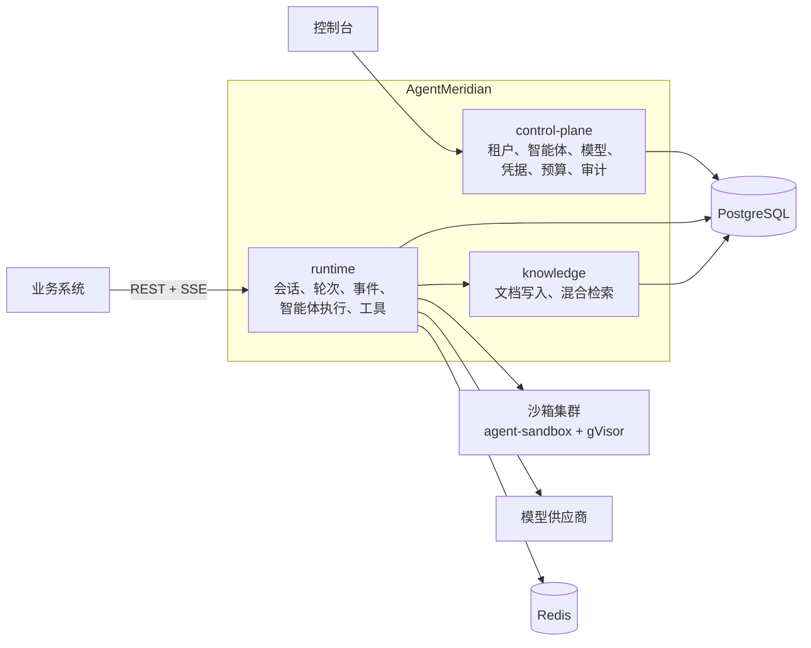

# AgentMeridian

[English](README.md) | **简体中文**

企业级通用智能体平台：生产级 Agent Harness、沙箱化多智能体运行时、RAG 知识库、模型与预算治理、可视化控制台，以及基于 SSE 的标准 Sessions/Events API。

> [!IMPORTANT]
> **当前阶段：架构基线，M0 之前。** 架构已经定稿并通过评审，还没有可运行的代码。下文描述的都是[架构设计](docs/architecture/architecture.md)中定义的目标形态。

## 它是什么

AgentMeridian 部署在企业内部，同时为多个业务系统服务。业务系统拿到 BaseUrl 和 API Key，通过一套 Sessions/Events API，就能驱动具备完整能力的智能体：会话、子智能体、工具、沙箱执行代码、审批、记忆、技能、知识库。管理员在控制台配置智能体、模型、凭据和预算，每一次执行都可审计、可计量。

典型场景：聊天助手、知识库问答、文档编制与修改、智能问数。

## API 一览

一个知识库问答助手只需要三个调用。智能体和环境由管理员在控制台预先配置。

```bash
# 1. 创建会话
curl -X POST $MERIDIAN_BASE_URL/v1/sessions \
  -H "Authorization: Bearer $MERIDIAN_API_KEY" \
  -d '{"agent": "agt_policy_qa", "environment": "env_default", "end_user_id": "u_1024"}'

# 2. 发送消息
curl -X POST $MERIDIAN_BASE_URL/v1/sessions/ses_01JC.../events \
  -H "Authorization: Bearer $MERIDIAN_API_KEY" \
  -d '{"events": [{"type": "user.message", "content": [{"type": "text", "text": "差旅住宿标准是多少？"}]}]}'

# 3. 订阅 SSE 事件流（断线后带 Last-Event-ID 重连）
curl -N $MERIDIAN_BASE_URL/v1/sessions/ses_01JC.../stream \
  -H "Authorization: Bearer $MERIDIAN_API_KEY" -H "Accept: text/event-stream"
```

智能体工作时，事件流里依次出现 `agent.message`、`agent.tool_use`、`agent.tool_result` 和状态事件。工具需要审批时，会话进入 `requires_action`，业务方回一个 `user.tool_confirmation` 事件即可继续。执行过程中，还可以插入补充指令、排队后续消息，或者直接中断。

## 能力

| 领域 | 能力 | 里程碑 |
|---|---|---|
| 会话 | 事件日志、可续传的 SSE、排队消息与插入指令、中断、跨节点崩溃续跑 | M1 |
| Harness | 上下文压缩、大工具结果卸载、计划模式、技能、子智能体 | M1 |
| 工具 | 文件、Shell、联网搜索与抓取、知识检索、按租户注入凭据的 MCP、业务侧执行的自定义工具 | M1 |
| 安全 | 分层权限规则与审批、每会话独立的 gVisor 沙箱、出网白名单、凭据不进入模型上下文 | M1 |
| 知识库 | 文档写入、向量与全文混合检索、rerank、按终端用户的权限过滤；以工具、REST、MCP 三种方式提供 | M1 |
| 模型 | 多供应商路由、限流、降级、OpenAI 兼容接口 | M1 |
| 治理 | 多租户 RBAC、API Key、用量账本、四级预算、审计日志、管理控制台 | M1 |
| 扩展 | 长期记忆、后台子智能体、A2A、Web 终端、会话分叉与回退、智能问数 | M2 |
| 生态 | 结构化判断层、外部 Agent Worker、浏览器沙箱、IM 渠道、定时任务 | M3 |

## 架构



会话语义由平台掌控：事件、队列、审批、租约、恢复都在平台代码和 PostgreSQL 里。[AgentScope Java](https://github.com/agentscope-ai/agentscope-java) 通过一层适配器负责执行每一轮，全仓库只有一个模块允许依赖它。runtime 无状态、可水平扩展；PostgreSQL 承载轮次队列和租约，Redis 承载实时事件流和限流。

模块边界、数据模型、状态机、API 契约，以及由 CI 强制检查的约束，见[架构设计](docs/architecture/architecture.md)。

## 技术栈

| 层 | 选型 |
|---|---|
| 语言与框架 | Java 25、Spring Boot 4.1（runtime 用 WebFlux，其余用 MVC） |
| 智能体内核 | AgentScope Java 2.0.4（core 与 harness） |
| 存储 | PostgreSQL 17 + pgvector、Redis、S3 兼容对象存储 |
| 沙箱 | kubernetes-sigs/agent-sandbox、gVisor、Envoy 出网代理 |
| 协议 | REST + SSE、OpenAI 兼容接口、MCP |
| 可观测 | OpenTelemetry、Langfuse、Prometheus、Grafana |
| 控制台 | React 19、TypeScript、Vite、TanStack、shadcn/ui、Tailwind CSS |
| 文档解析 | Apache Tika、PDFBox、POI；复杂 PDF 用 Docling、MinerU |
| 部署 | Kubernetes、Helm；本地开发用 Docker Compose |

## 仓库结构

以下是规划中的结构，各模块随里程碑逐步加入。

```text
meridian-control-plane/      控制面服务
meridian-runtime/            会话运行时服务
meridian-knowledge/          知识库服务
meridian-engine-spi/         内核适配层接口与端口
meridian-engine-agentscope/  唯一依赖 AgentScope 的模块
meridian-api/                OpenAPI 规范与生成的 DTO
console/                     管理控制台（React）
doc-parser/                  文档解析服务（Python）
sandbox-runtime/             沙箱镜像
deploy/                      Helm Chart 与 Docker Compose
docs/                        架构、调研、ADR、验证报告
```

## 路线图

- **M0 技术验证**：15 个需要写代码才能确认的验证项，例如租约 fencing、崩溃恢复语义、沙箱预热池、中间件执行顺序。进度见 [docs/poc](docs/poc/README.md)。
- **M1 MVP**：交付上表全部 M1 能力，按 8 个端到端场景验收。
- **M2、M3**：扩展与生态能力。

## 文档

| 文档 | 内容 |
|---|---|
| [架构设计](docs/architecture/architecture.md) | 项目唯一的架构基线 |
| [技术选型调研](docs/research/tech-selection.md) | 候选框架评估与被否决的方案 |
| [ADR](docs/adr/README.md) | 架构决策流程与记录 |
| [M0 技术验证](docs/poc/README.md) | 验证项与报告 |

## 参与贡献

架构设计是硬约束。改动它的基线，包括组件选型、模块边界、API 破坏性变更、任何"必须"或"禁止"条目，都从一份 [ADR](docs/adr/README.md) 开始。架构规则由 ArchUnit、maven-enforcer 和契约测试强制检查，全部通过后才能合并。

## 许可证

[Apache License 2.0](LICENSE)
