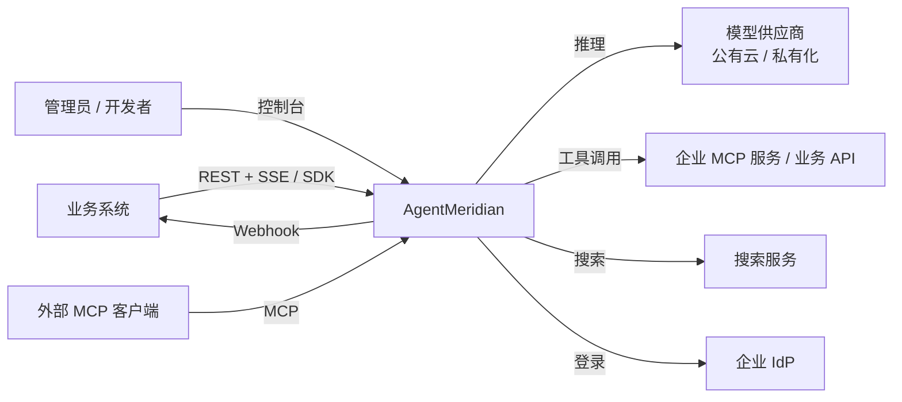
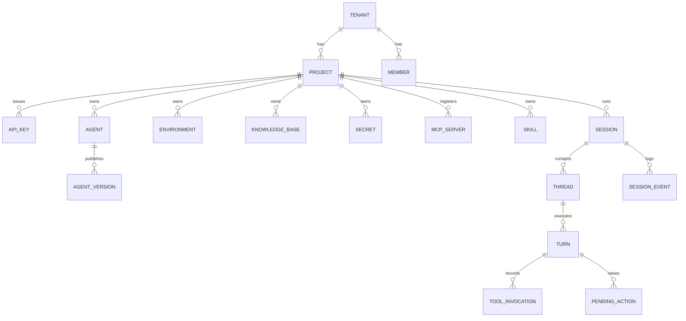
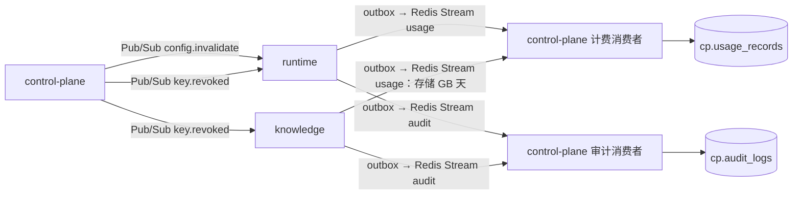
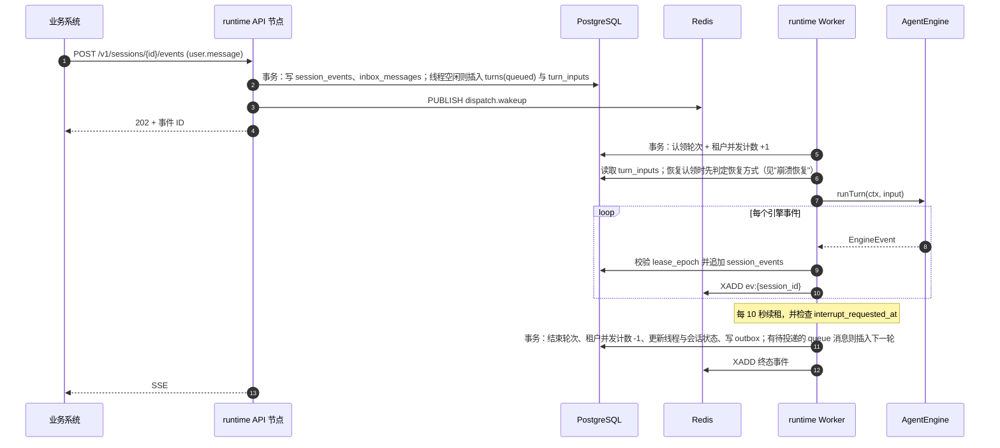
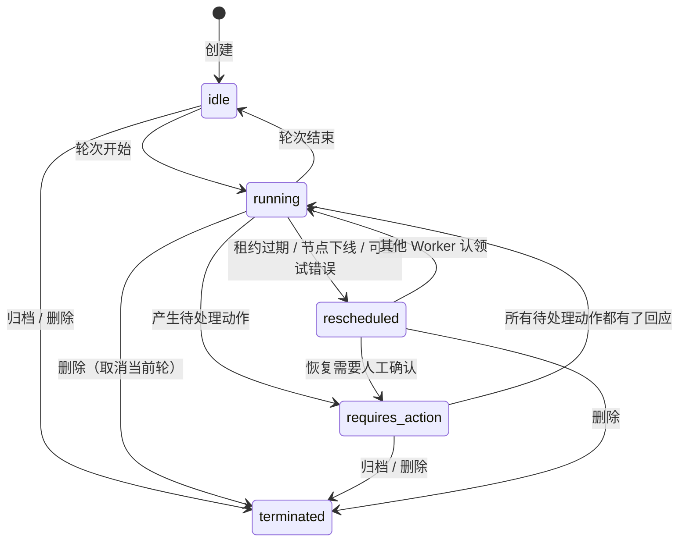

# AgentMeridian 架构设计

| 项 | 内容 |
|---|---|
| 版本 | v1.17 |
| 日期 | 2026-11-09 |
| 状态 | 基线，后续变更走"防漂移机制"一节的 ADR 流程 |
| 依据 | [技术选型调研](../research/tech-selection.md)；AgentScope Java `v2.0.4` 源码逐类核查；两轮架构对抗性评审；一轮交付计划对抗性评审 |

AgentMeridian（简称 Meridian）是部署在企业内的通用智能体平台。业务系统拿到 BaseUrl 和 API Key，通过一套标准的 Sessions/Events API，就能使用具备完整 Harness 能力的智能体：会话、子智能体、工具、沙箱、审批、记忆、技能、知识库。管理员在控制台配置智能体、模型、凭据、预算，并审计所有执行过程。

这份文档是项目落地的唯一架构基线，读者是参与开发、评审和运维的所有人，以及在仓库里写代码的 AI 编码助手。它规定三件事：系统由哪些部分组成、每部分怎么实现、哪些约束不能违反。

使用规则有三条：

- 写"必须"和"禁止"的条目是硬约束，大部分有自动化检查，见"防漂移机制"。
- 没写到的细节，由实现者按"架构原则"自行决定。
- 要改动已经定下的内容，先提 ADR，评审通过后同步修改本文档，再改代码。

文中所有 AgentScope 类名、方法名、常量都已在 `v2.0.4` tag 上核对过。标"平台自研"的类是我们要写的，不是 AgentScope 提供的。

## 目标与非目标

### 目标

1. 业务系统用标准 API 接入：创建会话、发送消息、订阅 SSE 事件流、处理审批和自定义工具回调。智能体能力覆盖聊天对话、知识库问答、文档编制与修改、智能问数。
2. 运行时具备 Claude Code 同级别的 Harness 能力：上下文压缩、计划模式、子智能体、技能、权限与审批、沙箱执行、中断与排队消息、崩溃续跑。
3. 多租户隔离：租户之间的数据、凭据、配额、沙箱完全隔离，每次执行都可审计、可计量。
4. 水平扩展：运行时无状态，并发能力随节点数线性增长；单个租户的突发流量不影响其他租户。
5. 私有化部署：模型、搜索、存储都可以换成企业内部服务，能在无公网环境运行。

### 非目标

- **低代码工作流引擎。** 编排靠模型自主决策加子智能体；业务侧需要确定性流程时，在自己的代码里按顺序调用 API。
- **模型训练与微调。**
- **面向 C 端的聊天产品。** 控制台的 Playground 只用于调试。
- **自研向量数据库、网关、沙箱运行时。**
- **以 AgentScope 以外的框架作为内核。** 内核适配层为将来替换留了接口，一期只有一个实现。

## 架构原则

每条原则后面写了理由，遇到本文档没覆盖的情况时，按理由判断。

1. **平台掌控会话语义，框架只执行一轮。** 会话、事件、队列、审批、恢复的数据和逻辑都在平台；AgentScope 只被调用来执行一轮。API 语义要长期稳定，而框架每个大版本都在变。
2. **框架类型不出适配层。** 只有 `meridian-engine-agentscope` 和它的测试模块可以引用 `io.agentscope`。平台其他代码只看见自己的类型，内核升级或替换时改动只落在一个模块。
3. **事件日志是对外的唯一事实来源。** 业务方看到的、控制台回放的、审计读取的，都是同一份 `session_events`。
4. **所有写入受租约约束。** 智能体状态、事件、工具账本的写入都要校验当前节点持有的租约；失去租约的执行只能被丢弃，不能写入任何东西。
5. **默认拒绝。** 工具权限默认 ask，沙箱默认无出网，凭据默认不可读，新租户默认零预算。
6. **凭据永不进入模型上下文。** 凭据只在工具执行边界注入（HTTP 头、MCP 请求定制器），不出现在提示词、事件、日志里。
7. **能用 PostgreSQL 解决的不引入新组件。** 队列、租约、事件日志、并发计数都在 PostgreSQL；Redis 只做实时流、限流和通知。少一个组件，就少一类一致性问题。
8. **服务只读写自己的 schema。** 跨服务的数据只通过 API 或事件获取。
9. **契约优先。** OpenAPI 规范是 API 的唯一定义，DTO 和 SDK 都从它生成。
10. **可确定性测试。** 所有智能体行为必须能用脚本化的假模型（`ScriptedModel`，平台自研）跑通，测试不依赖真实模型。

## 技术基线

版本在 `meridian-bom` 锁定，升级任何一项都要提 ADR。

| 类别 | 选型 | 版本 |
|---|---|---|
| JDK | Eclipse Temurin | 25 LTS |
| 应用框架 | Spring Boot | 4.1.2 |
| 智能体内核 | AgentScope Java core、harness，以及 `agentscope-extensions-sandbox-kubernetes` | 2.0.4 |
| MCP | MCP Java SDK（随 AgentScope） | 0.17.2 |
| JSON | 平台 API 用 Jackson 3（Boot 默认）；AgentScope 内部用 Jackson 2.21 | — |
| 主存储 | PostgreSQL + pgvector；中文全文检索用 zhparser | PostgreSQL 17，pgvector 0.8 |
| 缓存与实时流 | Redis | 7.4 或以上 |
| 对象存储 | S3 兼容（MinIO、OSS、COS） | — |
| 数据库迁移 | Flyway | 随 Boot |
| 沙箱 | kubernetes-sigs/agent-sandbox + gVisor（RuntimeClass），经 AgentScope Kubernetes 沙箱扩展接入 | agent-sandbox v1.0.10 |
| 沙箱出网代理 | Envoy（Lua 过滤器回调 runtime 做域名授权，ADR-0038） | Envoy v1.40 |
| 文档解析 | Apache Tika、PDFBox、POI；复杂 PDF 用 Python 服务（Docling、MinerU） | — |
| 可观测 | OpenTelemetry、Langfuse（自托管）、Prometheus、Grafana、Loki | — |
| 身份 | OIDC（Keycloak 或企业 IdP） | — |
| 控制台 | React 19、TypeScript、Vite、TanStack Router 与 Query、shadcn/ui、Tailwind CSS 4、motion、xyflow、xterm.js、Monaco、ECharts | 立项时锁定 |
| 部署 | Kubernetes、Helm；本地开发用 Docker Compose | — |

**禁止**引入以下依赖：

- AgentScope 的 Spring Boot starter：基于 Boot 4.0.4 编译。
- AgentScope 的 RAG 扩展：依附于已标记删除的 `core.rag` 包。
- AgentScope 的 Service 模块。
- Spring AI。
- LangChain4j。

## 系统组成

### 系统上下文



### 部署单元

| 单元 | 技术 | 职责 | 拥有的数据 |
|---|---|---|---|
| `meridian-control-plane` | Spring Boot MVC + 虚拟线程 | 租户、成员、RBAC、API Key、模型目录、凭据、智能体定义与版本、环境、技能、MCP 注册、预算、价格表、用量账本、审计 | schema `cp` |
| `meridian-runtime` | Spring Boot WebFlux + AgentScope | 会话、事件、SSE、调度、执行轮次、工具、沙箱生命周期、模型调用与计量、实时预算、OpenAI 兼容接口、文件、出网授权 | schema `rt`；对象存储 `rt/` 前缀 |
| `meridian-knowledge` | Spring Boot MVC + 虚拟线程 | 知识库、文档写入、切分、混合检索、MCP Server | schema `kb`；对象存储 `kb/` 前缀 |
| `meridian-doc-parser` | Python（FastAPI + Docling / MinerU） | 复杂文档解析为 Markdown | 无 |
| `meridian-console` | React SPA 静态资源 | 管理与调试界面 | 无 |
| 沙箱集群 | agent-sandbox 控制器、沙箱 Pod、Envoy 出网代理 | 隔离执行代码与命令 | Pod 内临时文件；快照与产物在对象存储 |

### 容器视图

```mermaid
flowchart TB
    subgraph Edge[入口]
        GW[Ingress / Higress<br/>TLS、路由、粗粒度限流]
    end
    subgraph Apps[meridian-system]
        CP[control-plane]
        RT[runtime × N]
        KB[knowledge × N]
        DP[doc-parser]
        UI[console]
    end
    subgraph SBX[meridian-sandbox / gVisor 节点池]
        Ctrl[agent-sandbox 控制器]
        Pool[WarmPool]
        Pod[会话沙箱 Pod]
        EG[Envoy 出网代理]
    end
    PG[(PostgreSQL<br/>cp / rt / kb)]
    RD[(Redis)]
    OS[(对象存储)]
    LF[OTel Collector / Langfuse]

    GW --> CP & RT & KB & UI
    RT -->|内部 API：配置、凭据、Key 校验| CP
    RT -->|检索| KB
    KB -->|内部 API：Embedding、rerank| RT
    KB --> DP
    RT -->|SandboxClaim| Ctrl --> Pool --> Pod
    RT -->|execute / upload / download| Pod
    Pod -->|HTTP(S)_PROXY| EG
    EG -->|ext_authz| RT
    CP & RT & KB --> PG
    CP & RT & KB --> RD
    RT & KB --> OS
    CP & RT & KB --> LF
```

外部请求按路径路由：

- `/v1/sessions*`、`/v1/files*`、`/v1/chat/completions`、`/v1/responses`、`/v1/embeddings` 进 runtime。
- `/v1/knowledge-bases*` 和 `/mcp/knowledge` 进 knowledge。
- 其余 `/v1/*`，以及管理 API `/admin/v1/*`（控制台使用，ADR-0042），进 control-plane。
- `/` 进 console。

runtime 和 knowledge 互相调用：runtime 调 knowledge 做检索，knowledge 调 runtime 做 Embedding 和 rerank，这样模型调用只有 runtime 一个计量点。双方都必须容忍对方不可用：检索失败时，`knowledge_search` 返回错误结果给智能体；Embedding 失败时，写入任务按退避策略重试。

## 代码仓库与模块

### 仓库布局

单一仓库，Maven 多模块，加前端与 Python 子项目：

```text
agent-meridian/
├── meridian-bom/                       依赖版本唯一来源
├── meridian-common/                    ID、错误模型、分页、时钟、JSON 工具、PlatformContext
├── meridian-api/                       OpenAPI 规范与生成的 DTO（不含服务端接口）
├── meridian-security/                  API Key、OIDC、服务间 JWT；从请求填充 PlatformContext
├── meridian-persistence/               数据源、事务、TenantScopedRepository、outbox
├── meridian-engine-spi/                内核适配层接口、端口接口、平台事件模型
├── meridian-engine-agentscope/         唯一依赖 AgentScope 的生产模块
├── meridian-engine-agentscope-test/    ScriptedModel 与内核场景测试夹具
├── meridian-model-client/              knowledge 调用 runtime 内部模型接口的客户端
├── meridian-control-plane/             应用
├── meridian-runtime/                   应用
├── meridian-knowledge/                 应用
├── meridian-sdk-java/                  由 OpenAPI 生成
├── meridian-test-support/              Testcontainers 夹具
├── meridian-arch-tests/                ArchUnit 架构规则
├── console/                            React 控制台（pnpm）
├── doc-parser/                         Python 解析服务（uv）
├── sandbox-runtime/                    沙箱镜像
├── deploy/helm/、deploy/compose/
└── docs/adr/                           架构决策记录
```

`meridian-api` 只生成 DTO。各应用在自己的模块里，用 openapi-generator 从同一份规范生成服务端接口：runtime 生成 reactive 接口（`Mono`/`Flux`），control-plane 和 knowledge 生成 servlet 接口。

### 模块依赖规则

下表是允许的依赖，**没列出的一律禁止**，由 ArchUnit 和 maven-enforcer 检查。

| 模块 | 可以依赖 |
|---|---|
| `meridian-common` | 无（只依赖 JDK、Jackson、reactor-core；reactor-core 只允许出现在 `context` 与 `concurrent` 包） |
| `meridian-api` | common |
| `meridian-security`、`meridian-persistence` | common、api |
| `meridian-engine-spi` | common |
| `meridian-engine-agentscope` | common、engine-spi、AgentScope |
| `meridian-engine-agentscope-test` | common、engine-spi、engine-agentscope、AgentScope（test scope）（ADR-0025） |
| `meridian-model-client` | common、security |
| `meridian-control-plane` | common、api、security、persistence |
| `meridian-runtime` | common、api、security、persistence、engine-spi；engine-agentscope 只能在 `config` 包中引用其装配入口 |
| `meridian-knowledge` | common、api、security、persistence、model-client |
| `meridian-test-support` | common、persistence；只作为其他模块的 test 作用域依赖 |
| `meridian-sdk-java` | 无（只依赖 JDK 与 Jackson） |
| 三个应用之间 | 禁止互相依赖，只走 HTTP |

### 端口

`meridian-engine-agentscope` 里的平台工具、中间件、状态存储需要用到 runtime 的服务。这些服务通过 `meridian-engine-spi` 定义的端口接口访问，由 runtime 实现，在 `config` 包里注入：

| 端口 | 用途 | runtime 中的实现 |
|---|---|---|
| `LeaseRegistry` | 查询某线程在本节点持有的租约 epoch | `dispatch` |
| `AgentStateRepository` | 智能体状态的带租约读写 | `session` |
| `InboxPort` | 读取并标记 steer 消息 | `delivery` |
| `ToolLedgerPort` | 工具调用账本；沙箱命令的审计（ADR-0037） | `tooling` |
| `EventSinkPort` | 子线程事件、自定义事件写入 | `stream` |
| `ModelGateway` | 解析供应商账号与凭据、限流、预算预扣与结算、用量记录 | `modelrouting` |
| `WorkspaceStorePort` | 工作区 KV 存储 | `workspace` |
| `SandboxStatePort` | 读写会话的沙箱状态（序列化后的字符串）与使用标记；内核每轮经它读出 runtime 准备好的沙箱（ADR-0037） | `sandbox` |
| `SnapshotStorePort` | 沙箱工作区快照（tar）的写入、读取与存在性，键为 `rt/snapshots/{tenant_id}/{project_id}/{session_id}/{snapshot_id}.tar`（ADR-0036） | `sandbox` |
| `KnowledgeSearchPort` | 知识库检索 | `tooling` |
| `WebSearchPort`、`WebFetchPort` | 联网搜索与抓取（含 SSRF 防护） | `tooling` |
| `SecretResolver` | 凭据明文解析 | `config` |
| `BlobStorePort` | 大对象写入与读取（超过 16 KB 的工具结果等） | `stream` |
| `ThreadRegistryPort` | 创建子线程、更新线程状态；线程行与 `session.thread_*` 事件在同一事务中写入，状态更新带停止原因（ADR-0040） | `session` |
| `AgentConfigPort` | 读取已解析的智能体版本与环境配置，智能体实例缓存未命中时使用（ADR-0024）；读取技能版本的内容，装配时生成受保护路径 `skills/`（ADR-0034）；读取租户提示词，装配时作为系统提示词的租户层（ADR-0035） | `config` |

上表是落地时的初始清单。为落实本文档已规定的行为，可以在 `meridian-engine-spi` 中新增端口或给既有端口加方法，签名只出现平台类型，并同步更新本表；删除端口或改变既有端口的语义，才需要走 ADR。

反方向，runtime 需要内核完成的事，也由 `meridian-engine-spi` 定义接口、`meridian-engine-agentscope` 实现，签名里只出现平台类型：

| 接口 | 用途 |
|---|---|
| `AgentEngine` | 执行一轮、中断、下线，见"内核适配层"；恢复确认选择 `retry` 时用原幂等键重新执行工具调用、读取装配后的保留工具名（ADR-0031） |
| `SandboxDriver` | 沙箱的创建、恢复、快照、删除；技能资源的投影、产物的清单与读取（ADR-0037）。入参和返回值是平台的 `SandboxHandle` 和序列化后的状态，内部使用 AgentScope Kubernetes 扩展的 `SandboxClient` |
| `ModelInvoker` | OpenAI 兼容直通接口用的聊天调用，内部使用 `RoutedModel` |

`PlatformContext` 定义在 `meridian-common`，所以 security、engine-agentscope、runtime 都能使用它。

### 包结构

Maven groupId 与 Java 包根都是 `cn.refinex.meridian`。

`meridian-engine-agentscope` 按职责分包。下面列出的类都是平台自研的，其中 `ReadOnlyFilesystem` 实现 AgentScope 的 `AbstractFilesystem`，所有写操作返回失败：

```text
cn.refinex.meridian.engine.agentscope
├── assembly/    AgentAssembler：智能体版本 → HarnessAgent；实例缓存
├── model/       RoutedModel（继承 ChatModelBase）、模型工厂、供应商客户端与 HTTP 传输（ADR-0032）
├── state/       FencedAgentStateStore（实现 AgentStateStore）
├── fs/          MeridianBaseStore（实现 BaseStore）、ReadOnlyFilesystem
├── tools/       平台工具（继承 ToolBase）、SpawnSubagentTool
├── middleware/  平台中间件
├── events/      AgentEvent → EngineEvent 映射与增量拼装
├── turn/        AgentScopeEngine：执行一轮、中断、下线；输入与权限翻译（ADR-0026）
└── sandbox/     SandboxDriver 实现、SingleStartSandbox、外部 SandboxContext 适配
```

runtime 按业务上下文分包，每个上下文内部是 `api`（HTTP 处理器，只做 decode → call → map）、`app`（用例服务）、`domain`（实体与规则）、`infra`（数据库、外部调用）四层。`domain` **禁止**依赖 Spring 和 `infra`。

```text
cn.refinex.meridian.runtime
├── session/  dispatch/  stream/  delivery/  approval/
├── tooling/  modelrouting/  sandbox/  workspace/  egress/
└── config/   （装配 engine-agentscope、实现端口注入、配置缓存）
```

## 领域模型

### 租户层级



**项目是隔离和授权的基本单位。** API Key、智能体、知识库、凭据、会话都挂在项目下；租户是计费和管理的单位。

### 核心概念

| 概念 | 定义 |
|---|---|
| 智能体（Agent） | 模型、系统提示词、工具、MCP、技能、子智能体、权限策略、知识库绑定的组合 |
| 智能体版本（Agent Version） | 发布后不可变的智能体快照。会话绑定版本，修改定义不影响运行中的会话 |
| 环境（Environment） | 执行档位 `none` 或 `sandbox`；沙箱档再选资源规格（`small`、`medium`、`large`，各对应一套预部署的沙箱模板和预热池），并配置出网白名单。环境有修订号，修改即递增 |
| 会话（Session） | 绑定一个智能体版本和一个环境的有状态实例。`interaction` 取 `attended`（有人值守，默认）或 `unattended` |
| 线程（Thread） | 会话中的一条执行线。主智能体是主线程，每次拉起子智能体产生一条子线程 |
| 轮次（Turn） | 线程上的一次执行：从接收输入到智能体停下 |
| 会话事件（Session Event） | 会话里发生的一切，按 `seq` 严格递增 |
| 工具调用（Tool Invocation） | 一次工具执行的账本记录，带副作用等级和幂等键 |
| 待处理动作（Pending Action） | 需要调用方回应的事项：工具确认、计划退出确认、自定义工具结果、恢复确认 |
| 终端用户（End User） | 业务系统里的用户，由 `end_user_id` 标识，平台不管理其身份 |

### ID 规则

所有对外 ID 采用 `{前缀}_{ULID}`，例如 `ses_01JC8Z4V7Q9X3M2N6P0R5T8W1Y`。ULID 按时间有序，便于索引和排查。

| 前缀 | 对象 | 前缀 | 对象 |
|---|---|---|---|
| `ten` | 租户 | `ses` | 会话 |
| `prj` | 项目 | `thr` | 线程 |
| `key` | API Key | `trn` | 轮次 |
| `agt` | 智能体 | `evt` | 会话事件 |
| `agv` | 智能体版本 | `tiv` | 工具调用 |
| `env` | 环境 | `act` | 待处理动作 |
| `mdl` | 模型 | `kb` | 知识库 |
| `prv` | 供应商账号 | `doc` | 文档 |
| `sec` | 凭据 | `fil` | 文件 |
| `skl` | 技能 | `mcp` | MCP 服务 |
| `mbr` | 成员 | `rbd` | 角色绑定 |

## 数据架构

### 存储分工

| 数据 | 存储 | 原因 |
|---|---|---|
| 配置、租户、权限、账本、审计 | PostgreSQL `cp` | 事务与关系查询 |
| 会话、线程、轮次、事件、待处理动作、工具账本、智能体状态 | PostgreSQL `rt` | 租约与写入在同一事务 |
| 轮次队列、租约、租户并发计数 | PostgreSQL `rt` | 与会话状态同库同事务，没有双写 |
| 工作区文件（`none` 档） | `rt.workspace_entries` 存元数据和 64 KB 以内的内容，更大的进对象存储 | 小文件多，走数据库延迟低 |
| 大工具结果、上传文件、产物、沙箱快照、归档事件 | 对象存储 | 体积大 |
| 实时事件扇出 | Redis Stream `ev:{session_id}` | 跨节点推送 SSE |
| 限流令牌桶、实时预算计数 | Redis | 高频原子操作 |
| 唤醒与中断加速通知 | Redis Pub/Sub | 降低延迟；丢失时有数据库兜底 |
| 向量与全文索引 | PostgreSQL `kb`（pgvector + zhparser） | 一期规模足够；超过 5000 万切片时评估 Milvus |

### 核心表

下面只列关键列，完整 DDL 以各服务的 Flyway 脚本为准。除注明的例外，所有业务表都带 `tenant_id` 和 `project_id`。

**runtime（schema `rt`）**

| 表 | 关键列 | 说明 |
|---|---|---|
| `sessions` | `id`、`agent_version_id`、`environment_id`、`environment_revision`、`end_user_id`、`interaction`、`status`、`last_seq`、`sandbox_state jsonb`、`sandbox_pod_ip`、`sandbox_last_used_at`、`sandbox_snapshot_key`、`sandbox_metered_at`、`budget_limit`、`deleted_at` | `last_seq` 用于分配事件序号；`deleted_at` 不为空表示已删除、等待清理（ADR-0030）；`sandbox_state` 为 `{sandbox_id, size, state}`，回收后清空并在 `sandbox_snapshot_key` 留下快照（ADR-0037） |
| `threads` | `id`、`session_id`、`parent_thread_id`、`parent_tool_use_id`、`agent_name`、`status` | 主线程的 `parent_thread_id` 为空 |
| `turns` | `id`、`thread_id`、`tenant_id`、`kind`、`status`、`priority`、`not_before`、`lease_owner`、`lease_epoch`、`lease_expires_at`、`claim_count`、`recovery_attempt`、`interrupt_requested_at`、`stop_reason` | 轮次队列与租约 |
| `turn_inputs` | `turn_id`、`payload jsonb` | 每轮的完整输入，用于恢复时重放 |
| `tenant_concurrency` | `tenant_id`、`running`、`max_running` | 租户并发计数，与认领同事务更新（无 `project_id`） |
| `session_events` | `session_id`、`seq`、`id`、`thread_id`、`turn_id`、`type`、`data jsonb`、`created_at` | 主键 `(session_id, seq)`；`PARTITION BY HASH (session_id)`，16 个分区 |
| `inbox_messages` | `id`、`session_id`、`thread_id`、`event_id`、`delivery`、`status`、`consumed_turn_id`、`consumed_epoch` | 待投递的用户消息；`consumed_epoch` 记录消费它的那次执行的 `lease_epoch` |
| `agent_states` | `user_id`、`thread_id`、`state_key`、`state jsonb`、`version`、`content_epoch`、`content_turn_id` | 由平台的 `FencedAgentStateStore` 读写；`content_epoch` 与 `content_turn_id` 一起标识最近一次内容写入来自哪次执行，见"崩溃恢复"（ADR-0028） |
| `tool_invocations` | `id`、`turn_id`、`thread_id`、`tool_use_id`、`tool_name`、`side_effect`、`idempotency_key`、`status`、`input jsonb`、`result_ref` | 工具账本 |
| `pending_actions` | `id`、`turn_id`、`thread_id`、`type`、`payload jsonb`、`status`、`decided_by`、`remember_scope`、`expires_at`、`response jsonb`、`consumed_turn_id` | 待处理动作；`response` 是回应或超时、中断、自动拒绝给出的结论，`consumed_turn_id` 是交出结论的恢复轮（ADR-0031） |
| `permission_rules` | `layer`（`tenant`、`project`、`session`）、`tool_name`、`rule_content`、`behavior`、`session_id`、`source_action_id` | 五层权限中的租户、项目、会话三层；项目级与会话级的"记住此决定"写在这里。T15b 起租户与项目策略由 control-plane 下发（ADR-0031） |
| `workspace_entries` | `namespace text[]`、`key`、`version`、`size`、`inline_content`、`object_key` | `MeridianBaseStore` 的存储 |
| `sandbox_outputs` | `session_id`、`path`、`size`、`sha256`、`object_key`、`synced_at` | `sandbox` 档 `outputs/` 同步到对象存储的清单（ADR-0037） |
| `outbox` | `id`、`topic`、`payload`、`created_at`、`published_at` | 用量与审计的可靠投递 |

`turns` 上有一个部分唯一索引：`UNIQUE (thread_id) WHERE status IN ('queued','running','awaiting_action')`。所以每个线程同时最多一个未结束的轮次，插入用 `ON CONFLICT DO NOTHING`。

**control-plane（schema `cp`）**：`tenants`（含并发配额 `max_concurrent_turns`、事件保留天数 `event_retention_days`；租户与项目软删除，删除时吊销其下的 API Key）、`tenant_settings`（租户级系统提示词、联网搜索后端等）、`projects`、`members`（按身份提供方的主体标识 `subject` 识别）、`role_bindings`（`role`、租户级角色的 `project_id` 为空）、`api_keys`（只存 SHA-256 哈希和 `mk_live_` 之后随机部分的前 8 位，带作用域、每分钟上限、过期与吊销时间）、`provider_accounts`、`models`、`price_books`、`secrets`（信封加密的密文）、`agents`、`agent_versions`（`spec jsonb`，发布后只读）、`environments`（带 `revision`）、`skills`、`skill_versions`、`mcp_servers`、`budgets`、`webhooks`。另有两张按月分区的表，主键都是 `(id, occurred_at)`，`occurred_at` 取自消息载荷，重投时落在同一分区，保证幂等：

- `usage_records`。
- `audit_logs`，只追加。

**knowledge（schema `kb`）**：`knowledge_bases`、`documents`、`chunks`（`embedding vector(n)`、`tsv tsvector`、`acl_tags text[]`、`source_locator jsonb`）、`ingestion_jobs`。

### 跨服务数据流



用量和审计采用 outbox 模式：业务事务里写 `outbox`，Relay 发布到 Redis Stream，control-plane 的消费者按 `(id, occurred_at)` 幂等入库。Redis 短暂不可用时，记录不会丢。

模型用量只由 runtime 记账，包括 knowledge 发起的 Embedding 和 rerank。knowledge 只上报知识库存储量（每日统计，计量单位 GB 天）。knowledge 调用内部模型接口时，在请求头里带上租户、项目、知识库，用于记账归属。

### 数据保留

- **会话事件**：默认保留 365 天，租户可配置。会话 90 天无活动后，事件导出为对象存储中一个按会话命名的文件，数据库中删除，`sessions` 记录归档位置；API 读取归档事件时延迟更高。
- **删除会话**：级联删除事件（含归档文件）、线程、轮次、智能体状态、工作区、产物、沙箱与快照，在 24 小时内完成，并写一条审计记录。
- **用量账本、审计日志**：保留 3 年，不随会话删除。

## 运行时架构

这一节规定一次会话请求在 runtime 里怎样执行，是整个平台的核心。

### 内核适配层

`meridian-engine-spi` 定义平台与内核之间的接口：

```java
public interface AgentEngine {
    /** 执行一轮，输出平台事件流。订阅被取消即中止执行，不再写入任何数据。 */
    Flux<EngineEvent> runTurn(TurnContext ctx, TurnInput input);

    /** 以 USER 来源中断本节点上正在执行的线程。 */
    boolean interrupt(ThreadRef thread);

    /** 节点下线：以 SYSTEM 来源中断全部执行并等待状态保存，最长等待 timeout。 */
    Mono<Void> shutdown(Duration timeout);
}

/** 一轮的输入只能是以下四种之一。 */
public sealed interface TurnInput {
    record NewMessages(List<InboundMessage> messages, RecoveryNote recovery) implements TurnInput {}
    record Confirmations(List<ToolConfirmation> confirmations, RecoveryNote recovery) implements TurnInput {}
    record CustomToolResults(List<CustomToolResult> results, RecoveryNote recovery) implements TurnInput {}
    record RecoveryOnly(RecoveryNote recovery) implements TurnInput {}
}
```

输入必须分类，原因在 AgentScope 的执行入口：上下文中有待确认的工具调用时，入口直接进入工具执行，同一批输入里的普通用户文本会被丢弃。所以审批结果、自定义工具结果，与普通消息不能放在同一轮。

### 身份映射

AgentScope 的状态键是 `(userId, sessionId, key)`，没有智能体维度。平台按下表映射，**必须**遵守：

| AgentScope 概念 | 平台取值 | 理由 |
|---|---|---|
| `RuntimeContext.sessionId` | 线程 ID（`thr_…`） | 每条线程一份状态，主智能体与子智能体互不覆盖 |
| `RuntimeContext.userId` | `{project_id}:{end_user_id}`；没有终端用户时为 `{project_id}:_` | 按项目加终端用户隔离 |
| 类型键 `PlatformContext` | 租户、项目、会话、线程、轮次、API Key、租约 epoch、预算句柄、`interaction`、终端用户（ADR-0034） | 平台中间件和工具读取；工作区命名空间的四个值从这里取 |
| Reactor Context | `runTurn` 顶层 `contextWrite(PlatformContext)` | `RoutedModel` 在压缩等内部模型调用中也能取到上下文 |

### 引擎装配

`AgentAssembler` 为每个"智能体版本加环境修订"装配一个 `HarnessAgent`，缓存键为 `(agent_version_id, environment_id, environment_revision)`；子智能体的实例在键中再加上子智能体名（ADR-0024）。

缓存规则：

- 缓存容量上限 500 个，条目空闲 30 分钟后可以淘汰。
- 条目带引用计数：每轮开始时加一，结束时（包括异常结束）减一。
- 淘汰时，引用计数归零才调用 `close()`；还有轮次在执行，就推迟到归零后再关闭。原因是 `close()` 会关闭 MCP 客户端。

`HarnessAgent` 本身无状态，被同一缓存键下的所有会话共享。装配时**必须**这样配置：

| 配置 | 取值 | 原因 |
|---|---|---|
| `sysPrompt(...)` | 「平台基础提示词 → 租户 → 智能体」（`PlatformPrompt.compose`），技能清单由 harness 追加在最后（ADR-0035） | 见"上下文管理"中的提示词分层 |
| `model(Model)` | 平台构造的 `RoutedModel` 实例，内含主模型与备用模型 | 不经 `ModelRegistry` 全局注册表；凭据和路由在调用时按 `PlatformContext` 解析 |
| `fallbackModel` | 不设置 | AgentScope 对首个信号的任何错误都会切换，包括预算和限流异常；降级由 `RoutedModel` 自己做 |
| `maxRetries(1)` | 必须 | 同理，重试由 `RoutedModel` 只针对供应商错误进行。参数是含首次在内的总尝试次数，1 即不重试；2.0.4 中 0 非法（ADR-0023） |
| `stateStore` | `FencedAgentStateStore` | 所有状态写入都受租约约束，见"租约与 fencing" |
| `enablePendingToolRecovery` | `true` | 悬空的 tool_use 自动补结果 |
| `maxIters` | 智能体配置，默认 50，上限 200 | 控制单轮成本 |
| 文件系统 | `none` 档用 `abstractFilesystem(...)`；`sandbox` 档用 `filesystem(KubernetesFilesystemSpec)` 加 `filesystemRoute(...)`，规范的客户端一律拒绝创建沙箱、工作区投影关闭（ADR-0037）。两者在 AgentScope 中互斥。`workspace(...)` 设为平台控制、平台不写入的本机目录（ADR-0034） | 见"工作区与沙箱"；不设时本机工作区根是 `${user.dir}/.agentscope/workspace`，harness 会从中回退读取 |
| `disableWebTools()` | 必须 | 内置 `web_search` 写死 Tavily 和环境变量，`web_fetch` 没有 SSRF 防护 |
| `disableToolsConfig()` | 必须 | `tools.json` 只在构建时加载一次，无法按租户注入 MCP 凭据 |
| `disableFilesystemTools()`、`disableShellTool()` | 必须 | 由平台工具替代，以支持内容级权限规则 |
| `disableSubagents()`、`disableDynamicSubagents()` | 必须 | 子智能体由平台的 `spawn_subagent` 实现，见"子智能体" |
| `disableMemoryTools()`、`disableMemoryHooks()` | 一期必须 | `session_search` 只扫本机磁盘；长期记忆在二期 |
| `disableDefaultWorkspaceSkills()`、`disableDynamicSkills()` | 必须 | 技能只来自平台技能仓库，智能体不能自建技能 |
| `disableTranscript()` | 必须 | 转录写入工作区或沙箱，不受 fencing 约束且无限增长；会话记录以 `session_events` 为准 |
| `disableWorkspaceContext()` | 必须 | 2.0.4 的 `WorkspaceContextMiddleware` 每次推理往系统提示词追加当天日期、本机路径与再读一遍的 `AGENTS.md`，破坏提示词分层与缓存前缀；时间改以消息注入（ADR-0035） |
| `disableAtPathExpansion()` | 必须 | 2.0.4 的 `AtPathExpansionMiddleware` 把用户消息中的 `@路径` 展开为文件内容，读取不经权限引擎、账本与审计；`sandbox` 档的文件系统不是 `CompositeFilesystem`，会读到沙箱内的任意文件（ADR-0041） |
| `toolExecutionConfig(...)` | 超时 660 秒，只尝试一次 | 2.0.4 的 Toolkit 默认单个工具 5 分钟超时，会截断 `bash` 与 `spawn_subagent` 各自 600 秒的上限；平台工具自己执行超时，这里只兜底（ADR-0041） |
| `messageBus(...)` | 平台的 `NoopMessageBus` | 默认的工作区消息总线会让每次推理都读一次工作区；`wait_async_results` 仍会注册（2.0.4 把它包装为 `ReflectiveFunctionTool`，是 `ToolBase`），由工具策略的整工具拒绝规则拒绝（ADR-0034） |
| `asyncToolRegistry(...)` | 平台的 `NoopAsyncToolRegistry` | 不设置时 harness 创建基于工作区的异步工具登记，`InboxMiddleware` 每次推理前仍会读工作区（ADR-0024） |
| `enableAgentTracingLog(false)` | 必须 | 默认的 `AgentTraceMiddleware` 以 INFO 记录模型输出正文，违反日志规范（ADR-0024） |
| `skillRepository(...)` | 平台的 `MeridianSkillRepository`（继承 2.0.4 的 `WorkspaceSkillRepository`，它实现 `RuntimeContextSkillRepository`），读取受保护路径 `skills/` 的只读视图 | 按租户、项目、智能体解析技能；`MarketplaceStager` 只对 `WorkspaceSkillRepository` 不做本机暂存（ADR-0034） |
| `compaction(...)` | 见"上下文管理"，其中 `flushBeforeCompact(false)`、`offloadBeforeCompact(false)`、`triggerMessages(0)`，摘要提示词由平台维护（ADR-0032） | 一期没有长期记忆；原文卸载同样不受 fencing 约束；只按 token 阈值触发 |
| `toolResultEviction(...)` | 见"上下文管理" | — |
| `enablePlanMode(...)` | 按智能体配置 | 这是构建期配置，实例被 attended 和 unattended 会话共享；`unattended` 会话靠权限规则禁止 `plan_enter`，见"权限判定" |
| `middlewares(...)` | 平台中间件 | — |

### 平台中间件

平台通过 `MiddlewareBase` 扩展行为，**禁止** fork 或继承 AgentScope 的智能体类。

| 中间件 | 挂载点 | 职责 |
|---|---|---|
| `PlatformContextMiddleware` | `onAgent` | 校验 `PlatformContext`，写入 MDC，打开轮次 span |
| `LeaseGuardMiddleware` | `onReasoning`、`onActing` | 每次推理和工具执行前，向 `LeaseRegistry` 确认租约仍然有效；已失效则抛 `LeaseLostException` |
| `PolicyMiddleware` | `onActing` | 纵深防御：工具必须在智能体允许的工具集内；非 `ToolBase` 工具只放行 `load_skill_through_path`，`wait_async_results` 得到 DENIED 结果；子智能体拉起数量上限。2.0.4 不发布 `onActing` 中间件自己合成的事件，所以工具集外的工具与 `wait_async_results` 由工具策略生成整工具拒绝规则、每轮并入权限，经权限引擎拒绝（有事件与审计）；中间件只拦截非 `ToolBase` 工具，违反时本轮以错误结束（ADR-0034）。拉起上限：每批执行前按批内顺序在本轮的名额中登记 `spawn_subagent` 调用，超出的调用由工具返回错误结果（ADR-0040） |
| `RecoveryNoteMiddleware` | `onReasoning` | 恢复轮的第一次推理前，把恢复说明追加到输入和 `AgentState` 上下文。恢复说明不走调用入参，因为 AgentScope 在停机中断后的下一次调用会丢弃全部入参 |
| `BatchCheckpointMiddleware` | `onActing`、`onReasoning` | 每批工具执行完成后、下一次推理之前保存一次状态（批次级 checkpoint，P3），强杀后从最近的批次续跑；可配置关闭。`SteerMiddleware` 必须排在它之外（ADR-0028） |
| `InterruptCheckpointMiddleware` | `onReasoning` | 认领时已有中断请求的轮次（等待回应时被中断生成的恢复轮、中断后被恢复认领的轮次），在第一次推理前按用户中断结束：本轮的输入已写进上下文，不再调用模型。排在 `RecoveryNoteMiddleware` 之内、`SteerMiddleware` 之外（ADR-0031） |
| `SteerMiddleware` | `onReasoning` | 读取本线程 `delivery=steer` 的待投递消息，追加到本次推理输入和 `AgentState` 上下文，记录 `consumed_turn_id` 和 `consumed_epoch`，同一事务写 `session.message_consumed`。只挂在主智能体上，排在 `BatchCheckpointMiddleware` 之外 |
| `CompactionGuardMiddleware` | `onReasoning`，分内外两层（外层 order 20、内层 0），夹住 harness 的 `CompactionMiddleware`（1） | 外层在本次推理会触发压缩时预检预算、限流、租约（只检查不占用），不满足就抛出平台异常；内层检查压缩结果，摘要以 `(Summarization failed` 开头或为 `(Summary unavailable)` 时把上下文恢复为压缩前的副本并抛 `CompactionFailedException`（原因链决定本轮如何结束），防止失败文本替换历史；新出现 `__compaction_summary__` 消息时发出压缩事件（ADR-0032） |
| `ContextCompositionMiddleware` | `onModelCall` | 统计本次模型请求的上下文构成（系统提示词、技能清单、历史、工具结果、平台注入内容的条数与 token 估算），放进 `span.model_request_start`，不含正文（ADR-0032） |
| `KnowledgePrefetchMiddleware` | `onAgent` | 智能体配置为"前置检索"时，用最后一条用户消息检索并注入 |
| `ToolSpanMiddleware` | `onActing` | 每个工具调用单独建 span（AgentScope 一批工具只建一个 span） |
| `OtelTracingMiddleware` | AgentScope 自带，由平台的 `PlatformTracingMiddleware` 委托装配 | GenAI 语义约定的 span；平台补上公共属性 |

模型的限流、预算、计量不放在中间件里，而是在 `RoutedModel` 内实现。原因是压缩器直接调用 `model.stream(...)`，不经过 `onModelCall`。压缩器会吞掉模型异常，所以压缩前由 `CompactionGuardMiddleware` 预检；预检通过后压缩中途仍然失败，内层检查会拦住失败的摘要。中间件之间的实际执行顺序由 `order()` 决定（数值大的在外层），P13 已验证：两层守护夹住 `CompactionMiddleware`，实测链路见 `docs/poc/P13-中间件顺序.md`。

### 平台工具

所有平台工具**必须**继承 `ToolBase`，并实现 `matchRule` 以支持内容级权限规则。AgentScope 的权限引擎只对 `ToolBase` 生效；而 harness 内置的文件与 Shell 工具，只认整工具规则。

| 工具 | 规则内容语法 | 副作用等级 | 档位 |
|---|---|---|---|
| `read_file`、`list_files`、`glob_files`、`grep_files` | 路径 glob，如 `read_file(reports/**)` | `none` | 全部 |
| `write_file`、`edit_file` | 路径 glob | `idempotent` | 全部 |
| `bash` | 命令前缀，如 `bash(git status:*)` | `non_idempotent` | 仅 sandbox |
| `web_search` | 无 | `none` | 全部 |
| `web_fetch` | 域名，如 `web_fetch(domain:docs.example.com)` | `none` | 全部 |
| `knowledge_search` | 知识库 ID | `none` | 全部 |
| `spawn_subagent` | 子智能体名 | 取子智能体工具中最高的等级 | 全部 |
| `sql_query` | 数据源 ID | `none`（只读） | 二期 |
| MCP 工具 `mcp__{server}__{tool}` | 无 | 管理员注册时标注 | 全部 |
| 自定义工具（业务侧执行） | 无 | 业务方声明 | 全部 |

副作用等级：

- `none`：无副作用，可以重放。
- `idempotent`：重复执行结果相同，可以重放。
- `non_idempotent`：有副作用，不能重放，必须带幂等键。

两个联网工具的约束：

- `web_fetch` 必须做 SSRF 防护：拒绝内网、回环、链路本地地址；DNS 解析后再校验一次；响应体上限 5 MB。
- `web_search` 的后端按租户配置，可选博查、Tavily、Brave、SearXNG。

**联网、知识检索与 MCP 工具（ADR-0035）。**

- `web_fetch`：runtime 的 `GuardedWebFetcher` 用 Reactor Netty 加平台的解析器组，DNS 解析后校验全部地址，连接用的就是校验过的地址；不复用连接、不走代理、逐跳处理重定向（至多 5 跳）。IP 字面量（含十进制、八进制、十六进制写法与 IPv6）由平台解析判定，不合法的数字主机名直接拒绝。拒绝的段见 `AddressPolicy`（私有、CGNAT、回环、链路本地与云元数据、唯一本地、保留、组播等，映射与隧道地址按内嵌 IPv4 判定）。读满 5 MB 停止并标记截断；HTML 经 jsoup 去掉不可见元素后由 flexmark 转 Markdown，文本与 JSON 原样，其他类型拒绝。工具一次输出至多 50000 字符，`offset` 续读。
- `web_search`：一期实现 SearXNG 与博查两个后端，按 `tenant_settings` 中的配置选择，密钥经 `SecretResolver` 每次解析。
- `knowledge_search`：按智能体实例创建，`knowledge_base_ids` 必填，schema 只列出智能体绑定的知识库；knowledge 未接入时检索以错误结果交给模型。
- MCP：`McpConnector` 用 `McpClientBuilder` 先选传输、再设置 HTTP 客户端与请求定制器、显式声明协议版本，构建异步客户端（同步客户端在内部另起订阅，凭据传不到传输层）。每个工具包成继承 `PlatformTool` 的 `McpPlatformTool`，进权限引擎与账本，未标注副作用等级时按 `non_idempotent`，幂等键放进请求的 `_meta`。凭据在每次请求前解析，只放进这一次调用的 Reactor Context，由请求定制器写入请求头。装配时连不上服务以 `tool.mcp_unavailable`（可重试）结束本轮。MCP 端点由管理员登记、允许内网地址；客户端不跟随重定向，拒绝链路本地与云元数据地址。

平台工具的文件和命令操作，通过 `HarnessAgent.getWorkspaceManager().getFilesystem()` 拿到的文件系统执行：`none` 档是平台的 `CompositeFilesystem`；`sandbox` 档是 harness 包装的 `RoutedSandboxFilesystem`，`bash` 调用它的 `execute`。`sandbox` 档的平台工具实际使用装配器以同一组路由重建的 `RoutedSandboxFilesystem`，主文件系统外包 `SandboxWorkspaceFilesystem`：把平台路径翻译到 `/workspace` 下、按 `RemoteFilesystem` 的语义做 `glob`、拒绝没有本次绑定沙箱的调用（ADR-0037）。调用时**必须**传入 `ToolCallParam.getRuntimeContext()`，因为沙箱实例要从这个上下文里取；传新建的上下文会退回到跨会话共享的字段。

**工具基类（ADR-0034）。** 平台工具继承 `PlatformTool`：子类声明名称、英文描述、入参 schema、副作用等级与规则内容语法；基类实现 `matchRule`（规则内容为空时匹配全部调用）与带内容的 `generateSuggestions`，执行前经 `ToolLedgerPort` 记录开始（幂等键 `session_id:tool_use_id`，恢复确认重试时沿用原键），执行后记录结束；`non_idempotent` 工具把幂等键传给下游，结果写入对象存储、引用进账本。指标 `meridian_tool_calls_total` 与审计 `tool.executed`（有副作用的调用）由账本实现在记录结束时写出。规则与工具中的路径相对工作区根，`**` 匹配零或多级目录，`dir/**` 也匹配 `dir`；`grep_files` 的命中再按它的拒绝规则过滤。修改已有文件要求本线程读过当前版本（"先读后改"），读取状态随工具结果的元数据保存在 `AgentState` 中。装配后 Toolkit 中只允许 `load_skill_through_path` 一个非 `ToolBase` 工具，违反时装配失败，runtime 启动时自检一次。

**`bash`（ADR-0037）。** 复合命令（`&&`、`||`、`;`、`|`、`|&`、`&`、换行）在引号外分段：放行规则要求每一段都被某条规则覆盖，拒绝与询问规则任一段命中即生效（剥离开头的环境变量赋值与 `nice`、`timeout` 等包装命令后再比较）；含命令替换、进程替换、反引号、子 shell 的命令不匹配任何内容级规则，存在内容级拒绝规则时询问。命令以 coreutils 的 `timeout` 落实超时（默认 120 秒、最多 600 秒，退出码 124），输出上限 30000 字符、保留头尾，每条命令写审计 `sandbox.command`。"记住此决定"对 `bash` 记这一条命令（规则内容为命令原文）。

**保留工具名。** 业务方声明的自定义工具不能与以下名称重名：平台工具名、harness 仍然注册的工具（`plan_enter`、`plan_write`、`plan_exit`、`load_skill_through_path`、`wait_async_results`），以及 `mcp__` 前缀。原因是 `ToolRequestConfig` 遇到同名时外部工具优先，会顶掉平台工具。保留名单由 `AgentAssembler` 在装配后从 Toolkit 读出，API 校验时使用。

### 一轮执行的生命周期



**认领。** 认领与租户并发计数在同一事务中完成：

```sql
-- 1. 选出一个可执行的轮次；:excluded 为本节点仍在执行的线程（见"同节点重新认领"）
SELECT t.* FROM rt.turns t
  JOIN rt.tenant_concurrency c ON c.tenant_id = t.tenant_id
 WHERE t.status = 'queued' AND t.not_before <= :now AND c.running < c.max_running
   AND NOT (t.thread_id = ANY (:excluded))
 ORDER BY t.priority, t.created_at
   FOR UPDATE OF t SKIP LOCKED LIMIT 1;
-- 2. 占用租户并发名额；更新 0 行则回滚本事务，稍后重试
UPDATE rt.tenant_concurrency SET running = running + 1
 WHERE tenant_id = :tenant AND running < max_running;
-- 3. 标记轮次；:lease_expires_at = :now 加 30 秒
UPDATE rt.turns SET status = 'running', lease_owner = :node, lease_epoch = lease_epoch + 1,
       lease_expires_at = :lease_expires_at, claim_count = claim_count + 1
 WHERE id = :turn;
```

满额租户的轮次在第 1 步就被排除。所以一个租户积压再多，也不会让 Worker 反复认领又放回，更不会挤占其他租户。

调度与租约的时间（`:now`、租约到期时间、回收条件）都取应用注入的 `Clock`，不用数据库的 `now()`，各节点需要 NTP 同步（ADR-0027）。

**租户并发计数行**。为某个租户第一次插入轮次时，同一事务中执行 `INSERT INTO rt.tenant_concurrency ... ON CONFLICT DO NOTHING`，`max_running` 取该租户的并发配额（`cp.tenants.max_concurrent_turns`，经内部接口下发，未配置时取全局默认值，默认 20，ADR-0027）。control-plane 修改配额时经 `config.invalidate` 通知 runtime 更新。runtime 只在计数行不存在时经内部接口 `GET /internal/v1/tenants/{tenant_id}/quotas` 读取配额（尽量在入队事务之外）；`config.invalidate` 的消息为 `{"type":"tenant_quota","tenant_id":"ten_…"}`，各节点收到后重新读取并更新已有计数行的 `max_running`，其他 `type` 由各自的订阅者处理（ADR-0042）。

**租约。**

- 租约 30 秒，Worker 每 10 秒续租一次。
- 续租时顺便检查 `interrupt_requested_at`。
- 续租连续失败超过 15 秒（从上次成功续租起算），Worker 自行取消本轮的订阅。
- 带租约条件的写入先以 `FOR SHARE` 锁住持有租约的轮次行再写，回收器与置回队列的更新因此要等写入事务提交。所有事务按"先 `rt.turns`，再 `rt.tenant_concurrency`，再 `rt.sessions`"加锁；同一事务里既入队又写事件时，先入队（ADR-0027）。

**租约回收。** 每个 runtime 节点每 5 秒运行一次回收器，用 `SKIP LOCKED` 避免重复处理。回收器在一个事务里做四件事：

- 把 `status='running' AND lease_expires_at < now()` 的轮次置回 `queued`。
- `recovery_attempt` 加一。
- 租户并发计数减一。
- 发出 `session.status_rescheduled` 事件。

**置回队列的三种情况。** 轮次回到 `queued` 时，租户并发计数一律减一；`recovery_attempt` 是否加一，按原因区分：

| 原因 | `recovery_attempt` | 会话事件 |
|---|---|---|
| 租约过期，由回收器处理 | 加一 | `session.status_rescheduled` |
| 可重试的错误，如供应商 5xx、限流等待超时 | 加一 | `session.error`（`retry_status=retryable`），然后 `session.status_rescheduled`（`retryable_error`，ADR-0026） |
| 节点优雅下线 | 不变 | `session.status_rescheduled` |

**结束轮次。** 终态事件到达后的事务按以下顺序：取线程的事务级咨询锁（与 API 写 `user.message` 的事务串行，否则两边都看不到对方未提交的数据，消息会留在收件箱里没有轮次处理）→ 结束轮次与租户并发计数减一 → 收件箱中待投递的消息合并成下一轮并入队 → 写终态事件 → 写 outbox。事件在写入入口提交后 XADD，XADD 失败不回滚，由 SSE 从数据库补发（ADR-0028）。

**同节点重新认领。** `FencedAgentStateStore` 的接口拿不到调用上下文，只能按线程 ID 查 `LeaseRegistry`。所以同一节点上，一个线程的上一次执行在 `doFinally` 完成之前，本节点**禁止**再次认领这个线程，`LeaseRegistry` 也在执行结束时才移除条目。这样，旧执行的残余写入不会借用新 epoch 通过校验。事件、账本等经端口的写入，则直接使用 `PlatformContext` 中本次执行自己的 epoch。

### 租约与 fencing

AgentScope 写状态的时机不止"调用结束"一处。用户中断、非中断错误、优雅停机、权限上下文替换时，它都会保存状态；`HarnessAgent` 也没有暴露冲突策略配置。所以 fencing 必须在存储层实现：

- **状态写入。** `FencedAgentStateStore` 是平台自研的 `AgentStateStore` 实现，支持版本号，表结构由 Flyway 管理。它的每次 `save` 和 `saveIfVersion` 写入，包括无条件写，都在同一事务里附加一个条件：`rt.turns` 中该线程的活动轮次 `status='running' AND lease_owner = 本节点 AND lease_epoch = LeaseRegistry 中的值`。不满足条件就抛 `LeaseLostException`，什么都不写。子线程的状态写入使用父轮次的租约。除了权限上下文的安装写入（由平台在 `LeaseRegistry` 条目上标记），每次写入都把 `content_epoch` 更新为当前 epoch，供崩溃恢复判断。
- **事件与账本。** 事件和工具账本的写入带同样的条件。
- **工具执行前。** `LeaseGuardMiddleware` 在每次工具执行前检查租约，失效就不再发起新的副作用。
- **失去租约时。** Worker 只通过取消订阅来终止本轮，**禁止**调用 `interrupt`，因为中断会触发 AgentScope 保存状态。

**状态缓存。** AgentScope 的 `ReActAgent` 在进程内按 `(userId, sessionId)` 缓存状态。线程的上一轮如果在别的节点执行过，本节点的缓存就是旧的。所以每轮开始前**必须**调用 `harnessAgent.clearStateCache(userId, threadId)`，轮次结束（含异常）时在 `finally` 中再调一次，让每轮都从存储重新加载。缓存清理后，内存是否稳定由 M0 验证（P11）。

### 状态机

**会话状态**对外可见：



会话状态随 `session.status_*` 事件推进，与事件写入在同一事务中完成，所以 `sessions.status` 不会与事件日志分叉（ADR-0027）。

**轮次状态**是内部状态，取值为 `queued`、`running`、`awaiting_action`、`completed`、`interrupted`、`failed`、`cancelled`。轮次类型 `kind` 取 `messages`、`confirmations`、`custom_tool_results`、`recovery`，与 `TurnInput` 的四种输入一一对应。

**停止原因**是 `session.status_idle` 事件里的 `stop_reason`。映射规则：

| 来源 | stop_reason |
|---|---|
| GenerateReason `MODEL_STOP`、`STRUCTURED_OUTPUT`、`TOOL_RETURN_DIRECT` | `end_turn` |
| GenerateReason `PERMISSION_ASKING`、`TOOL_SUSPENDED` | 不进入 idle，会话转为 `requires_action` |
| GenerateReason `INTERRUPTED` | `interrupted` |
| GenerateReason `MAX_ITERATIONS` | `max_turns` |
| GenerateReason `ALL_TOOLS_DENIED` | `tools_denied` |
| GenerateReason `REASONING_STOP_REQUESTED`、`ACTING_STOP_REQUESTED`、`MIDDLEWARE_STOP_REQUESTED` | 平台中间件发起时，取它经 `PlatformStopRequest` 记录的原因；否则为 `end_turn`（ADR-0026） |
| 异常 `BudgetExceededException` | `budget_exceeded` |
| 可重试的异常（`RetryableTurnException`，如 `RateLimitTimeoutException`） | 不进入 idle，以 `session.status_rescheduled` 结束，见"置回队列的三种情况" |
| 其他不可重试异常；`TOOL_CALLS` 或未知的 GenerateReason | `error`，并告警 |

映射必须穷举。单元测试遍历 `GenerateReason.values()` 和 `AgentEventType.values()`，断言每个值都有映射；AgentScope 升级时新增的值会让测试失败。

### 事件映射

AgentScope 的 `AgentEventType` 有 31 个值。结束类事件只带 ID，不带内容：`TEXT_BLOCK_END` 只有 `replyId` 和 `blockId`，`TOOL_CALL_END` 只有工具调用 ID 和名称。所以适配层按 `blockId` 和 `toolCallId` 拼装增量事件，在结束事件到来时输出完整内容。

| AgentScope 事件 | 平台事件 | 持久化 |
|---|---|---|
| `AGENT_START`（主线程） | 不输出；轮次开始时平台已发 `session.status_running` | — |
| `MODEL_CALL_START` | `span.model_request_start` | 是 |
| `MODEL_CALL_END`（带 `ChatUsage`） | `span.model_request_end` | 是 |
| `TEXT_BLOCK_START`、`TEXT_BLOCK_DELTA` | `event_start`、`event_delta` | 否，只在流上 |
| `TEXT_BLOCK_END` | `agent.message`（拼装后的完整文本） | 是 |
| `THINKING_BLOCK_*` | `agent.thinking`（配置 `expose_thinking=true` 时带内容） | 结束时 |
| `DATA_BLOCK_*` | 结束时 `agent.message`，内容为数据块 | 结束时 |
| `TOOL_CALL_START`、`TOOL_CALL_DELTA` | `event_start`、`event_delta` | 否 |
| `TOOL_CALL_END` | `agent.tool_use` 或 `agent.mcp_tool_use`（拼装后的完整入参）。并行调用交错到达时同一调用会多次结束，所以在所在模型调用结束时输出；自定义工具不在这里输出（ADR-0026） | 是 |
| `TOOL_RESULT_START`、`TOOL_RESULT_TEXT_DELTA`、`TOOL_RESULT_DATA_DELTA` | `event_start`（`TOOL_RESULT_START`）、`event_delta` | 否 |
| `TOOL_RESULT_END` | `agent.tool_result` 或 `agent.mcp_tool_result`。`data.state` 取自 `ToolResultState`。`data.permission` 由平台推导：状态为 DENIED 时为 `denied`；本轮有对应的确认记录时为 `approved`；否则为 `allowed`。超过 16 KB 的结果存对象存储，事件里放引用 | 是 |
| `REQUIRE_USER_CONFIRM` | `session.status_requires_action`（动作类型 `tool_confirmation` 或 `plan_exit`） | 是 |
| `REQUIRE_EXTERNAL_EXECUTION` | `agent.custom_tool_use` 和 `session.status_requires_action`（动作类型 `custom_tool_result`） | 是 |
| `EXCEED_MAX_ITERS`、`REQUEST_STOP`、`AGENT_RESULT`、`AGENT_END` | 合并 `GenerateReason` 后输出终态事件 | 是 |
| `ALL_TOOLS_DENIED` | 不单独输出；各工具的 `agent.tool_result` 已带 DENIED 状态 | — |
| `USER_CONFIRM_RESULT`、`EXTERNAL_EXECUTION_RESULT` | 不输出；对应的 `user.*` 事件已经持久化 | — |
| `SUBAGENT_EXPOSED`、`HINT_BLOCK` | 不输出，只记日志。子线程事件由 `SpawnSubagentTool` 通过 `EventSinkPort` 直接写入 | — |
| `CUSTOM` | 平台中间件以约定名字发出的事件按名字映射：`meridian.context_compacted` → `agent.context_compacted`；其余只记日志（ADR-0032） | 是 |
| `Flux.error` | `session.error`（带 `retry_status`），然后输出终态事件 | 是 |

AgentScope 没有 ERROR 事件类型，错误以 `Flux.error` 结束事件流。适配层**必须**捕获错误并补发终态事件，保证每个轮次有且只有一个终态。`AgentShuttingDownException` 映射为 `session.status_rescheduled`，不发 `session.error`。内核自己发现租约丢失（`LeaseLostException`）时，本节点已不拥有这一轮，不输出任何事件，以该异常结束事件流，终态由回收器或新的认领者给出（ADR-0026）。

### 消息投递

| 投递方式 | 线程空闲时 | 线程运行中 | 线程等待回应时（`awaiting_action`） |
|---|---|---|---|
| `queue`（默认） | 立即生成 `messages` 轮次 | 本轮结束后，与其他 queue 消息合并成下一轮 | 保留在收件箱，待恢复轮结束后成为下一轮 |
| `steer` | 同 queue | `SteerMiddleware` 在下一次推理前注入当前轮；本轮在注入前就结束时，降级为 queue | 降级为 queue |
| `user.interrupt` | 无效果 | 写 `turns.interrupt_requested_at`，并向 `node:{lease_owner}` 频道发布通知；Worker 收到后调用 `AgentEngine.interrupt` | 对所有待处理动作生成拒绝结果，运行一个恢复轮后停止 |
| 删除会话 | — | 取消当前轮 | 取消 |

**中断。** 中断以数据库字段为准，Pub/Sub 只用来加速。Pub/Sub 消息丢失时，Worker 在下次续租时（最多 10 秒）发现中断请求。轮次还在 `queued` 时收到中断，直接置为 `cancelled`。

AgentScope 只在三个检查点响应中断：每轮推理开始前、进入工具执行前、模型流的每个分块。正在执行的工具会执行完毕。随中断传入的消息会被 AgentScope 忽略，所以跟在 `user.interrupt` 后面的新消息一律按 queue 处理。

落地约定（ADR-0031）：

- 节点频道的消息是线程 ID，持有租约的节点收到后立即对该线程续租一次，从数据库读出中断请求或发现租约已失去。删除会话取消执行中的轮次后同样通知。
- 中断按本批到达时主线程的状态处理。排队中的消息轮被取消时写 `session.status_idle(interrupted)`，收件箱中尚未投递的消息与之后的消息合成下一轮；排队中的恢复轮、执行到一半被置回队列的消息轮（有过租约持有者）不取消，改为带着中断请求执行，否则状态里待确认的调用没有结论、被消费的 steer 不会重投（ADR-0041）。
- "运行一个恢复轮后停止"：恢复轮入队时写上 `interrupt_requested_at`，执行时由 `InterruptCheckpointMiddleware` 在第一次推理前结束，结论已写进上下文，`stop_reason=interrupted`。
- 等待回应时到达的 steer 以 queue 写入收件箱。

`spawn_subagent` 本身是一个工具，父线程被中断后它不会停。所以 `AgentEngine.interrupt` 先中断该轮登记的所有子线程（`interrupt(userId, childThreadId)`），再中断父线程。

### 待处理动作

| 动作类型 | 触发 | 调用方的回应事件 | 超时处理（默认 30 分钟，可配置） |
|---|---|---|---|
| `tool_confirmation` | 权限判为 ask | `user.tool_confirmation` | 视为拒绝 |
| `plan_exit` | `plan_exit` 工具请求退出计划模式 | `user.tool_confirmation` | 视为拒绝，保持计划模式 |
| `custom_tool_result` | 智能体调用自定义工具 | `user.custom_tool_result` | 以错误结果回传，内容为 `timeout` |
| `recovery_confirmation` | 崩溃恢复时，有状态未知的 `non_idempotent` 调用 | `user.recovery_confirmation`（`retry` 或 `skip`） | 视为 `skip` |

一轮里所有待处理动作都有了回应（含超时），平台才生成恢复轮，输入只包含这些回应。恢复轮的类型按下面的规则确定：

- 同一批里既有待确认的调用又有自定义工具时，先生成 `confirmations` 轮。它结束时如果仍停在 `TOOL_SUSPENDED`，再生成 `custom_tool_results` 轮。原因是 AgentScope 只要发现待确认调用，就走确认分支，同批的工具结果不会被处理。
- `recovery_confirmation` 的回应生成只带恢复说明的恢复轮（`RecoveryOnly`）。选 `retry` 时，平台在 Java 侧用原幂等键重新执行该工具调用，把结果写进恢复说明；选 `skip` 时，只在恢复说明里注明跳过。例外是恢复方式为 `replay_input`（进程被强杀，状态里没有本轮的输入）：恢复轮重放原轮输入并附恢复说明，否则会丢掉用户消息。`retry` 在恢复轮第一次执行、调用内核之前进行（ADR-0031）。
- 结论记在 `pending_actions.response`，交出结论的恢复轮记在 `consumed_turn_id`。同批中暂不交出的自定义工具结论，在确认轮再次停在 `TOOL_SUSPENDED` 时由平台直接交出。2.0.4 中待确认的调用会让整批工具都不执行，自定义工具在确认之后才挂起，所以实际总是先确认、后工具结果（ADR-0031）。
- 超时由每个节点每 10 秒扫描一次，动作行以 `SKIP LOCKED` 锁住，同一动作只被处理一次（ADR-0031）。

**无人值守会话。** `unattended` 会话在合成权限时已经把 ask 改写为 deny。如果仍然以 `PERMISSION_ASKING` 结束（例如工具自检返回安全类 ask），平台不产生待处理动作，而是对所有待确认调用自动生成拒绝结果，立即运行恢复轮：本轮以 `session.status_idle(tools_denied)` 结束，同一事务中入队 `confirmations` 恢复轮（ADR-0031）。

**审批结果的传递。** 平台在 Java 侧构造 `ConfirmResult` 实例，放进输入消息元数据的 `Msg.METADATA_CONFIRM_RESULTS`。AgentScope 只认 `ConfirmResult` 实例，不认反序列化出来的 Map。

**"记住此决定"。** `ConfirmResult.rules` 不会写回 AgentScope 状态。所以平台把它存为会话级或项目级权限规则，在之后每轮开始时注入，见"权限判定"。记住的是整工具规则，批准记 allow、拒绝记 deny；项目级规则经 runtime 内部端口 `PolicyStorePort` 写入（ADR-0031）。

**自定义工具。**

- 声明：业务方在创建会话时声明工具 schema，名称必须匹配 `^[a-z][a-z0-9_]{0,63}$`，且不在保留工具名内（见"平台工具"），API 校验时拒绝冲突。
- 注入：平台每轮通过 `RuntimeContext` 的 `ToolRequestConfig` 注入 `SchemaOnlyTool`，合并模式为 `MERGE_EXTERNAL_PRIORITY`。
- 回传：智能体调用自定义工具后，本轮以 `TOOL_SUSPENDED` 结束。业务方回传的结果，平台转成 `ToolResultBlock` 放进恢复轮的输入。

### 权限判定

每轮开始前，平台把下面五层规则合成为一个 `PermissionContextState`：

1. 平台安全规则：最高优先级的 deny，包括写受保护路径、读凭据文件。
2. 租户策略。
3. 项目策略，含"记住此决定"写入的项目级规则。
4. 智能体版本的策略。
5. 会话级规则。

合成结果在清理状态缓存之后，通过 `harnessAgent.getDelegate().replacePermissionContext(userId, threadId, state)` 写入。这次写入同样经过 `FencedAgentStateStore`，受租约保护。

模式取自智能体配置（`DEFAULT`、`ACCEPT_EDITS`、`EXPLORE`、`BYPASS`、`DONT_ASK`），会话可以收紧，不能放宽。判定顺序沿用 AgentScope `PermissionEngine` 的原生顺序：deny → ask → 工具自检（含危险路径）→ allow → BYPASS → 默认 ask；`DONT_ASK` 下默认结果为 deny。

`DONT_ASK` 只把最后一步的"默认 ask"变成 deny；显式的 ask 规则在第 2 步就直接返回 ask。所以对没有人能审批的执行，平台在合成时做两处改写：

- `unattended` 会话和所有子线程：使用 `DONT_ASK` 模式，并把合成结果中的全部 ask 规则改写为 deny。
- `unattended` 会话：额外加一条 `plan_enter` 的 deny 规则，因为退出计划模式需要人工确认。

工具自检仍可能返回安全类 ask，这种情况的兜底处理见"待处理动作"和"子智能体"。

合成的落地约定（ADR-0031）：

- 合成结果是五层的并集，按层从高到低排列，相同的规则只保留层最高的一条；冲突按上面的原生顺序裁决，所以低层只能收紧，不能放开高层的 deny 与 ask。租户、项目、会话三层只有规则，不决定模式。
- 平台安全规则：`write_file`、`edit_file` 对 `AGENTS.md`、`skills/**`、`subagents/**`、`tools.json`、`MEMORY.md` deny；`read_file`、`grep_files` 对凭据类文件（`**/.env`、`**/*.pem`、`**/*.key`、`**/id_rsa*`、`**/.ssh/**` 等）deny。路径 glob 相对工作区根，`**` 匹配零或多级目录。
- 2.0.4 对"平凡"的权限上下文（`DEFAULT`、没有规则）不走权限引擎、一律放行。平台安全规则使上下文永远不平凡，`DEFAULT` 模式下没有命中 allow 的调用都要确认，智能体版本要显式放行它的工具。会话声明的自定义工具在会话层各有一条整工具 allow。

### 子智能体

拉起子智能体靠平台工具 `spawn_subagent`，不使用 harness 的 `agent_spawn` 系列。原因有四个，都已在 v2.0.4 源码核实：

- `agent_spawn` 自己生成子会话 ID，平台无法把它对应到线程。
- `AgentSpawnTool` 的实例状态被所有会话共享。
- 子智能体继承父智能体的全部中间件。
- 子智能体请求审批时没有出口。

`spawn_subagent` 的行为：

1. 参数为 `subagent`（名称）和 `task`（任务描述）。可用的子智能体来自智能体版本配置，每个子智能体有自己的模型、提示词、工具集，工具集必须是父智能体的子集。
2. 工具创建子线程（`thr_…`，记录 `parent_tool_use_id`），发出 `session.thread_created`。用该线程 ID 作为 `sessionId`，用 `RuntimeContext.builder()` **从空白构建**子上下文，只放入派生的 `PlatformContext`（线程 ID 改为子线程）和会话沙箱的 `SandboxContext`。**禁止**用 `RuntimeContext.builder(parent)` 复制父上下文：它会把父线程的 `AgentState`、沙箱获取结果、文件系统、`ToolRequestConfig` 一并带过去。
3. 子智能体的 `HarnessAgent` 由 `AgentAssembler` 按子智能体配置单独装配和缓存。它挂载的是平台为子智能体准备的中间件，不含 `SteerMiddleware` 和 `KnowledgePrefetchMiddleware`，也不能再拉起子智能体，嵌套深度固定为 1。
4. 子智能体的权限按"权限判定"一节合成：`DONT_ASK` 模式，ask 规则改写为 deny，可用规则是父智能体 allow 规则的子集：继承父智能体中工具属于子智能体工具集的 allow，子智能体配置自带的 allow 只在被父智能体的 allow 覆盖时保留（ADR-0031）。子智能体如果仍以 `PERMISSION_ASKING` 或 `TOOL_SUSPENDED` 结束，`spawn_subagent` 把它转成一条拒绝结果返回父智能体，由父智能体决定下一步。
5. 工具调用子智能体的 `streamEvents`，把事件经 `EventSinkPort` 写成子线程事件，带子线程的 `thread_id`，并把最终消息作为工具结果返回父智能体。
6. 同步执行，超时取子智能体配置，上限 600 秒。超时后取消子智能体的订阅，返回超时结果。

并行与配额：父智能体可以在一次推理中拉起多个子智能体，Toolkit 默认并行执行，由于每个子线程的 ID 由平台生成，事件不会混淆。并行的子智能体共享会话工作区，平台不保证它们之间的文件互斥，子智能体的提示词应要求各自写入独立目录。每轮的拉起数量由 `PolicyMiddleware` 限制，默认 8 个。子智能体的用量计入父会话，账本里带子线程 ID。

落地约定（ADR-0040）：

- 执行组件：内核每轮把本轮入口（`SubagentSlot`）与拉起名额放进主线程的 `RuntimeContext`，`spawn_subagent` 从调用上下文取出入口，由内核级的 `SubagentRunner` 执行；工具以响应式执行，父线程的订阅被取消时取消一路传到子智能体。`spawn_subagent` 由 `PlatformToolProvider` 在其他工具之后加入，副作用等级按本实例中同名工具的等级计算。
- 子线程的上下文只有派生的 `PlatformContext`、会话沙箱的 `SandboxContext` 与本次执行新建的停止记录；恢复说明、批次 checkpoint、中断检查点与本轮入口都不放，对应的中间件对子线程不起作用。输入是平台上下文消息加任务文本。
- 缺少该子智能体的预合成策略时失败关闭（`DONT_ASK`、没有放行规则）。
- 子线程的终态不写成 `session.status_*`（会推进会话状态），换成 `session.thread_status_idle`：取映射出的停止原因；`PERMISSION_ASKING`、`TOOL_SUSPENDED` 为 `tools_denied`；节点下线为 `interrupted`；超时为 `interrupted`。子线程的 `session.error` 照写，`retry_status` 一律为 `terminal`；子线程创建之后的装配失败同样以 `session.error` 加 `thread_status_idle(error)` 结束。只有 `end_turn` 是成功的工具结果。
- 父线程被中断之后开始的拉起直接拒绝，不创建子线程。
- 每轮拉起上限由 `meridian.runtime.worker.max-subagents-per-turn` 配置。
- 子线程的工具结果同样写 `permission.decided`；删除会话时删除全部线程（含子线程）的 `agent_states`。

二期的后台子智能体，改为在子线程上由平台调度的独立轮次，享有同样的租约与恢复机制。

### 崩溃恢复

AgentScope 保存状态的时机决定了恢复策略。只有进程被强杀时，存储里才没有本轮的内容；出错、中断、停机时，它会保存执行到一半的状态。每轮开始时安装权限上下文也会写一次状态，所以判断依据不能用版本号，而是 `content_epoch`：它记录最近一次"内容写入"（权限安装除外）发生在哪次执行。

1. 每轮开始前，`turn_inputs` 中已经有本轮的完整输入。
2. 轮次被置回 `queued` 后，新 Worker 认领时，**先**读取线程状态的 `content_epoch`，与失败那次执行的 `lease_epoch` 比较，**再**清理缓存、安装权限：
   - **不相等**（进程被强杀，本轮内容没有写入）：重放 `turn_inputs` 中的完整输入。被失败那次执行消费掉的 steer 消息（`consumed_epoch` 等于失败的 epoch）重新投递。
   - **相等**（出错、中断、停机时已保存中途状态）：不重放输入，输入类型为 `RecoveryOnly`。

   `lease_epoch` 每轮从 1 开始，一轮也可能执行不止两次，所以"相等"按本轮的内容写入判断：状态写入同时记录所属轮次 `content_turn_id`，Worker 查询本轮最近一次内容写入的 epoch（ADR-0028）。只执行过一次的轮次与上面两条完全相同：

   | 本轮的内容写入 | 恢复方式 | 重新投递失败那次执行消费的 steer |
   |---|---|---|
   | 没有 | 重放完整输入 | 是 |
   | 有，来自失败那次执行 | `RecoveryOnly` | 否 |
   | 有，来自更早的一次执行 | `RecoveryOnly` | 是 |

   恢复认领指本轮此前执行过（`epoch` 大于 1），包括优雅下线后的续跑（它不增加 `recovery_attempt`）。
3. 两种情况都附恢复说明。它由平台根据 `tool_invocations` 生成：哪些工具调用已经成功（附结果摘要），哪些状态未知。恢复说明由 `RecoveryNoteMiddleware` 在第一次推理前注入，不走调用入参。
4. 状态未知的 `non_idempotent` 调用，产生 `recovery_confirmation` 待处理动作，由人决定是否用原幂等键重试。
5. `recovery_attempt` 达到 2 次后，轮次以 `stop_reason=error` 结束：认领时恢复次数已达 2 的轮次不再执行，写 `session.error`（`retry_status=exhausted`）与 `session.status_idle`（ADR-0028）。`claim_count` 只用于观测，不参与这个判断。

子线程不会被恢复：每次拉起都是新的子线程。父线程的轮次被置回队列或取消时，仍在运行的子线程在同一事务中写 `session.thread_status_idle(interrupted)`，执行它的节点已失去租约、写不进它的结束事件（ADR-0041）。子线程的工具调用记在父轮次下，父线程恢复时的账本记录与结果摘要只取本线程的，父线程看到的是 `spawn_subagent` 本身，它的副作用等级决定状态未知时是否需要恢复确认；确认重试会拉起一条新的子线程（ADR-0040）。

批次级 checkpoint 已通过 M0 验证（P3，[报告](../poc/P03-批次checkpoint.md)），默认开启：`BatchCheckpointMiddleware` 在每批工具执行完成后、下一次推理之前调用 `saveAgentState`，强杀后从最近的批次续跑，tool_use 与 tool_result 配对，不重复执行已完成的工具。保存不能放在 `onActing` 结束时，因为 2.0.4 在那之后才把工具结果写进状态。

**节点优雅下线。** runtime 启动时，用 `GracefulShutdownManager.getInstance().setConfig(...)` 把停机超时设为 45 秒。默认超时为空，AgentScope 永远不会强制中断，一个运行 600 秒的子智能体会一直跑下去。

收到 SIGTERM 后，由一个 `SmartLifecycle` 组件按以下顺序处理。它的 phase 排在数据源关闭之前；AgentScope 自注册的 JVM 关闭钩子无法注销，两者并存，各自的操作都是幂等的。

1. 停止认领新轮次。
2. 调用 `performGracefulShutdown()`。AgentScope 在下一个检查点以 `SYSTEM` 来源中断执行并保存状态，超时后强制中断。
3. 调用 `awaitTermination(Duration.ofSeconds(60))` 等待，然后把本节点所有轮次置回 `queued`（`recovery_attempt` 不变），释放租约。

AgentScope 会在状态上记下停机中断标志，下一次调用（无论在哪个节点）都会丢弃全部入参。这时 `content_epoch` 一定等于失败那次的 epoch，恢复走 `RecoveryOnly`，本来就不需要入参；恢复说明由中间件注入，不受影响。

### 上下文管理

- **压缩**：使用 harness 的 `CompactionMiddleware`，`flushBeforeCompact(false)`。`RoutedModel` 通过 `setContextWindowSize` 报告模型的上下文窗口（装配时经 `ModelGateway.describe` 取模型目录的值），压缩阈值等于窗口减去 `reserved`（默认 20000 token）；关闭 2.0.4 默认的 50 条消息阈值，只按 token 触发。摘要提示词由平台统一维护，要求保留目标、关键决定、产物、未完成事项、下一步。
- **上下文构成**：每次模型请求的 `span.model_request_start` 带 `context`：系统提示词、技能清单、历史消息、工具结果、平台注入内容（steer、前置检索、恢复说明）各自的条数与 token 估算，不含正文，供控制台展示"模型这一轮实际看到了什么"。命中提示词缓存的 token 在响应结束后才知道，在 `span.model_request_end` 的 `usage.cached_tokens` 与用量记录中给出（ADR-0032）。
- **工具结果卸载**：使用 `ToolResultEvictionMiddleware`，阈值 80000 字符，预览 2000 字符，写入工作区 `large_tool_results/`。这个路径在两个档位都路由到平台存储。
- **提示词分层**：平台基础提示词和工具定义放在最前，作为跨租户共享的缓存前缀；其后依次是租户、智能体、技能清单；时间、待办提醒等动态内容以消息形式注入，不改前缀。`RoutedModel` 记录每次请求的缓存命中 token，用于成本分析。落点（ADR-0035）：装配时 `sysPrompt` 为前三层，技能清单由 `HarnessSkillMiddleware` 追加；关闭 `WorkspaceContextMiddleware`；当前时间以 `<platform_context>` 用户消息在每个新消息轮次的用户消息之前注入；平台工具的入参 schema 按键排序，跨节点的工具定义也相同。

### 模型调用

`RoutedModel` 是平台自研的 `ChatModelBase` 子类，每个智能体版本一个实例，内部持有主模型和可选的备用模型配置。每次调用 `doStream` 时，它从 Reactor Context 取出 `PlatformContext`，依次执行以下步骤。Reactor Context 能传到 `doStream`，压缩器内部的模型调用也在同一条订阅链上，已在 v2.0.4 核实。

1. 通过 `ModelGateway` 解析供应商账号和凭据。用 AgentScope 对应的模型类（OpenAI 兼容、Anthropic、Gemini、DashScope、Ollama）构造底层客户端，按"供应商账号加模型"缓存。
2. 限流：按"供应商账号加模型"的 RPM 与 TPM，用 Redis 令牌桶等待，最长 30 秒。超时抛 `RateLimitTimeoutException`。
3. 预算预扣：按"估算输入 token 加 `max_tokens`"在 Redis 预扣。失败时抛 `BudgetExceededException`。
4. 调用底层模型，在流结束时按 `ChatUsage` 结算预扣，并通过 `ModelGateway` 写用量记录。

**错误处理：**

- 供应商错误（连接失败、5xx、429）发生在首包之前时，`RoutedModel` 自己重试 2 次（指数退避从 500 毫秒起，429 遵循 `Retry-After`，要求等待超过 10 秒的不原地重试；每次重试前重新等待限流，预扣只做一次）；仍失败且配置了备用模型，就切到备用模型。预算和限流异常不重试、不切换。这也是装配时禁用 AgentScope `fallbackModel` 和 `maxRetries` 的原因。
- 首包之后的错误不重试、不切换模型，本轮以 `session.error` 结束：连接中断、5xx 一类仍按可重试处理，其余按终止处理。
- 其余 4xx（认证失败、参数错误）抛 `ProviderRejectedException`，以 `session.error`（`terminal`）结束。
- 结算：流完成、出错、被取消都会结算（`Flux.usingWhen`）。供应商报告了用量按报告结算；没有报告（被取消、首包之后出错）时按字符数估算的输入与已收到的输出结算并标为估算；首包之前失败只释放预扣、不写用量记录。估算输入 token 按 ASCII 每 3 个字符、其余字符每个 1 个 token，误差方向偏多（ADR-0032）。
- 供应商 HTTP 走平台的 `ProviderHttpTransport`：2.0.4 自带的传输在流式路径上丢弃响应头，拿不到 `Retry-After`。底层客户端按"供应商账号加模型"缓存且不含凭据，凭据与端点在每次调用的选项中给出。T09a 实现 OpenAI 兼容类型（含 DashScope 的 `compatible-mode/v1`）；Anthropic、Gemini 等经同一扩展点 `ProviderClientFactory` 加入（ADR-0032）。
- `RateLimitTimeoutException` 和可重试的供应商错误，产生 `session.error`（`retry_status=retryable`），平台按"置回队列的三种情况"重新排队。
- `BudgetExceededException` 以 `budget_exceeded` 结束本轮。

**直通接口、Embedding 与 rerank（ADR-0033）：**

- `/v1/chat/completions` 经 `ModelInvoker`（`RoutedModelInvoker`，每次调用一个只含主模型的 `RoutedModel`），与智能体共用解析、限流、预扣、重试与结算；直通调用的 `PlatformContext` 没有会话，预算只计租户、项目、API Key。流式先等第一个信号再提交响应：首包之前的错误以对应状态码的 problem+json 返回，之后的错误以一条 `{"error": {...}}` 结束流。
- `/v1/embeddings`、`/internal/v1/embeddings`、`/internal/v1/rerank` 经 runtime 的 `VectorModelService` 与平台自己的 HTTP 客户端（不用 AgentScope 的 RAG 组件），每次供应商请求同样经 `ModelGateway` 的路径限流、预扣、结算，重试规则与首包之前相同。模型目录区分种类（`chat`、`embedding`、`rerank`），种类与接口不符返回 400；模型可以有自己的端点（DashScope 的 rerank 在 `compatible-api/v1`）；Embedding 按模型的单次上限拆批。

## 工作区与沙箱

### 环境档位

| 档位 | 文件系统 | 命令执行 | 适用 |
|---|---|---|---|
| `none` | 平台虚拟文件系统 | 不提供 `bash` | 对话、知识问答、文档撰写、智能问数 |
| `sandbox` | 会话沙箱内的文件系统；受保护路径和大结果路由到平台存储 | 沙箱内 `bash` | 代码执行、文档格式转换、数据分析 |

### 文件系统装配

**`none` 档**用 `abstractFilesystem(CompositeFilesystem(default, routes))`：

- `default` 为 `RemoteFilesystem(MeridianBaseStore)`，命名空间由 `NamespaceFactory` 生成，格式为 `[tenant_id, project_id, end_user_id, session_id]`。这四个值**必须**从 `PlatformContext` 取，不能取 `RuntimeContext.getSessionId()`：后者是线程 ID，用它会让子智能体看不到父线程写的文件。
- `routes` 把受保护路径映射到 `ReadOnlyFilesystem`。

这样所有路径都落在平台存储，runtime 节点的本地磁盘上没有会话数据。

**`sandbox` 档**用 `filesystem(KubernetesFilesystemSpec)`，再用 `filesystemRoute(prefix, fs)` 挂载两类路径：受保护路径挂 `ReadOnlyFilesystem`，`large_tool_results/` 挂 `RemoteFilesystem`。harness 会把它们包装成 `RoutedSandboxFilesystem`，`execute` 始终在沙箱内执行。规范的默认工作区投影（`workspaceProjectionEnabled`）关闭，技能资源的投影方式见下文。

**`MeridianBaseStore`** 是平台自研的 `BaseStore` 实现，**必须**覆盖 `putIfVersion`：默认实现返回 false，会导致所有写入失败。删除会话时按命名空间前缀清除。

**受保护路径**包括 `AGENTS.md`、`skills/`、`subagents/`、`tools.json`、`MEMORY.md`，由平台从控制面配置生成，对智能体只读。这样，智能体不能通过写文件改写自己的提示词、技能或子智能体。内容在装配时按智能体版本生成（ADR-0034）：`AGENTS.md` 为智能体层的系统提示词，`skills/<name>/` 为技能文件（经 `AgentConfigPort.skill` 取得），`subagents/<name>.md` 为子智能体定义，`tools.json` 为启用的工具与 MCP 服务的说明，`MEMORY.md` 一期为空。

**存储细则（ADR-0034）。** `WorkspaceStorePort` 的值序列化为 JSON，不超过 64 KB 内联在 `workspace_entries`，否则写进对象存储（`rt/{tenant}/{session}/workspace/…`），表中存键；版本号从 1 开始，`putIfVersion` 的 0 表示"不存在才创建"。本机工作区根（`workspace(...)`）是平台控制的目录，平台不在其中写入。

### 会话沙箱

一个会话一个沙箱，主线程和子智能体共享，生命周期由平台管理，不交给 harness。职责分两层：runtime 的 `SandboxService` 负责何时创建、何时回收、状态存在哪里；engine-agentscope 的 `SandboxDriver` 负责具体操作，内部使用 AgentScope Kubernetes 扩展的 `SandboxClient`。runtime 只看见 `SandboxHandle` 和序列化后的状态。

- **获取。** 会话第一次需要沙箱时，`SandboxService` 经 `SandboxDriver` 从对应规格的预热池认领沙箱。状态和 Pod IP 存入 `sessions.sandbox_state` 与 `sandbox_pod_ip`。之后每轮，适配层把它作为外部沙箱（`SandboxContext.builder().externalSandbox(...)`）放进 `RuntimeContext`，子线程也放同一份。harness 对外部沙箱不停止也不持久化，所以沙箱能跨轮次存活。
- **启动的并发。** 每次调用 harness 都会对外部沙箱执行 `start()`，而它不是线程安全的；并行的子智能体会同时触发。所以适配层把沙箱包装成 `SingleStartSandbox`，保证 `start()` 在每个会话只真正执行一次。
- **空闲回收。** 轮次开始时更新 `sessions.sandbox_last_used_at`。回收器找出空闲超过 10 分钟（可配置）的会话，在 `sessions` 行锁内确认该会话没有 `queued`、`running`、`awaiting_action` 的轮次，然后把工作区打成快照存入对象存储，再删除沙箱。下一轮需要时，新建沙箱并从快照恢复。
- **产物。** 约定 `outputs/` 为产物目录。每轮结束时，平台把它同步到对象存储。在沙箱档，工作区 API 读取的是这份副本。
- **驱动（ADR-0036）。** `KubernetesSandboxDriver` 按规格从预热池 `sandbox-<规格>` 认领（claim 带会话标签），恢复前确认 claim 与 `Sandbox` 都存在、否则以 `NotFoundException` 失败；快照经 `SnapshotStorePort` 写入对象存储，恢复时把快照放进新沙箱的状态，由 harness 的"从快照恢复"分支展开；基础设施失败为可重试的 `SandboxUnavailableException`。runtime 连接沙箱都经 sandbox-router：本机开发用端口转发，生产环境 runtime 在集群内直连 router 服务，在集群外时用网关。
- **技能资源。** 技能附带的脚本和模板，在沙箱创建或恢复后，由 `SandboxDriver` 用 `execute` 加 tar 写入 `/workspace/.meridian/skills/`。每轮开始时校验哈希，不一致就重新写入。沙箱内的智能体与上传使用同一个系统用户，这些文件无法做成只读；被篡改只影响本会话，下一轮也会被恢复。技能正文仍通过 `load_skill_through_path` 加载。
- **生命周期细则（ADR-0037）。** 获取在 runtime 调用内核之前、会话行锁内完成：已有沙箱重新连接，不存在时从快照恢复或认领，基础设施暂时不可用时本轮置回队列；内核经 `SandboxStatePort` 读出沙箱注入。回收在 `FOR UPDATE SKIP LOCKED` 的行锁内判定并快照、删除、提交，删除在提交之前；每个会话至多保留一个快照，被取代的在提交后删除，删除会话时按前缀清除快照与产物。产物按 `rt.sandbox_outputs` 的清单镜像同步（单文件上限 64 MB），在轮次以 `idle` 或 `requires_action` 结束之前完成。技能资源只投影 `SKILL.md` 之外的文件，摘要与沙箱内的 `sha256sum` 管道一致时不重写。

### 沙箱 Pod 与镜像

- **集群侧**：由 Helm 为每个资源规格预先部署一套 `SandboxTemplate` 和 `SandboxWarmPool`，AgentScope 扩展不负责创建它们。所有模板的共同要求：
  - RuntimeClass 为 gVisor。
  - 以非 root 运行，根文件系统只读，`/workspace` 和 `/tmp` 为 emptyDir。
  - 去掉全部 capabilities，`seccompProfile: RuntimeDefault`。
  - 环境变量 `HTTP_PROXY`、`HTTPS_PROXY` 固定指向出网代理。

  三个规格的资源上限：

  | 规格 | vCPU | 内存 | 磁盘 | 进程数 |
  |---|---|---|---|---|
  | `small` | 1 | 2 GiB | 5 GiB | 256 |
  | `medium` | 2 | 4 GiB | 10 GiB | 512 |
  | `large` | 4 | 8 GiB | 20 GiB | 1024 |

  环境只能在这三个规格中选择。新增规格要改 Helm 并发布，属于运维变更。

  落地细则（ADR-0036）：Helm chart `meridian-sandbox` 装在命名空间 `meridian-sandbox`（Pod Security `restricted`）；模板的 `networkPolicyManagement` 为 `Unmanaged`，网络策略由 chart 提供（agent-sandbox 的默认策略允许访问公网）；同一命名空间部署 agent-sandbox 的 sandbox-router（服务 `sandbox-router-svc:8080`，AgentScope 扩展的三种连接方式都经它转发）；工作区 emptyDir 挂在 `/var/lib/sandbox`，`/workspace` 是镜像中指向其下 `workspace/` 的符号链接（emptyDir 挂载点属于 root，恢复快照的 `tar` 要设置归档根目录的时间与权限）；进程数由入口脚本的 `ulimit -u` 限制，gVisor 中按沙箱计数；磁盘为 `ephemeral-storage` 上限与工作区 emptyDir 的 `sizeLimit`。
- **镜像**：`sandbox-runtime` 是平台自建镜像，基于 Debian slim，预装 Python 3、Node.js 和常用文档处理库。它实现 AgentScope Kubernetes 扩展约定的 `POST /execute`、`/upload`、`/download` 接口（扩展另外调用 `GET /list`、`/exists`，字段对照见 `sandbox-runtime/README.md`），监听 8888 端口。命令有超时与输出上限，结束后整个进程组被终止（ADR-0036）。

### 沙箱出网

一期只做域名白名单，不在代理上注入凭据。需要凭据的外部调用一律走平台工具或 MCP，凭据在 runtime 侧注入。

1. NetworkPolicy 默认拒绝沙箱的所有出网，只允许访问 Envoy 出网代理。不走代理的连接会被直接拦截。
2. 沙箱模板里的 `HTTP_PROXY`、`HTTPS_PROXY` 固定指向代理。预热池中的 Pod 是提前创建的，无法按会话注入令牌，所以代理按源 Pod IP 鉴权。
3. Envoy 对每个 CONNECT 或 HTTP 请求，带上源 IP 调用 runtime 的 `/internal/v1/egress:authorize`。runtime 用 `sessions.sandbox_pod_ip` 找到会话和环境，按环境的白名单判定目标域名，结果缓存 30 秒。沙箱删除时清空该会话的 Pod IP。回调由 Envoy 内置的 Lua 过滤器发出（ADR-0038）：`ext_authz` 的 HTTP 服务模式把客户端的方法带进检查请求，CONNECT 的检查本身成了 CONNECT，授权不了 HTTPS。HTTP 与 CONNECT 走同一段脚本，源 IP 取 TCP 对端地址，检查请求由脚本从头构造（沙箱的请求头不会到达 runtime），响应不是 200、超时或出错一律拒绝。
4. HTTPS 走 CONNECT 隧道，代理不终止 TLS。

落地细则（ADR-0039）：

- **按 IP 找会话。** 只认 `deleted_at` 为空、未终止的会话；同一 IP 被两个会话记录（沙箱在平台之外重建、旧 IP 被复用）时拒绝。查询走部分索引 `sessions (sandbox_pod_ip)`。
- **白名单。** 条目是主机名或 IP 字面量（逐字匹配），或 `*.` 加域名（匹配任意层级的子域名，不含域名本身）；不区分大小写，不限定端口，非法条目被忽略。目标只接受规整的 DNS 名与 IP 字面量。
- **缓存与失效。** 每个节点按源 IP 缓存会话与白名单 30 秒，找不到会话不缓存。会话的 Pod IP 每次变化（认领、恢复、重新连接时 IP 变了、回收、删除），本节点立即淘汰旧 IP 与新 IP，提交后经 Redis Pub/Sub 频道 `egress:revoke` 通知其他节点。
- **接口。** 放行返回 200 与会话 ID；拒绝返回 403 problem+json，`code` 为 `egress.not_allowlisted`、`egress.unknown_source`、`egress.invalid_target`。
- **网络策略。** 沙箱只能访问代理与集群 DNS。代理只能访问 DNS、授权回调的 runtime 与公网（排除私网、链路本地、CGNAT、回环），白名单域名被解析到内网地址时也连不上。runtime 在集群内时代理经 Service 回调，在宿主（本机开发）时经 `host.docker.internal`，由 Helm values 切换。

## 知识库架构

知识库服务完全自研，不依赖任何智能体框架。

### 写入流程

1. 上传文件到对象存储，创建 `ingestion_jobs` 任务。
2. 解析：Office 和常规 PDF 用 Tika、PDFBox、POI；扫描件、复杂表格、公式交给 doc-parser。
3. 切分：按标题层级和段落结构切分，目标 512 token，重叠 64 token；表格整体作为一个切片。
4. Embedding：经 `meridian-model-client` 调用 runtime 的 `/internal/v1/embeddings`，每批 64 条。用量由 runtime 记账。
5. 写入 `kb.chunks`，同时写 `tsv` 和 `acl_tags`。

写入任务用 PostgreSQL 队列（`SKIP LOCKED`），失败按指数退避重试 3 次。

### 检索流程

1. 可选的查询改写，用小模型完成。
2. 并行召回：向量检索（HNSW，取前 50）和全文检索（zhparser，取前 50）。过滤条件 `tenant_id`、`knowledge_base_id IN (...)`、`acl_tags && :caller_tags` 都在 SQL 中下推。
3. 用 RRF 融合两路结果。
4. 调用 runtime 的 `/internal/v1/rerank`，取前 k 个，k 默认 8。
5. 返回切片内容、分数、来源定位（文档、页码、标题路径），供引用标注。

### 对外形态

- 平台工具 `knowledge_search`：智能体自主决定何时检索。
- 前置检索：由 `KnowledgePrefetchMiddleware` 实现。
- REST：`/v1/knowledge-bases/{id}/search`。
- MCP Server：`/mcp/knowledge`，用 MCP Java SDK 的 `HttpServletStreamableServerTransportProvider` 注册为 Servlet。

调用方的 `acl_tags` 来自会话创建时声明的 `end_user_attributes.acl_tags`。平台信任 API Key 所属项目声明的这些属性。

## 记忆

| 层 | 一期 | 二期 |
|---|---|---|
| 工作记忆 | 当前上下文 | 同左 |
| 会话记忆 | 事件日志、压缩摘要 | 同左 |
| 长期记忆 | 无 | 启用 harness 的 `MemoryFlushMiddleware` 和 `MemoryConsolidator`，存储走 `MeridianBaseStore`，命名空间为 `[tenant, project, end_user]`；用平台版本替换 `session_search` 系列工具；控制台和 API 提供查看、编辑、删除 |

二期的长期记忆写入必须经过准入判断（排除一次性信息和敏感字段），每条记忆都可追溯到产生它的会话。

## 安全架构

### 认证

| 调用方 | 方式 |
|---|---|
| 业务系统 | `Authorization: Bearer mk_live_…`。只存 SHA-256 哈希；各服务经 control-plane 内部接口 `POST /internal/v1/api-keys:verify` 按哈希校验，结果（含无效）缓存 60 秒，吊销经 Pub/Sub `key.revoked` 广播 Key ID 立即失效（ADR-0042） |
| 控制台用户 | OIDC 授权码 + PKCE，access token 只放内存。控制台调用公开 API（如 Playground 创建会话）时，同样携带 OIDC access token，并用请求头 `Meridian-Project` 指定项目；服务端按该用户在项目中的角色授权。T14b 之前只有 `dev`、`test` profile 接受开发期控制台令牌；成员按令牌中的主体标识识别，角色只来自 control-plane 的角色绑定（ADR-0042） |
| 服务之间 | control-plane 签发的服务 JWT（RS256，5 分钟有效，带 audience），经 `security.servicejwt` 的 `ServiceCredentialResolver` 校验 `/internal/` 下的请求；T14b 之前只有 `dev`、`test` profile 接受开发期的静态服务凭据（ADR-0033） |
| 外部 MCP 客户端 | API Key；MCP 规范的 OAuth 在二期支持 |

### 授权

API Key 带作用域：`sessions:write`、`sessions:read`、`knowledge:read`、`knowledge:write`、`files:write`、`models:invoke`。控制台用户按角色授权：

| 角色 | 能做什么 |
|---|---|
| 租户所有者 | 全部，包括计费和删除租户 |
| 租户管理员 | 管理项目、成员、模型、凭据、预算 |
| 项目开发者 | 管理本项目的智能体、环境、技能、知识库、API Key，可用 Playground |
| 项目观察者 | 只读，包括会话回放和用量 |
| 审批人 | 处理本项目的待处理动作 |

另有**平台管理员**，由 control-plane 配置给出主体标识，不属于任何租户：创建租户（同时指定首个所有者）、查看租户、修改租户配额。配额是平台资源的分配，租户所有者不能改自己的配额。

授权是声明式的：角色矩阵（角色 × 操作类别）只在 `security.rbac` 中定义，管理 API 的处理器方法标注所需的操作类别，MVC 拦截器按路径中的租户与项目查该用户的角色绑定后判定；`/admin/` 下没有标注的处理器一律拒绝。租户级角色作用于租户下的全部项目，项目级角色只作用于绑定的项目，在租户级的只读操作上也算租户成员；授予或撤销租户所有者另需所有者权限，租户至少保留一位所有者（ADR-0042）。

### 租户隔离

数据访问按作用域分为三类，每类有自己的基类，ArchUnit 检查 `JdbcClient` 只被这三类基类的子类依赖：

| 基类 | 作用域 | 用于 | 位置约束 |
|---|---|---|---|
| `TenantScopedRepository`（项目级，默认） | 从 `PlatformContext` 取 `tenant_id` 与 `project_id`，自动加到每条查询上 | 绝大多数业务数据 | 各上下文的 `infra` 包 |
| `TenantScopedRepository`（租户级） | 只取 `tenant_id` | 租户级数据：成员、角色绑定、供应商账号、租户设置 | 子类在构造时声明作用域 |
| `SystemRepository` | 不带租户条件，跨租户运行 | 认证查找（按 API Key 哈希）、调度（认领、回收、租户并发计数）、超时扫描、沙箱空闲回收、outbox 投递、用量与审计消费者、对账、事件归档与保留、写入队列 | 只能放在各上下文的 `infra.system` 包，类上标注 `@CrossTenant(reason = "...")` 写明理由 |

三类之外，还有两个按自身键隔离的端口实现，也继承 `SystemRepository`：

- `AgentStateRepository` 的实现，服务于 `FencedAgentStateStore`：键为线程 ID。线程 ID 只能经租约获得，租约又只对本租户的轮次发放。
- `WorkspaceStorePort` 的实现，服务于 `MeridianBaseStore`：命名空间以租户和项目开头。

`SystemRepository` 的子类不能被 `api` 层直接调用，只能被本上下文的后台作业与端口实现使用。

二期在 PostgreSQL 启用行级安全（RLS）作为第二道防线。

### 凭据

- **存储**：信封加密，主密钥在 KMS 或 Vault，数据密钥按租户区分，密文存 `cp.secrets`。
- **取用**：runtime 用服务 JWT 调用 `/internal/v1/secrets:resolve` 取明文，只在内存缓存 5 分钟。
- **禁止出现的位置**：提示词、事件、日志、错误信息、追踪属性。日志框架配置脱敏过滤器，CI 运行 gitleaks。

### 智能体安全

- 工具权限默认 ask，沙箱默认无出网，受保护路径只读。
- `web_fetch` 和 MCP 的 HTTP 调用经过 SSRF 防护。
- 检索结果、网页内容、工具结果进入上下文前，包上来源标签；平台基础提示词声明这类内容一律视为数据，不是指令。标签为 `<external_content source="…" …>`，内容中出现的 `<external_content`、`</external_content`（不区分大小写，允许空白）把 `<` 转义为 `&lt;`，防止伪造闭合（ADR-0035）。
- 每次权限判定、待处理动作的回应、凭据访问、沙箱命令都写审计日志。

## API 设计

### 约定

| 项 | 规则 |
|---|---|
| 规范 | OpenAPI 3.1，源文件 `meridian-api/src/main/resources/openapi/meridian-v1.yaml`；控制台使用的管理 API 是单独的 `meridian-admin-v1.yaml`（前缀 `/admin/v1`，只接受控制台用户身份，所有写操作支持 `Idempotency-Key`，ADR-0042），服务之间的内部接口是 `meridian-internal-v1.yaml` |
| 版本 | 路径前缀 `/v1`；破坏性变更只出现在新的大版本，旧版本至少保留 12 个月 |
| 命名 | 路径用复数名词和短横线，JSON 字段用 snake_case |
| 时间 | RFC 3339 UTC |
| 分页 | 游标分页：`?limit=&after=`，返回 `{data, has_more, next_cursor}` |
| 错误 | RFC 9457 `application/problem+json`，扩展字段 `code`、`request_id` |
| 幂等 | 所有 POST 支持 `Idempotency-Key` 头，24 小时内同键返回首次结果 |
| 限流 | 按 API Key 的 Redis 令牌桶，容量与每分钟补充量都是该 Key 的每分钟上限（默认 600）。返回 `RateLimit-Limit`、`RateLimit-Remaining`、`RateLimit-Reset`（补满所需秒数）；超限返回 429 `rate_limit.exceeded` 加 `Retry-After`；Redis 不可用时放行（ADR-0042） |
| 追踪 | 响应带 `X-Request-Id`，支持传入 `traceparent` |

### 资源

| 资源 | 端点 | 一期 |
|---|---|---|
| 会话 | `POST/GET /v1/sessions`、`GET/PATCH/DELETE /v1/sessions/{id}`、`POST /v1/sessions/{id}:archive`。删除返回 202，会话进入 `terminated` 并带 `deleted_at`，数据在 24 小时内清理；只有 `idle`、`requires_action` 的会话可以归档（ADR-0030） | 是 |
| 事件 | `POST /v1/sessions/{id}/events`、`GET /v1/sessions/{id}/events`、`GET /v1/sessions/{id}/stream` | 是 |
| 线程 | `GET /v1/sessions/{id}/threads`、`GET /v1/sessions/{id}/threads/{tid}/stream` | 是 |
| 待处理动作 | `GET /v1/sessions/{id}/pending-actions` | 是 |
| 工作区 | `GET/PUT /v1/sessions/{id}/workspace/files/{path}`、`GET /v1/sessions/{id}/workspace:list`（沙箱档只读 `outputs/` 副本） | 是 |
| 文件 | `POST /v1/files`、`GET /v1/files/{id}`、`GET /v1/files/{id}/content` | 是 |
| 智能体（只读） | `GET /v1/agents`、`GET /v1/agents/{id}` | 是 |
| 知识库 | `/v1/knowledge-bases`、`/documents`、`/search` | 是 |
| 模型直通 | `POST /v1/chat/completions`、`POST /v1/responses`、`POST /v1/embeddings`（OpenAI 兼容）。服务之间的内部接口（`/internal/v1/embeddings`、`/internal/v1/rerank` 等）另写 `meridian-internal-v1.yaml`，不随公开 API 发布（ADR-0033） | 是 |
| 用量 | `GET /v1/usage` | 是 |
| 会话分叉与回退 | `POST /v1/sessions/{id}:fork`、`POST /v1/sessions/{id}:rewind` | 二期 |
| 管理类资源 | 租户、项目、成员与角色、API Key（T14a），智能体、环境、技能、MCP、凭据、预算等的写操作 | 管理 API `/admin/v1/`（`meridian-admin-v1.yaml`），一期只对控制台开放 |

### 事件

所有事件共用一个信封：

```json
{
  "id": "evt_01JC8Z5A...",
  "seq": 42,
  "session_id": "ses_01JC8Z4V...",
  "thread_id": "thr_01JC8Z4W...",
  "turn_id": "trn_01JC8Z59...",
  "type": "agent.tool_result",
  "created_at": "2026-11-07T08:30:12.345Z",
  "data": { "tool_use_id": "toolu_01", "name": "knowledge_search", "state": "success", "permission": "allow", "content": [] }
}
```

事件类型清单：

| 域 | 类型 |
|---|---|
| user（调用方发送） | `user.message`（`delivery: queue \| steer`）、`user.interrupt`、`user.tool_confirmation`、`user.custom_tool_result`、`user.recovery_confirmation` |
| agent | `agent.message`、`agent.thinking`、`agent.tool_use`、`agent.tool_result`、`agent.mcp_tool_use`、`agent.mcp_tool_result`、`agent.custom_tool_use`、`agent.context_compacted` |
| session | `session.status_running`、`session.status_idle`、`session.status_requires_action`、`session.status_rescheduled`、`session.status_terminated`、`session.error`、`session.usage`、`session.message_consumed`、`session.thread_created`、`session.thread_status_running`、`session.thread_status_idle` |
| span | `span.model_request_start`、`span.model_request_end` |
| 只在流上 | `event_start`、`event_delta`、`ping` |

`session.status_requires_action` 的 `data.actions` 列出全部待处理动作，每项带 `id`、`type`（取值同"待处理动作"一节）、相关工具调用和截止时间。

### SSE 协议

每条 SSE 消息的 `event:` 为事件类型，`id:` 为 `seq`，`data:` 为事件信封 JSON。服务端处理一个连接的步骤：

1. 先订阅 Redis Stream `ev:{session_id}`，把收到的事件放进缓冲。
2. 从 PostgreSQL 补发 `Last-Event-ID` 之后、直到当前 `last_seq` 的事件。
3. 输出缓冲中的事件，按 `seq` 去重，之后转为实时输出。
4. 输出过程中发现 `seq` 跳号，立即从 PostgreSQL 回补缺失的事件。
5. 每 5 秒用 PostgreSQL 中的 `last_seq` 对账一次。这一步覆盖"事件已提交、Worker 在 XADD 前崩溃"的情况。

第 1 步由每个节点的一个读取循环完成：它每 100 毫秒用一条不阻塞的 `XREAD` 读取本节点全部被订阅的会话，按会话分发给连接；连接先登记、再取 Stream 最新条目的 ID 作为起点，起点之后的条目一定会交付。去重与跳号按会话的全部序号判断：连接记录"seq 不超过它的事件都已处理"的位置，其他线程的条目同样推进这个位置（ADR-0030）。

其他规则：

- 连接建立后先发一行注释 `:open`，响应头立即到达客户端（没有历史事件时不必等第一个 `ping`）；之后每 15 秒发一次 `ping`。
- 带 `?event_deltas=true` 时才推送 `event_start` 和 `event_delta`。
- 单连接最长 60 分钟，到期由服务端关闭，客户端带 `Last-Event-ID` 重连。推送 `session.status_terminated` 后服务端关闭连接。

会话流与线程流的 `seq` 语义不同：

- **会话流**（`/v1/sessions/{id}/stream`）包含全部线程的事件，`seq` 连续。可以用 `?threads=main` 只订阅主线程与线程状态事件，此时 `seq` 不连续，对账方式同线程流。
- **线程流**（`/v1/sessions/{id}/threads/{tid}/stream`）只包含本线程的事件，`seq` 不连续。服务端对账时查询 `(上次 seq, last_seq]` 区间内本线程的事件，其他线程占用的序号不算缺失；客户端只按 `seq` 去重，不做跳号判断。

### Webhook

- 可订阅的事件：`session.status_idle`、`session.status_requires_action`、`session.error`、`session.status_terminated`。
- 签名：`Meridian-Signature: t={ts},v1={hmac_sha256}`，签名密钥按 Webhook 单独生成。
- 重试：失败按指数退避，24 小时内最多 8 次。
- 投递语义：至少一次，接收方用事件 `id` 去重。

### 业务接入示例

```bash
# 创建会话
curl -X POST $MERIDIAN_BASE_URL/v1/sessions \
  -H "Authorization: Bearer $MERIDIAN_API_KEY" \
  -H "Idempotency-Key: 6f1c2a" \
  -d '{"agent": "agt_policy_qa", "environment": "env_default",
       "end_user_id": "u_1024",
       "end_user_attributes": {"acl_tags": ["dept:finance"]}}'

# 发送消息
curl -X POST $MERIDIAN_BASE_URL/v1/sessions/ses_01JC.../events \
  -H "Authorization: Bearer $MERIDIAN_API_KEY" \
  -d '{"events": [{"type": "user.message",
       "content": [{"type": "text", "text": "差旅住宿标准是多少？"}]}]}'

# 订阅事件流
curl -N "$MERIDIAN_BASE_URL/v1/sessions/ses_01JC.../stream" \
  -H "Authorization: Bearer $MERIDIAN_API_KEY" -H "Accept: text/event-stream"
```

`end_user_id` 的信任边界是 API Key 所属的项目：数据按"项目 + `end_user_id`"隔离，一个业务系统即使填了别的 `end_user_id`，也读不到其他项目的数据。所以每个业务系统必须使用独立项目下的 API Key。

## 计量与预算

- **计量项**：模型 token（输入、输出、缓存读、缓存写、推理分别记）、沙箱 vCPU 秒、搜索次数、Embedding token、知识库存储 GB 天。沙箱 vCPU 秒是沙箱存活时间乘以规格的 vCPU 数，在每轮结束、回收与删除会话时分段记录，用量种类 `sandbox_vcpu_seconds`（ADR-0037）。
- **账本**：每条记录带租户、项目、API Key、智能体版本、会话、线程、轮次、模型、价格表版本。价格表有版本，调价不影响历史记录。
- **预算**：分租户、项目、API Key、会话四级，每级有软阈值（告警）和硬阈值（停止）。
- **实时扣减**：在 `RoutedModel` 中完成，见"模型调用"。预扣失败抛 `BudgetExceededException`，本轮以 `budget_exceeded` 结束。Redis 计数以 token（输入加输出）计，四级计数都记（没有限额的级别也记，供对账），键带租户哈希标签；用量记录经 outbox 的 `usage` 主题投递，输入、输出、缓存读、缓存写、推理 token 分别记，带调用用途（推理、压缩、Embedding、rerank）；Embedding 与 rerank 的记录种类分别为 `embedding_tokens`、`rerank_tokens`（ADR-0033）。T16 之前限额来自开发配置，没有配置的级别不限（ADR-0032）。
- **对账**：Redis 中的预算计数每小时与账本对账一次，以账本为准。

## 可观测性

**追踪。**

- span 层级：`turn` → `invoke_agent` → `chat {model}`，另有 `execute_tool {name}`、`sandbox.exec`、`subagent {name}`。
- 公共属性：每个 span 带 `meridian.tenant_id`、`meridian.project_id`、`meridian.session_id`、`meridian.thread_id`、`meridian.turn_id`。
- 提示词与输出：默认不导出到追踪，只进入 Langfuse，Langfuse 的访问权限与控制台一致。

**指标**（Prometheus）：

| 指标 | 类型 | 标签 |
|---|---|---|
| `meridian_turns_total` | counter | `status`、`stop_reason` |
| `meridian_turn_duration_seconds` | histogram | `agent_version` |
| `meridian_turn_queue_wait_seconds` | histogram | `tenant` |
| `meridian_dispatch_queue_depth` | gauge | — |
| `meridian_turn_recoveries_total` | counter | `mode`（`replay` 或 `recovery_only`） |
| `meridian_lease_lost_total` | counter | — |
| `meridian_event_publish_failures_total` | counter | — |
| `meridian_model_tokens_total` | counter | `model`、`type` |
| `meridian_model_first_token_seconds` | histogram | `model` |
| `meridian_tool_calls_total` | counter | `tool`、`state` |
| `meridian_pending_actions` | gauge | `type` |
| `meridian_sse_connections` | gauge | — |
| `meridian_sse_gap_refills_total` | counter | — |
| `meridian_sandbox_claim_seconds` | histogram | — |
| `meridian_egress_authorize_seconds` | histogram | `result`、`reason`（ADR-0039；授权缓存的命中率为 `cache_gets_total{cache="egress_grants"}`） |
| `meridian_budget_rejections_total` | counter | `level` |

**日志。** JSON 格式，每行带 `trace_id`、`span_id`、`tenant_id`、`session_id`，不记录提示词正文。

## 非功能需求

目标值在 M0 压测后确认；单 Pod 容量一行是 R1 的实测值（P7），测试条件见表后。

| 维度 | 目标 |
|---|---|
| API 可用性 | 月度 99.9% |
| 从用户消息到 `session.status_running` | p95 低于 500 ms（不含排队） |
| 事件从写入到 SSE 推出 | p99 低于 300 ms |
| 沙箱认领到可执行 | p95 低于 3 s（预热池命中） |
| 单个 runtime Pod（4 vCPU / 8 GiB） | 300 个并发运行的轮次（模型平均 3.5 秒；轮次启动速率约 70 轮/秒，并发上限约为 70 × 平均每轮秒数）；SSE 连接：数据库连接池 10 时 2000 个、30 时 3000 个（推送延迟 p99 低于 200 ms） |
| 崩溃续跑 | 节点失联后 45 秒内被其他节点接管（30 秒租约，加 5 秒回收周期，加认领时间） |
| RPO / RTO | PostgreSQL RPO 5 分钟，RTO 30 分钟 |

单 Pod 容量的测试条件（P7，`docs/poc/P07-容量.md`）：单个 runtime JVM，`-Xmx6g`、按 4 核设置线程池，CPU 峰值 2.1 核、堆峰值 1.4 GB；脚本化模型服务模拟 2 至 5 秒的流式输出；PostgreSQL、Redis 为单实例。瓶颈在数据库侧：单线程串行认领与连接池决定轮次启动速率，每个 SSE 连接每 5 秒一次的对账查询决定连接数上限。

## 部署架构

### Kubernetes 拓扑

- **命名空间**：
  - `meridian-system`：三个 Java 服务、doc-parser、console、outbox Relay。
  - `meridian-sandbox`：沙箱 Pod 与 Envoy 出网代理，跑在独立节点池，节点带污点 `meridian.io/sandbox=true:NoSchedule`。
  - `meridian-observability`：OTel Collector 与 Langfuse。
- **runtime**：按 `meridian_dispatch_queue_depth` 和 CPU 做 HPA，至少 3 副本；配 PodDisruptionBudget；`terminationGracePeriodSeconds: 90`。
- **数据组件**：PostgreSQL、Redis、对象存储优先用企业已有的托管服务；自建时 PostgreSQL 一主两从。
- **配置与凭据**：配置走 ConfigMap；凭据类 Secret 由 External Secrets 从 Vault 同步。

### 发布

- 数据库迁移由 Flyway 在服务启动前以 Job 执行。迁移脚本只增不改，破坏性变更分两次发布完成。应用使用的数据库角色只有 DML 权限。
- runtime 滚动发布依赖优雅下线，轮次会被其他节点续跑，业务方只会看到一次 `session.status_rescheduled`。
- 环境分 dev、staging、prod；staging 使用 prod 的数据结构和脱敏数据。

### 本地开发

`deploy/compose` 启动 PostgreSQL、Redis、MinIO 等数据组件；`app` profile 启动 Java 服务（T14a 起为 control-plane、runtime 与脚本化模型服务，镜像由 Jib 构建；T18 加入 knowledge 与 doc-parser），`observability` profile 启动可观测组件，`auth` profile 启动 Keycloak。本地的沙箱档使用 `scripts/dev/kind-gvisor.sh` 创建的 kind 集群（Calico 加 gVisor），与生产的隔离方式一致。集群的 Pod 网段是 `10.244.0.0/16`，不能与 Docker Desktop 的宿主地址重叠，否则集群中的出网代理回调不到宿主上的 runtime（ADR-0039）。

## 控制台

### 信息架构

| 一级导航 | 内容 |
|---|---|
| 概览 | 用量趋势、运行中的会话、待处理动作数、错误率 |
| 会话 | 会话列表；单会话的事件时间线（含子线程展开、工具入参与结果、上下文构成）；回放 |
| Playground | 选择智能体和环境直接对话，实时查看事件流和工作区 |
| 智能体 | 定义编辑、版本发布与对比、子智能体拓扑（xyflow） |
| 环境 | 沙箱模板、出网白名单、资源上限 |
| 能力 | 技能、MCP 服务、自定义工具 |
| 知识库 | 文档管理、写入进度、检索测试 |
| 模型 | 供应商账号、模型目录、价格表 |
| 待处理 | 待处理动作与历史 |
| 用量与预算 | 账单、预算设置与告警 |
| 设置 | 成员与角色、API Key、Webhook、凭据、审计日志 |

### 设计规则

- 用布局、层级和主操作按钮表达意图，不堆说明文字；补充信息放在 info 图标的 tooltip 里。
- 保留表单标签和可访问名称。
- 删除、吊销 Key、清空预算等不可逆操作，必须在确认对话框中写明后果。
- 事件流、状态切换、面板展开用 motion 做过渡，时长 150 到 250 ms，尊重 `prefers-reduced-motion`。
- 列表和时间线使用虚拟滚动，单会话 1 万条事件时依然流畅。
- 支持亮色和暗色主题，颜色全部来自设计令牌。

### 技术约定

- 服务端状态统一用 TanStack Query 管理。
- SSE 客户端基于 `fetch` 流式读取实现，封装成可订阅的 Hook，复用"SSE 协议"一节的去重和续传逻辑。浏览器的 `EventSource` 不能携带 `Authorization` 头，不使用。
- API 类型从 OpenAPI 生成，禁止手写。
- 路由和权限守卫用 TanStack Router。

## 测试策略

| 层 | 工具 | 要求 |
|---|---|---|
| 单元 | JUnit 5、AssertJ、Mockito、Reactor `StepVerifier` | `domain` 包行覆盖率 80% 以上 |
| 映射穷举 | JUnit 5 | 遍历 `AgentEventType.values()`、`GenerateReason.values()`，每个值都有映射 |
| 智能体行为 | `ScriptedModel`（在 `meridian-engine-agentscope-test`，实现 `Model`，按脚本返回文本和工具调用） | 每项 Harness 能力至少一个场景：压缩、计划模式、审批、自定义工具、子智能体、中断、steer、恢复 |
| 端到端 | `ScriptedOpenAiServer`（在 `meridian-test-support`，OpenAI 兼容的脚本化模型服务，可内嵌或用 `scripts/dev/scripted-model.sh` 独立启动） | 起着的 runtime 把它当普通供应商调用；控制台的 Playwright 用例、场景预演、M1 验收默认用它，只有 `live` 用例走真实模型（ADR-0033） |
| 集成 | Testcontainers（PostgreSQL、Redis、MinIO） | 调度、租约、fencing、回收、outbox、SSE 补发都有集成测试 |
| 契约 | OpenAPI 校验与 openapi-diff | 响应必须符合规范；CI 拦截破坏性变更 |
| 故障 | 进程强杀、Redis 断连、数据库切主 | 崩溃续跑；事件不丢、不重 |
| 压测 | Gatling | 每个里程碑跑一次，结果写回"非功能需求" |
| 阻塞检测 | BlockHound | runtime 测试中开启，检测 Reactor 线程上的阻塞调用 |

## 防漂移机制

架构约束靠检查落地，不靠记忆：

| 约束 | 检查方式 |
|---|---|
| 只有 `meridian-engine-agentscope` 和 `meridian-engine-agentscope-test` 能引用 `io.agentscope..` | ArchUnit |
| runtime 只能在 `config` 包中引用 engine-agentscope | ArchUnit |
| 禁止依赖 Spring AI、LangChain4j、AgentScope starter、AgentScope RAG 扩展、AgentScope Service | maven-enforcer `bannedDependencies` |
| 模块依赖方向符合"模块依赖规则" | ArchUnit + maven-enforcer |
| `domain` 包不依赖 Spring 和 `infra` | ArchUnit |
| `JdbcClient` 只被 `TenantScopedRepository` 与 `SystemRepository` 的子类依赖；`SystemRepository` 的子类只在 `infra.system` 包且带 `@CrossTenant` | ArchUnit |
| 平台工具继承 `ToolBase`；运行时 Toolkit 中的非 `ToolBase` 工具必须在白名单内 | ArchUnit + runtime 启动自检 |
| `HarnessAgent` 装配满足"引擎装配"表 | `AgentAssembler` 单元测试逐项断言 |
| 事件与停止原因映射穷举 | 单元测试 |
| API 与 OpenAPI 规范一致 | 契约测试 + openapi-diff |
| 凭据不出现在日志和事件中 | 脱敏单测 + gitleaks |
| 依赖版本只在 `meridian-bom` 声明 | maven-enforcer |

**ADR。** 以下变更必须先提 ADR（`docs/adr/NNNN-标题.md`），评审通过后修改本文档，再改代码：

- 新增或替换技术基线中的组件，或升级其大版本。
- 新增部署单元。
- 修改模块依赖规则或端口。
- API 的破坏性变更。
- 修改任何"必须"或"禁止"条目。

**AI 编码助手。** 仓库根目录的 `CLAUDE.md`（以及将来为其他 AI 工具提供的 `AGENTS.md`）必须指向本文档，并列出上面的约束清单。AI 生成的代码与人写的代码走同样的检查。

**完成定义。** 一个功能合并前必须满足：

- 通过全部架构检查和测试。
- OpenAPI 已更新。
- 涉及的事件类型已写入事件清单。
- 用户可见的变化已同步到 SDK 和控制台。
- 与本文档不一致的地方已经提 ADR。

## 里程碑与验收

### M0 技术验证

每项写验证报告存入 `docs/poc/`，任何一项不通过都要提 ADR 调整方案。

| 编号 | 验证内容 | 通过标准 |
|---|---|---|
| P1 | AgentScope 2.0.4 core、harness 在 Boot 4.1.2、JDK 25 下运行，Jackson 2 与 3 共存 | `ScriptedModel` 场景全部通过 |
| P2 | `FencedAgentStateStore` | 两个 Worker 争抢同一线程，失去租约的一方在中断、出错、停机各路径下都写不进任何状态 |
| P3 | 每批工具执行后调用 `saveAgentState`，得到批次级 checkpoint | 强杀后从批次续跑，tool_use 与 tool_result 配对 |
| P4 | 两个档位的文件系统装配 | runtime 节点本地磁盘上没有会话文件；沙箱档 `bash` 可用，受保护路径只读 |
| P5 | agent-sandbox + gVisor + 预热池 | 认领 p95 小于 3 秒；记录快照与恢复耗时 |
| P6 | 平台工具 `matchRule` 与审批流程 | `bash(git status:*)` 自动放行，其他命令触发审批 |
| P7 | 单 Pod 容量 | 记录并发轮次与 SSE 连接上限 |
| P8 | MCP SDK 0.17.2 的 Servlet 传输在 Boot 4.1 下暴露 MCP Server | 用 MCP Inspector 调通 `knowledge_search` |
| P9 | 外部 `SandboxContext` 跨轮次复用；子线程共享沙箱；技能资源上传 | 两轮之间沙箱不停止；子智能体能读到父线程写的文件 |
| P10 | 恢复语义：强杀、出错、用户中断、停机四种终止下分别续跑 | 每种情况不重复用户消息，不丢 steer，不重复执行 `non_idempotent` 工具 |
| P11 | `clearStateCache` 后的内存 | 10 万个线程轮转后，堆内存稳定 |
| P12 | `SpawnSubagentTool` 并行拉起同一子智能体 | 两条子线程的事件互不混淆；中断父线程时子线程同时停止 |
| P13 | 平台中间件与 harness 中间件的实际执行顺序 | `CompactionGuardMiddleware` 两层确实夹住 `CompactionMiddleware`；预算耗尽时压缩被阻止，失败摘要被拦截 |
| P14 | 出网代理按源 Pod IP 鉴权 | 白名单内的域名可访问，其他域名被拒；沙箱删除后同 IP 的新 Pod 不继承旧授权 |
| P15 | 权限改写 | `unattended` 会话和子线程在存在显式 ask 规则时都不会停在等待审批 |

### M1 MVP

交付能力清单中的一期能力。验收场景：

1. 业务系统用 SDK 接入知识库问答：带权限标签的文档只对有对应标签的终端用户可见。
2. 文档编制：智能体在沙箱里用 docx 技能生成文档，业务方从 `outputs/` 下载产物。
3. 审批：智能体调用标记为 ask 的 MCP 工具，业务方经 Webhook 收到请求，提交批准后，智能体继续执行。
4. 自定义工具：业务方声明 `query_order`，智能体调用后，业务方回传结果，会话继续。
5. 运行中发 steer，被注入当前轮；发 interrupt，当前轮在下一个检查点停止。
6. 强杀执行中的 runtime 节点，会话在 45 秒内被其他节点续跑；SSE 客户端收到的事件序号连续、不重复。
7. 会话预算耗尽时以 `budget_exceeded` 停止，账本与 Redis 计数一致。
8. 两个租户并发压测，一个租户打满并发上限，另一个租户的排队时间不受影响。

### M2 与 M3

- **M2**：长期记忆、后台子智能体、A2A、Web 终端、会话 fork 与 rewind、预算报表的高级分析、跨项目的待处理收件箱、智能问数、PostgreSQL RLS、MCP OAuth、出网代理注入凭据（TLS 终止方案）。AgentScope 2.1 正式版发布后，在这一期评估升级。
- **M3**：JEV 判断层、外部 Agent Worker（Claude Agent SDK、LangGraph）、浏览器沙箱、IM 渠道、定时任务、轨迹评估。

## 能力清单

| 能力 | 一期 | 二期 | 三期 |
|---|---|---|---|
| 会话、事件、SSE、断线续传 | ● | | |
| queue、steer、interrupt | ● | | |
| 审批、自定义工具、崩溃续跑 | ● | | |
| 子智能体（同步，平台工具实现） | ● | | |
| 子智能体（后台）、团队 | | ● | |
| 上下文压缩、工具结果卸载、计划模式 | ● | | |
| 技能（平台管理） | ● | | |
| 平台工具（文件、bash、web、knowledge、spawn_subagent） | ● | | |
| MCP 客户端（租户凭据） | ● | | |
| 会话沙箱、预热池、快照、出网白名单 | ● | | |
| 知识库（写入、混合检索、rerank、ACL） | ● | | |
| 模型调用、限流、OpenAI 兼容接口 | ● | | |
| 计量账本、四级预算 | ● | | |
| 控制台（"控制台"一节的全部页面） | ● | | |
| 长期记忆 | | ● | |
| 智能问数（`sql_query`） | | ● | |
| A2A、AG-UI | | ● | |
| Web 终端 | | ● | |
| fork、rewind | | ● | |
| RLS、MCP OAuth、出网凭据注入 | | ● | |
| JEV、外部 Agent Worker、浏览器沙箱、IM 渠道、定时任务 | | | ● |

## 架构决策记录

ADR-0001 至 ADR-0019 随本文档 v1.0 基线一起确立，决策与理由以下表为准。之后的新决策在 `docs/adr/` 下单独成文，编号从 ADR-0020 开始，流程见 `docs/adr/README.md`。

| 编号 | 决策 | 理由摘要 |
|---|---|---|
| ADR-0001 | 智能体内核只用 AgentScope Java 2.0.4 的 core 和 harness | Java 生态唯一具备生产级 Harness 的框架 |
| ADR-0002 | 不引入 Spring AI | 与 AgentScope 的 MCP SDK 冲突；两套抽象的维护成本高 |
| ADR-0003 | 会话层由平台自建，不依赖 AgentScope 2.1 的 Session 能力 | 2.1 仍是 BETA；会话语义要由平台长期掌控 |
| ADR-0004 | 轮次队列、租约、租户并发计数放在 PostgreSQL，Redis 只做实时流和限流 | 与会话状态同事务，没有双写 |
| ADR-0005 | 知识库自研，不用 AgentScope RAG | `core.rag` 已标记删除；检索需要权限过滤和混合召回 |
| ADR-0006 | 模型调用、限流、计量、重试与降级都在 `RoutedModel` 内完成，不用 AgentScope 的 `fallbackModel` 和 `maxRetries` | 覆盖压缩等不经过中间件的内部调用；预算和限流异常不能触发框架的切换；计费需要会话、线程、轮次维度 |
| ADR-0007 | 沙箱用 agent-sandbox + gVisor，按会话由平台管理生命周期，以外部 `SandboxContext` 传入 | 跨轮次存活，子线程共享，避免每轮快照 |
| ADR-0008 | 文件、bash、web 工具由平台实现，继承 `ToolBase` 并实现 `matchRule` | 内容级权限规则、SSRF 防护、可插拔搜索 |
| ADR-0009 | `none` 档用 `abstractFilesystem`，`sandbox` 档用 `KubernetesFilesystemSpec` 加 `filesystemRoute` | AgentScope 中两者互斥；不让会话数据落到本机磁盘 |
| ADR-0010 | API 资源模型采用 Agent、Environment、Session、Event | 与业界托管智能体 API 一致 |
| ADR-0011 | 不做低代码工作流引擎 | 一个执行模型；确定性流程由业务侧编排 |
| ADR-0012 | 子智能体由平台工具 `spawn_subagent` 实现，一期只支持同步 | harness 的 `agent_spawn` 在身份、共享状态、中间件继承、审批上不满足多租户要求 |
| ADR-0013 | JEV 推迟到 M3 | 外部服务；部署和合规待确认 |
| ADR-0014 | OpenAPI 契约优先，只生成 DTO，服务端接口按应用分别生成 | runtime 是 reactive，其余是 servlet |
| ADR-0015 | 状态存储由平台实现 `FencedAgentStateStore`，在存储层做租约校验，并记录 `content_epoch` 供恢复判断 | `HarnessAgent` 不暴露冲突策略；AgentScope 在多条路径上写状态；权限安装写入会干扰按版本号判断 |
| ADR-0016 | 轮次输入分为四类，审批与自定义工具结果不与普通消息混合 | AgentScope 在有待确认调用时会丢弃同批的普通消息 |
| ADR-0017 | 一期出网代理只做域名白名单，按源 Pod IP 鉴权，不注入凭据 | 预热池 Pod 无法按会话注入令牌；注入凭据需要 TLS 终止 |
| ADR-0018 | 沙箱资源规格固定为三档，每档一套预部署模板和预热池 | 模板和预热池由 Helm 静态部署，无法按环境动态生成 |
| ADR-0019 | 无人审批的执行（`unattended` 会话、子线程）在合成权限时把 ask 规则改写为 deny，仍停在 ask 时自动拒绝 | `DONT_ASK` 只处理默认 ask，不处理显式 ask 规则 |

### 与调研报告的差异

本文档按 AgentScope 2.0.4 源码核查和对抗性评审的结果，对调研报告做了以下调整，以本文档为准：

| 调研报告 | 本文档 | 依据 |
|---|---|---|
| Redis 租约 | PostgreSQL 租约，并在存储层做 fencing | ADR-0004、ADR-0015 |
| 沙箱 SDK 层用 OpenSandbox | 一期不用 | ADR-0007 |
| 内置文件、Shell、Web 工具 | 平台工具 | ADR-0008 |
| 子智能体用 harness 的 `agent_spawn` | 平台工具 `spawn_subagent` | ADR-0012 |
| 出网代理注入凭据 | 一期只做白名单 | ADR-0017 |
| 模型路由挂在 `onModelCall` 中间件 | 在 `RoutedModel` 内 | ADR-0006 |

## 变更记录

| 版本 | 日期 | 变更 |
|---|---|---|
| v1.0 | 2026-11-07 | 基线 |
| v1.1 | 2026-11-07 | 交付计划评审后修订：租户隔离改为三类基类（含 `SystemRepository`）；模块依赖表补充 reactor-core、test-support、sdk-java；端口表新增 `BlobStorePort`、`ThreadRegistryPort` 并明确新增端口属于补充；会话流与线程流的 `seq` 语义；租户并发计数行的创建与配额；`tenant_settings` 与租户级配置；知识库存储计量；本地沙箱改用 kind 加 gVisor；M2 清单措辞调整；控制台 SSE 改用 `fetch`、公开 API 接受控制台 OIDC 令牌 |
| v1.2 | 2026-11-07 | T03：引擎装配表 `maxRetries(0)` 改为 `maxRetries(1)`（ADR-0023）；模块依赖规则放行 `meridian-engine-agentscope-test` 依赖 common 与 engine-spi（ADR-0025）；补充 `asyncToolRegistry`、`enableAgentTracingLog(false)` 两行、子智能体缓存键与端口 `AgentConfigPort`（ADR-0024） |
| v1.3 | 2026-11-07 | T04：可重试错误以 `session.status_rescheduled`（`retryable_error`）结束；租约丢失时内核不输出事件；事件映射中工具调用在模型调用结束时输出、工具结果块的 `event_start`、自定义工具与平台中间件停止原因的处理；包结构增加 `turn/`；`OtelTracingMiddleware` 由 `PlatformTracingMiddleware` 装配（ADR-0026） |
| v1.4 | 2026-11-07 | T05：认领 SQL 的时间取注入的 `Clock` 并排除本节点仍在执行的线程；租约条件的加锁方式与锁顺序、续租失败阈值的起算点；新租户默认并发上限 20；会话状态随状态事件在同一事务中推进（ADR-0027） |
| v1.5 | 2026-11-07 | T06：`agent_states` 增加 `content_turn_id`，崩溃恢复按本轮的内容写入判定并写明恢复认领与恢复次数用尽；批次级 checkpoint 通过 P3 并默认开启，平台中间件增加 `BatchCheckpointMiddleware`；结束轮次的事务顺序与线程咨询锁；指标增加 `meridian_event_publish_failures_total`（ADR-0028） |
| v1.7 | 2026-11-08 | T08：权限合成的并集与排序、平台安全规则的内容、平凡权限上下文与自定义工具的放行、子线程 allow 的子集规则；中断经节点频道触发立即续租，排队轮次的取消与恢复轮的"带中断请求执行"，平台中间件增加 `InterruptCheckpointMiddleware`；`pending_actions` 增加 `response`、`consumed_turn_id`，新增 `permission_rules`；恢复确认在 `replay_input` 模式下重放原轮输入；无人值守会话的自动拒绝以 `tools_denied` 结束并入队恢复轮；`AgentEngine` 增加重试与保留工具名（ADR-0031） |
| v1.6 | 2026-11-07 | T07：`sessions` 增加 `deleted_at`；会话的删除返回 202、归档只允许 `idle` 与 `requires_action`；SSE 第 1 步由每节点一个不阻塞的 `XREAD` 读取循环完成，去重与跳号按会话的全部序号判断，会话终止后关闭连接；OpenAPI 生成链与 3.1 写作约束（ADR-0029、ADR-0030） |
| v1.8 | 2026-11-08 | T09a：模型调用的重试与降级细则、结算方式、平台 HTTP 传输与供应商扩展点；压缩只按 token 阈值触发、平台摘要提示词；`CompactionGuardMiddleware` 的顺序与失败恢复、新增 `ContextCompositionMiddleware`，`span.model_request_start` 带上下文构成；事件映射中 `CUSTOM` 的平台事件；预算以 token 计与用量记录格式（ADR-0032） |
| v1.9 | 2026-11-08 | T09b：模型直通接口的流式与错误约定、Embedding 与 rerank 的计量与拆批、模型目录的种类与模型级端点；内部接口规范与开发期服务凭据；测试策略增加脚本化模型服务（ADR-0033） |
| v1.10 | 2026-11-08 | T10a：`PlatformContext` 带终端用户；`wait_async_results` 在 2.0.4 中是 `ToolBase`，工具集外的工具与它由工具策略的拒绝规则拒绝，`PolicyMiddleware` 只拦截非 `ToolBase` 工具；技能仓库继承 `WorkspaceSkillRepository`；平台工具基类、路径约定、先读后改、账本的指标与审计；受保护路径的内容与工作区存储细则；本机工作区根；`AgentConfigPort` 读取技能内容（ADR-0034） |
| v1.12 | 2026-11-08 | T11：端口表增加 `SnapshotStorePort`；会话沙箱的驱动行为与连接方式；沙箱 Pod 的落地细则（sandbox-router、`Unmanaged` 网络策略、工作区符号链接、进程数上限）；镜像接口的完整清单（ADR-0036） |
| v1.11 | 2026-11-08 | T10b：系统提示词的落点（`sysPrompt` 三层、关闭 `WorkspaceContextMiddleware`、时间以 `<platform_context>` 消息注入、工具 schema 按键排序）；`AgentConfigPort` 读取租户提示词；来源标签格式与转义；`web_fetch` 的 SSRF 实现、`web_search` 的两个后端、`knowledge_search` 的入参、MCP 客户端的构建与凭据注入（ADR-0035） |
| v1.13 | 2026-11-08 | T12a：会话沙箱的获取、注入、回收与快照保留、产物同步、技能投影的细则；`sandbox` 档平台工具的文件系统（路径翻译与沙箱绑定）；`bash` 的复合命令规则、超时、输出上限与审计，"记住此决定"对 `bash` 记命令原文；`sessions` 的沙箱列与 `sandbox_outputs`；沙箱 vCPU 秒的计量；`ToolLedgerPort`、`SandboxDriver` 加方法（ADR-0037） |
| v1.14 | 2026-11-08 | T12b：沙箱出网的授权回调改用 Envoy 的 Lua 过滤器，技术基线一行随之修改（ADR-0038）；沙箱出网的按 IP 找会话、白名单语法、缓存的跨节点失效、接口、网络策略与两种拓扑，指标增加 `meridian_egress_authorize_seconds`，本地 kind 的 Pod 网段（ADR-0039） |
| v1.16 | 2026-11-09 | R1：「引擎装配」表新增 `disableAtPathExpansion()` 与 `toolExecutionConfig(...)`；SSE 连接先发 `:open` 注释；执行到一半被置回队列的消息轮被中断时带中断请求执行；父轮次被置回或取消时结束仍在运行的子线程；「非功能需求」写回 P7 实测值；Q6 已决（ADR-0041） |
| v1.17 | 2026-11-09 | T14a：外部请求的路由加 `/admin/v1/*`；ID 前缀 `mbr`、`rbd`；control-plane 核心表补列；认证补 API Key 的校验接口与控制台的开发期令牌；授权补平台管理员与声明式矩阵；约定补管理 API 规范与限流的算法和参数；租户并发计数行补配额的读取时机与 `config.invalidate` 格式；本地开发的 `app` profile（ADR-0042） |
| v1.15 | 2026-11-09 | T13：`ThreadRegistryPort` 的线程事件与停止原因；`PolicyMiddleware` 的拉起名额；子智能体的执行组件、子线程上下文、终态与停止原因、超时与中断、配置项、审计与删除的落地约定；崩溃恢复中子线程不恢复、父线程只看本线程的调用（ADR-0040） |

## 待决问题

| 编号 | 问题 | 影响 | 截止 |
|---|---|---|---|
| Q1 | Maven groupId 与 Java 包根 | 已决：`cn.refinex.meridian` | — |
| Q2 | 企业 IdP 类型（自建 Keycloak 还是对接现有） | 控制台登录；M0 结束时未决，是 T14b 开工的前提 | T14b 开工前 |
| Q3 | 首批接入的模型供应商与私有化推理服务 | 模型目录、价格表；M0 只接入了 OpenAI 兼容类型（DashScope 走兼容端点，登记事项 D25），是 T15a 开工的前提 | T15a 开工前 |
| Q4 | 沙箱镜像预装的工具清单 | 已决（一期基线）：`sandbox-runtime/README.md` 的预装清单，内置技能 `docx` 在其上运行（T11、T12a）；新技能需要的工具随镜像版本追加 | — |
| Q5 | 批次级 checkpoint 是否可行（P3） | 已决：可行并默认开启（`docs/poc/P03-批次checkpoint.md`，ADR-0028） | — |
| Q6 | 状态缓存清理后内存是否稳定（P11）；不稳定时定期重建引擎实例 | 已决：稳定，10 万个线程轮转后存活对象没有增长，不需要定期重建（`docs/poc/P11-内存.md`） | — |
| Q7 | 联网搜索服务商 | `web_search` 默认后端 | M1 中期 |

## 术语表

| 术语 | 含义 |
|---|---|
| Harness | 包在模型外面、让它能可靠完成长任务的工程层：上下文管理、工具、权限、沙箱、子智能体、恢复等 |
| 轮次 | 线程上一次从接收输入到智能体停下的执行 |
| steer | 在当前轮次的下一次推理前注入的补充消息 |
| 待处理动作 | 需要调用方回应才能继续的事项 |
| 副作用等级 | 工具调用能否安全重放的标注：`none`、`idempotent`、`non_idempotent` |
| fencing | 用租约 epoch 拒绝旧持有者写入的机制 |
| 档位 | 环境的执行方式：`none` 或 `sandbox` |
| 受保护路径 | 工作区中由平台生成、对智能体只读的文件 |
| 端口 | `meridian-engine-spi` 中定义、由 runtime 实现的服务接口 |
| outbox | 在业务事务中写入待发布消息，再由独立进程可靠投递的模式 |
