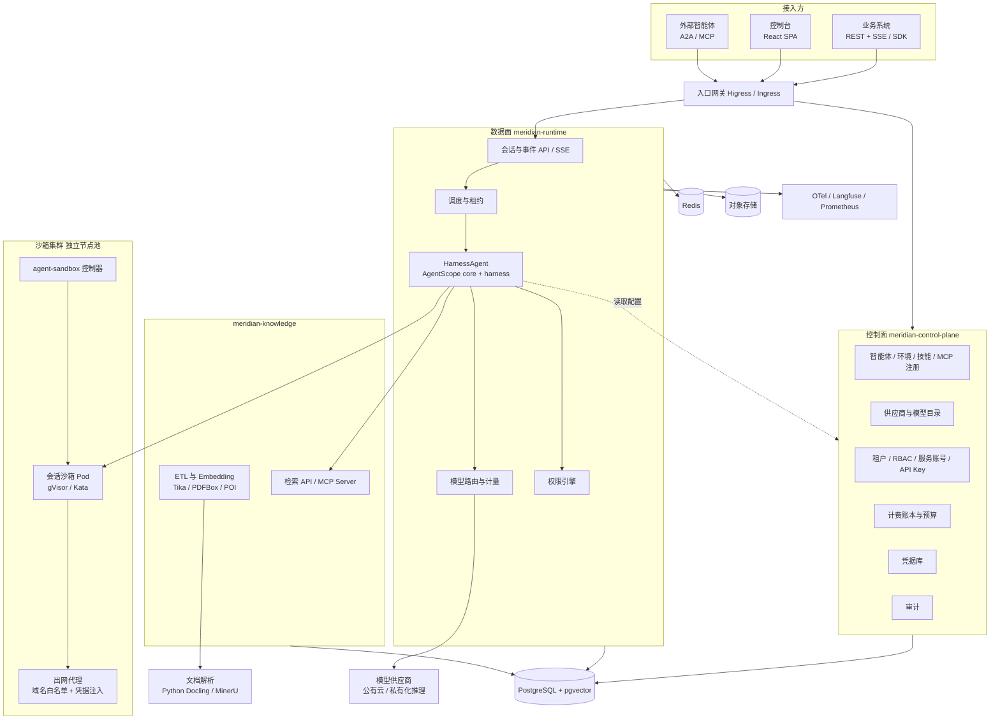
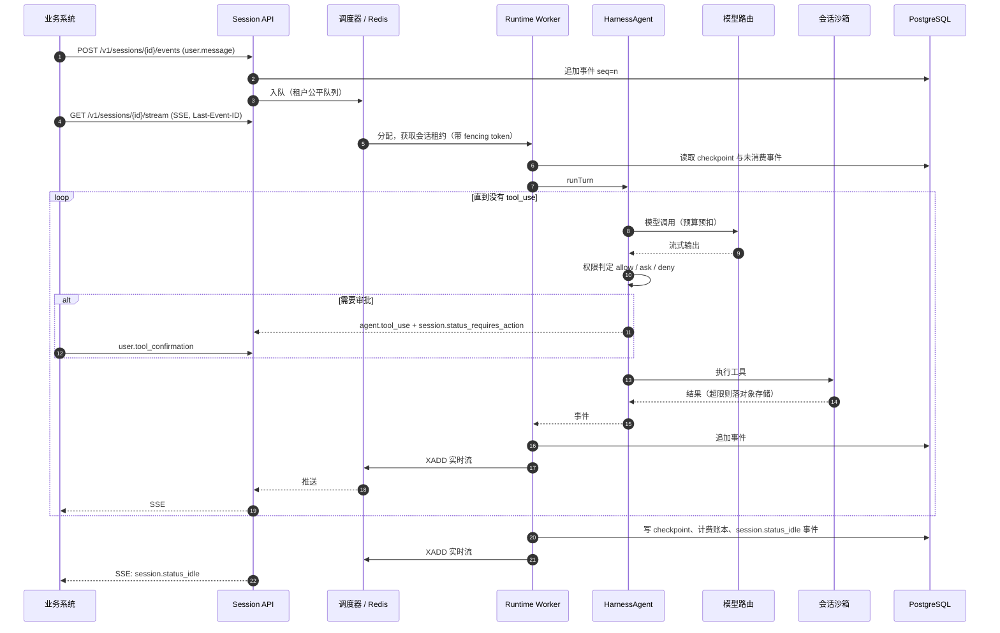

# AgentMeridian 技术选型调研

要做的是一个能部署到企业内网、供多个业务系统接入的通用智能体平台。它要有 Claude Code 同级别的 Harness 能力，包括会话、子智能体、上下文压缩、权限、沙箱、计划模式、记忆和技能，还要有可视化控制台和一套标准 API。业务系统拿到服务账号、BaseUrl 和 API Key，就能按手册实现聊天、知识库问答、文档编制、智能问数等需求。

这份报告给出技术栈组合、每个组件承载的能力、系统架构与部署方案、分优先级的能力清单、项目命名，以及每个结论的依据。依据来自四份本地源码（Spring AI、Spring AI Agent Utils、AgentScope Java、Claude Code 源码分析）的逐模块核查，和截至 2026-11-07 的官方发布页与文档。

结论先放在这里。全平台只用一个智能体框架：**AgentScope Java 2.0.x**（core 和 harness，不用它的 RAG 扩展和 Service 层），不引入 Spring AI。知识库服务、平台的控制面、数据面、API、计费、权限由我们基于 **JDK 25 + Spring Boot 4.1** 自研；对外暴露 MCP Server 直接用 MCP Java SDK。沙箱用 **Kubernetes agent-sandbox + gVisor/Kata + OpenSandbox**。Python 只承担文档解析和可选的外部 Agent Worker，Go 只以现成基础设施的形式出现，我们不自己写 Go。项目命名为 **AgentMeridian**。

## 版本基线

下表是调研时各组件的最新稳定版，后文提到版本时以此为准。日期取自 GitHub Release、Maven Central 或官方博客。

| 组件 | 版本 | 发布日期 | 备注 |
|---|---|---|---|
| JDK | 25 LTS | 2025-09-16 | JDK 26、27 已发布，均非 LTS |
| Spring Boot | 4.1.2 | 2026-10-22 | 4.2.0-RC2 已发布 |
| Spring AI | 2.0.2 | 2026-10-23 | 基于 Boot 4.1.2、Jackson 3、MCP SDK 2.1.0；2.1.0-RC2 已发布 |
| Spring AI Agent Utils | 0.13.0 | 2026-10-03 | 主干为 0.14.0-SNAPSHOT，依赖 Spring AI 2.0.1 |
| AgentScope Java | 2.0.4 | 2026-10-08 | 基于 Java 17、Reactor、Jackson 2.21、MCP SDK 0.17.2；主干为 2.1.0-SNAPSHOT，已升级到 MCP SDK 2.1.0 |
| MCP Java SDK | 2.1.0 | 2026-10-16 | 规范最新版为 2026-07-28（无状态传输），完整支持要等 SDK 3.x |
| A2A Java SDK | 1.5.0.Final | 2026-11-03 | 坐标已改为 `org.a2aproject.sdk` |
| LangChain4j | 1.23.0 | 2026-10-28 | `langchain4j-agentic` 仍为 beta |
| Spring AI Alibaba | 1.1.2.2 / 2.0.0-M1.1 | 2026-03 / 2026-06 | 2.0 仍是里程碑版 |
| OpenSandbox | 1.2.0 | 2026-10-27 | 阿里开源，提供 Java SDK |
| kubernetes-sigs/agent-sandbox | v1.0.10 | 2026-11-06 | 隔离交给 gVisor 或 Kata |
| Langfuse | v4.76.0 | 2026-11-05 | 核心 MIT，可自托管 |

## 候选框架评估

### Spring AI 2.0.2

Spring AI 是模型与工具的集成层，相当于大模型领域的 Spring Data。它的强项都在"单次调用"这一层：

- 模型：15 个原生供应商模块，另有 Groq、DeepSeek 等走 OpenAI 兼容端点。
- 工具：`@Tool`、`ToolCallback`、`ToolContext`（传租户等不发给模型的数据），2.0.1 起默认限制每个工具 40 次、总计 150 次调用，并关闭了 bean 级工具兜底解析。
- 中间件：Advisor 链，`ToolCallingAdvisor` 提供 `doBeforeCall`、`doAfterCall` 等钩子。
- RAG：`RetrievalAugmentationAdvisor` 加查询改写、多路扩展、上下文增强，22 种向量库共用一套过滤 DSL。
- MCP：client 支持 stdio、SSE、Streamable HTTP，server 支持 SSE、Streamable、Stateless，`@McpTool` 等注解完整。
- 可观测：Micrometer Observation，遵循 OpenTelemetry GenAI 语义约定。

它缺的恰好是平台最需要的那一层。在 `src/main` 里检索 agent、subagent、planner、checkpoint、sandbox、interrupt、session、approval，没有任何实现。工具循环只存在于一次 `ChatClient` 调用内部；没有 run 和 step 的持久化，没有工具事件流（`streamToolCallResponses` 在 2.0 已删除），没有 HITL 中断，也没有沙箱。记忆只有滑动窗口 `MessageWindowChatMemory`，官方文档明确说它不适合存完整聊天历史。MCP 的 OAuth 只有社区项目 `spring-ai-community/mcp-security`，状态为 WIP，且不支持 WebFlux。RAG 的 `DocumentPostProcessor` 只有接口，没有任何 rerank 实现。

所以 Spring AI 是一个优秀的集成层，但拿它当 Agent 内核，需要从零写整套 Harness。它擅长的知识库和 MCP Server 两块，平台用自研的知识库服务和 MCP Java SDK 覆盖，理由见"框架定选"一节。它的 Advisor 钩子设计、工具调用上限和 RAG 管道分段，作为设计参考保留。

### Spring AI Agent Utils

这个库把 Claude Code 的工具集照搬到了 Java，README 写明是"reimplements core Claude Code capabilities as Spring AI tools"。工具名和描述文本都沿用 Claude Code：Read、Write、Edit、Bash、Grep、Glob、WebFetch、WebSearch、TodoWrite、Task、Skill、AskUserQuestion。子智能体定义沿用 `.claude/agents/*.md` 的 frontmatter 格式，并内置 general-purpose、Explore、Plan、Bash 四个子智能体。

它的定位是工具插件，离平台还远：

- 子智能体的 `resume` 和 `model` 参数声明了但没有实现，`permissionMode` 非 default 时只打一条 warn。
- 没有会话持久化、事件流、权限审批、多租户、配额，也没有 Micrometer 集成。
- `DockerCliExecBackend` 创建容器时只传了 `-v`、`-w`、`--entrypoint sleep`，没有网络隔离、资源限制和非 root 用户。
- `SmartWebFetchTool` 的域名安全检查会外呼 `claude.ai/api/web/domain_info`。
- 仍是 0.x，近 3 个月 44 个提交中 35 个来自同一位作者，每个小版本都有迁移指南。

它的价值在于参考实现。`ExecBackend`、`Workspace` 这层 SPI，Skills 渐进式加载，以及 AutoMemory/Dream 的文件记忆方案，都值得在设计时对照。平台不直接依赖它。

### AgentScope Java 2.0.4

AgentScope Java 是这次调研中唯一一个在 Java 侧把 Claude Code 式 Harness 做成生产级的框架。它分三层：core 是 Agent 内核，harness 是工程能力，service 是可部署平台。core 和 harness 不依赖 Spring。

**core 的设计面向服务端多租户。** v2 的 Agent 完全无状态，每次调用的状态放在 `CallExecution` 里，经 Reactor Context 传递，身份用 `RuntimeContext(userId, sessionId)` 隔离。`streamEvents()` 输出 32 种事件，其中包括 `RequireUserConfirmEvent` 和 `RequireExternalExecutionEvent`，可以直接映射成审批和外部工具执行的 API。其余能力：

- 中间件：`MiddlewareBase` 有 `onAgent`、`onReasoning`、`onActing`、`onModelCall`、`onSystemPrompt`、`onAgentStateReady` 六个扩展点。
- 权限：`PermissionEngine` 的判定顺序是 deny → ask → 工具自检 → allow → bypass → 默认 ask，模式分 DEFAULT、ACCEPT_EDITS、EXPLORE、BYPASS、DONT_ASK，与 Claude Code 同构。
- 状态：2.0.4 用 `AgentStateStore` 持久化智能体状态，状态带版本号，并发修改时抛 `ConcurrentSessionModificationException`；扩展里有 Redis、MySQL、PostgreSQL、MongoDB、OSS 后端。2.1 改为 Session Log（`JournalSessionLog`）加 checkpoint。
- 模型：通过 SPI 用 `"provider:model"` 解析，支持 DashScope、OpenAI（含 Responses API）、Anthropic、Gemini、Ollama，以及 DeepSeek、Kimi、GLM、MiniMax 等 OpenAI 兼容方，并支持 `fallbackModel`。

**harness 补齐了 Claude Code 的工程能力。** `HarnessAgent` 包装 `ReActAgent`，不改推理循环，用约 20 个中间件叠加能力：

- 工作区：`AGENTS.md`、`MEMORY.md`、`skills/`、`subagents/`、`tools.json`、`plans/`，每次调用重新加载。
- 上下文：超过 80K 字符的工具结果卸载到文件、上下文只留首尾预览（`ToolResultEvictionMiddleware`），对话压缩加溢出时紧急压缩（`CompactionMiddleware`）。2.1 新增上下文预算策略 `ContextPolicy` 和"模型实际看到了什么"的清单 `ContextManifest`。
- 计划模式：`plan_enter`、`plan_write`、`plan_exit`，计划阶段拦截所有写操作。
- 子智能体：`agent_spawn`、`agent_send`、`task_output` 等工具，同步调用超时后转为后台任务，工作区可选 ISOLATED 或 SHARED，也能通过 Agent Protocol 调用远程子智能体。
- 技能：来源可以是 Git、Nacos、MySQL、PostgreSQL、classpath 和工作区，附带安全扫描和准入闸门。
- 会话：`SessionTurnGate` 保证同一会话串行，`enablePendingToolRecovery` 处理中断后悬空的工具调用。2.1 新增 `AgentSession`，支持后台执行、持久排队、补充输入、中断续做。
- 沙箱：Docker、Kubernetes（基于 agent-sandbox，用 SandboxClaim 和 WarmPool）、E2B、Daytona、阿里云 AgentRun，隔离粒度分 USER、SESSION、AGENT、GLOBAL，支持快照恢复。

成熟度方面，近 3 个月主干 419 个提交、114 位独立贡献者，1081 个测试类，CI 跑 Ubuntu 和 Windows。

上面标了"2.1"的能力，在 2.1.0-BETA1（2026-10-08）里已有，但还没进入正式版；`ToolSearchTool` 目前只在主干。平台的版本策略见"框架定选"一节。

它的风险也清楚：

- **API 变动快。** 1.x 到 2.0 删掉了 Pipeline、MsgHub、PlanNotebook，core 里还有 59 个 `@Deprecated` 文件计划在 2.1 清理。
- **强制 Reactor。** 团队需要响应式编程经验。
- **生态偏阿里云。** DashScope、百炼、Nacos、AgentRun 都是一等支持。
- **Service 层不成熟。** agentscope-service 仍是 2.1.0-BETA1，控制面用 Go 编写（551 个 .go 文件）。

### Claude Code 的 Harness 机制

Claude Code 源码分析（2026-03 版本）给出了 Harness 应该长什么样的参照。下面这些机制是平台必须具备的，AgentScope harness 已覆盖其中大部分：

| 机制 | Claude Code 的做法 | 平台上的形态 |
|---|---|---|
| 主循环 | async generator 加显式状态机；是否继续以有无 tool_use 块为准，不信任 `stop_reason` | 每轮作为持久化步骤，可跨节点续跑 |
| 工具并发 | 相邻的并发安全工具合批并发（上限 10），其余串行；Bash 出错时取消同批兄弟工具 | 同上，另加租户级并发上限和工作区写锁 |
| 上下文压缩 | 三级：工具结果预算 → microcompact → autocompact；阈值为窗口减输出预留再减 13k 缓冲，连续失败 3 次熔断；压缩后补回最近 5 个文件和计划 | 阈值按模型配置，摘要作为会话版本保存 |
| 大工具结果 | 单工具 50k 字符、单消息 200k 字符，超限落盘，上下文留 2KB 预览 | 落到对象存储，上下文留引用 |
| Prompt 缓存 | system prompt 分静态段和动态段，动态信息以附件注入，fork 子智能体复用父会话的前缀字节 | 平台级 prompt 作为跨租户共享前缀，监控缓存命中率 |
| 权限 | 五类规则来源，判定顺序 deny > ask > 工具自检 > 安全路径 > 模式 > allow | 来源层级改为平台、租户、项目、智能体、会话；判定顺序见"权限系统"一节；每次判定写审计 |
| 审批 | headless 模式通过 `control_request{subtype:'can_use_tool'}` 交给宿主 | `requires_action` 状态加审批 API，超时默认拒绝 |
| Hooks | 27 个事件，command、prompt、http、agent 四种执行器 | 只开放 http 和 agent 两种，加 SSRF 防护和签名 |
| 会话 | append-only JSONL，parentUuid 链，子智能体侧链分离，恢复时补齐 tool_result | 事件表加实时流，resume 前做一致性修复 |
| 排队消息 | `now` 立即中断，`next` 在两次模型调用之间注入，`later` 等本轮结束 | `later` 和 `next` 映射为 `user.message` 的 `delivery: queue` 和 `delivery: steer`，`now` 映射为独立的 `user.interrupt` 事件 |
| 子智能体 | 工具子集、禁止递归、后台运行完成后以通知回传 | 独立调度，配额从父任务继承且只能收紧 |
| 重试与降级 | 最多 10 次指数退避；529 连续 3 次切备用模型；后台请求不重试 | 放进模型路由层 |

### 其他 Java 框架

| 框架 | 版本 | 不选作内核的原因 |
|---|---|---|
| Spring AI Alibaba | 1.1.2.2 / 2.0.0-M1.1 | 有 Agent Framework（ReactAgent、多种编排、HITL）和 Graph（持久化状态图）。2.0 仍是里程碑版，对齐的 Spring AI 版本未验证；Admin 独立仓库 2026-01 后无更新。本次未读源码，评估基于公开文档 |
| LangChain4j | 1.23.0 | 主线成熟，但 `langchain4j-agentic` 仍是 beta，没有 Harness 层 |
| Embabel | 1.5.4 | 卖点是基于目标和动作的 GOAP 式规划，适合确定性业务流程，没有 Harness 层 |
| Koog | 1.3.0 | Kotlin 优先，有持久化和 OpenTelemetry，Java 互操作在 1.0 重做过；团队栈以 Java 为主 |
| Google ADK Java | 1.14.0 | 会话、记忆、评估齐全，约两周一版，生态偏 Gemini 和 Vertex |
| Solon AI | 4.1.1 | 兼容 Java 8 到 26，适合 Solon 生态，与 Spring Boot 4 主线不契合 |

### 非 Java 组件

LangGraph（1.2.20）的 durable execution 和 checkpointer 很成熟，Claude Agent SDK（Python 0.2.179、TS 0.3.319）就是 Claude Code 同源的 Harness。它们不适合当平台核心，因为团队主栈是 Java，平台的租户、权限、计费也都在 Java 侧，核心编排换成 Python 会让这些能力跨语言重复实现。它们适合作为"外部 Agent Worker"接入：跑在沙箱里，通过 A2A 或 HTTP 与平台通信。典型用法是编码类任务直接托管 Claude Agent SDK 或 Codex 进程，agentscope-service 的 hosted-runtime 模式就是这个思路。

### 评估结果

评分是基于上面证据的判断，1 到 5 分。"作为内核"指承担 Agent 运行时和 Harness。

| 候选 | Harness 完整度 30% | 生产特性 25% | 生态覆盖 15% | 成熟与稳定 15% | 企业栈契合 15% | 加权 |
|---|---|---|---|---|---|---|
| AgentScope Java 2.0.x | 5 | 4 | 4 | 3 | 3 | **4.00** |
| Spring AI 2.0 + 自研 Harness | 1 | 2 | 5 | 5 | 5 | 3.05 |
| Spring AI Alibaba 2.0-M | 2 | 3 | 4 | 2 | 4 | 2.85 |
| Google ADK Java | 2 | 3 | 3 | 3 | 3 | 2.70 |
| LangChain4j agentic | 1 | 2 | 5 | 3 | 4 | 2.60 |
| Spring AI Agent Utils | 3 | 1 | 3 | 2 | 4 | 2.50 |
| Embabel | 1 | 2 | 3 | 3 | 4 | 2.30 |
| Koog | 1 | 3 | 3 | 3 | 2 | 2.25 |

"生产特性"指会话持久化、中断恢复、HITL、多租户隔离、分布式状态。AgentScope 在权重最高的两项上明显领先。它在"成熟与稳定"上的扣分，用适配层隔离框架 API 来对冲，见后文"内核适配层"一节。

## 技术栈组合

### 语言分工

| 语言 | 承担什么 | 理由 |
|---|---|---|
| Java（JDK 25） | 控制面、数据面、Agent 运行时、知识库服务、计费、权限、API | 团队主栈；AgentScope 在这里；虚拟线程在 JDK 24 起（JEP 491）不再被 `synchronized` 钉住 |
| TypeScript | 控制台前端、TypeScript SDK | 前端生态 |
| Python | 文档解析服务（Docling、MinerU）、可选的外部 Agent Worker | 复杂 PDF、表格、公式解析只有 Python 有成熟方案 |
| Go | 只以现成组件出现：agent-sandbox 控制器、Higress | 不自研 Go 代码，避免多一套工程体系 |

### 各层选型

| 层 | 选型 | 承载的能力 |
|---|---|---|
| Agent 内核 | AgentScope Java core 2.0.x | ReAct 循环、消息模型、工具执行与并行、结构化输出、事件流、中断、权限引擎、会话状态、模型供应商 SPI |
| Harness | AgentScope Java harness 2.0.x | 工作区、上下文预算与压缩、工具结果卸载、计划模式、子智能体与团队、技能、记忆、沙箱抽象 |
| 平台服务框架 | Spring Boot 4.1.x | 控制面用 Spring MVC 加虚拟线程；数据面用 WebFlux，直接承接 Reactor 的 `Flux` 事件并输出 SSE |
| 知识库 | 自研服务，直接使用 Apache Tika、PDFBox、POI | 文档 ETL、切分、批量 Embedding、权限过滤、混合召回、rerank、查询改写；以 MCP Server、REST 和平台工具三种方式提供检索 |
| 文档解析 | Apache Tika 4.2 打底，Docling / MinerU 处理复杂 PDF | Office、PDF、扫描件、表格、公式转 Markdown |
| 主存储 | PostgreSQL（含 pgvector 0.8.x） | 配置、会话事件日志、checkpoint、计费账本、审计、中小规模向量 |
| 缓存与协调 | Redis | 会话租约、实时事件流（Redis Streams）、限流令牌桶、热状态缓存 |
| 对象存储 | S3 兼容（MinIO / OSS / COS） | 工作区快照、大工具结果、上传文件、产物、事件归档 |
| 大规模向量 | Milvus 2.6 / 3.0（按需） | 单库超过千万级向量或需要多副本检索时启用 |
| 沙箱 | kubernetes-sigs/agent-sandbox + gVisor 或 Kata，SDK 层用 OpenSandbox | 每会话隔离的代码执行、终端、浏览器，预热池，快照 |
| 联网搜索 | 可插拔：博查（国内）、Tavily 或 Brave（海外）、SearXNG（私有化） | Web 搜索与抓取 |
| 协议 | MCP Java SDK、A2A Java SDK、AG-UI（社区 Java SDK）、OpenAI 兼容接口 | 工具接入、智能体互通、前端事件协议、模型直通 |
| 可观测 | OpenTelemetry + Langfuse 自托管 + Prometheus / Grafana / Loki | 链路追踪、LLM 调用明细、指标、日志 |
| 身份 | Spring Security + OIDC（Keycloak 或企业 IdP） | 控制台登录、RBAC；业务侧用服务账号和 API Key |
| 凭据 | KMS 信封加密存 PostgreSQL，可对接 HashiCorp Vault / OpenBao | 模型 Key、MCP 凭据、数据源密码，执行时注入，不进模型上下文 |
| 判断层（三期） | AgentScope JEV 扩展（TypeSafe AI Jev） | 工具筛选、执行防护、模型路由、记忆准入、轨迹评估 |
| 控制台 | React + TypeScript + Vite，shadcn/ui + Tailwind CSS，motion，xyflow，xterm.js，Monaco | 管理与编排界面、会话调试、多智能体拓扑、Web 终端、技能与提示词编辑 |
| 入口网关 | Higress（或现有 Ingress） | TLS、路由、粗粒度限流；企业要求统一出网时兼做 AI 出口网关 |
| 部署 | Kubernetes + Helm；PoC 用 Docker Compose | — |

控制台前端各库的版本，本次调研没有逐一核对，立项时取最新稳定版。

### 框架定选

平台只用 AgentScope Java，不引入 Spring AI。

两者不能放进同一个 JVM：AgentScope 2.0.4 依赖 MCP SDK 0.17.2 和 Jackson 2.21，Spring AI 2.0.2 依赖 MCP SDK 2.1.0 和 Jackson 3。两个 MCP SDK 包名相同、API 不兼容。拆成两个进程分别使用可以绕开冲突，但代价是平台里同时存在两套模型抽象、两套工具抽象、两套 MCP 客户端。供应商适配、凭据注入、计量、追踪都要各接一遍，升级时要同时追两个框架的破坏性变更。

二选一时选 AgentScope，因为它提供的 Harness 和运行时是平台最难、最贵的部分，Spring AI 没有对应物。Spring AI 原本承担的能力，按下表覆盖：

| Spring AI 原本承担的 | 平台的做法 | 自研量 |
|---|---|---|
| 文档读取与切分 | 直接用 Apache Tika、PDFBox、POI；复杂 PDF 交给 Python 解析服务；切分按文档结构自研 | 小 |
| Embedding | 平台模型层统一的 OpenAI 兼容客户端，支持批量和连接复用 | 小 |
| 向量库适配（22 种） | 平台只需要 pgvector，规模上去后换 Milvus，各写一个存储实现 | 小 |
| 检索管道与元数据过滤 | 自研检索服务：连接池、租户与权限过滤、向量加全文混合召回、rerank | 中等 |
| 查询改写、多路扩展 | 在自研检索层里用小模型实现，约等于 Spring AI 三个 `QueryTransformer` 的工作量 | 小 |
| MCP Server 暴露 | MCP Java SDK 核心包自带 `HttpServletStreamableServerTransportProvider` 和 `HttpServletStatelessServerTransport`，注册为 Spring MVC 的 Servlet 即可 | 小 |
| Micrometer 观测 | AgentScope 的 `OtelTracingMiddleware`，遵循 GenAI 语义约定 | 无 |

知识库不用 AgentScope 的 RAG 组件。原因是 2.0.4 的 `io.agentscope.core.rag` 整个包已标记 `@Deprecated(forRemoval = true)`，官方建议在应用层集成检索。RAG simple 扩展依附在这个包上，而且自身限制明显：`RetrieveConfig` 只有条数和阈值，没有元数据过滤；`PgVectorStore` 只持有单个 JDBC 连接；Reader 只接受本地文件路径；`OpenAITextEmbedding` 不支持批量，每次调用都新建 HTTP 客户端。

所以知识库服务完全自研，不依赖任何智能体框架。需要自研的主要是检索层，它本来就是企业知识库的核心差异点：权限过滤、混合召回、rerank 都要按业务定制。Spring AI 在这里也只提供了骨架，它的 `DocumentPostProcessor` 没有 rerank 实现。因此这部分自研是必要的投入，不算重复造轮子。

AgentScope 的生产基线锁定 2.0.4。2.1 的 `AgentSession`、Session Log、`ContextPolicy` 很有吸引力，但还是 BETA。平台的会话层（事件日志、消息队列、steer 注入、租约、崩溃恢复）由平台自己实现，只依赖 2.0.4 已有的内核能力：`AgentStateStore`、`enablePendingToolRecovery`、中断与 `RunControl`、`SessionTurnGate`、`MiddlewareBase`。会话 API 的语义本来就要由平台掌控，所以这部分自研不会白做。2.1 正式版发布后，再评估用 `AgentSession` 替换平台会话层的哪些内部实现。

依赖基线统一跟随 AgentScope：2.0.x 阶段用 MCP SDK 0.17.2，AgentScope 2.1 正式版发布后随之升级到 MCP SDK 2.x。Spring Boot 4 默认用 Jackson 3，AgentScope 用 Jackson 2，两者包名不同（`tools.jackson` 与 `com.fasterxml.jackson`），可以共存：平台 API 层用 Jackson 3，AgentScope 内部用 Jackson 2。AgentScope 的 Spring Boot starter 是基于 Boot 4.0.4 编译的，平台不用这些 starter，而是自己写配置类组装 `HarnessAgent`，这样所有服务统一在 Boot 4.1.x。

运行时和知识库仍然分成两个进程，但原因换成了负载特征：知识库的写入负载（解析、Embedding）和运行时的长连接负载完全不同，需要独立扩缩容。

## 系统架构

### 总体架构



平台自有的部署单元有五个：控制面、数据面、知识库、文档解析、控制台静态资源；沙箱集群使用现成组件。控制面和数据面分开，原因是两者的负载形态不同。控制面是低频的配置读写，数据面是大量长连接和长时间运行的会话。数据面需要独立扩缩容，故障也不能波及管理功能。

### 控制面

控制面基于 Spring MVC 加虚拟线程，用 JDBC 访问 PostgreSQL，负责所有"配置类"资源：租户、项目、成员与角色、服务账号与 API Key、供应商与模型、凭据、智能体定义与版本、环境模板、技能、MCP 服务注册、知识库元数据、预算、价格表和审计查询。

智能体定义采用版本化发布。会话绑定到某个版本，所以修改定义不会影响正在运行的会话。数据面按版本号缓存配置，控制面变更时通过 Redis 发布失效通知。

### 数据面与内核适配层

数据面基于 WebFlux。AgentScope 的 `streamEvents()` 返回 `Flux`，可以直接转成 SSE，不需要线程桥接。阻塞的 JDBC 和沙箱 HTTP 调用放到虚拟线程调度器上（`Schedulers.fromExecutor`），不阻塞 Reactor 事件线程。AgentScope 的 AGENTS.md 也明确要求不要阻塞 reactive 线程。

平台代码不直接依赖 AgentScope 的类型，中间隔一层自己的 SPI，即内核适配层：

```java
public interface AgentEngine {
    Flux<PlatformEvent> runTurn(TurnContext ctx, List<InboundEvent> inputs);
    Mono<Void> interrupt(SessionRef session, InterruptReason reason);
    Mono<Void> resolveAction(SessionRef session, ActionResolution resolution);
}
```

`AgentScopeEngine` 是它的唯一实现，负责把平台的智能体定义翻译成 `HarnessAgent` 配置，再把 AgentScope 的 32 种事件映射成平台事件。AgentScope 升级时，改动只落在这一个模块里。将来需要接入外部 Agent Worker（Claude Agent SDK、LangGraph），也是新增一个 `AgentEngine` 实现。

### 一轮对话的执行流程



事件先写 PostgreSQL，再推 Redis Streams。任何一个 API 节点都能为任何会话提供 SSE：断线重连时带上 `Last-Event-ID`，先从 PostgreSQL 补齐缺失的事件，再切到实时流。

### 会话、事件与恢复

会话是平台的核心资源，状态有五种：`idle`、`running`、`requires_action`、`rescheduled`、`terminated`。同一会话同一时刻只有一个 Worker 在执行，由 Redis 租约保证。租约带 fencing token，旧 Worker 恢复后写入时会被拒绝，这就防住了"脑裂"导致的重复执行。

会话的持久化分两类数据，都存在 PostgreSQL 里：

- **会话事件**（`session_events`）是对外的事实来源：业务方看到的每一条事件、控制台回放、审计、SSE 断线补齐都读它。表结构为 `(session_id, seq, type, payload jsonb, created_at)`，只追加，按月分区，冷数据归档到对象存储。
- **智能体状态**（checkpoint）是内核续跑用的快照，即 AgentScope 的 `AgentState`。平台实现一个写 PostgreSQL 的 `AgentStateStore`，在每批工具结果返回后、每轮结束时各保存一次。每个 checkpoint 记录它覆盖到的事件 seq。

会话恢复有三种情况：

- **Worker 崩溃。** 租约过期后，另一个 Worker 加载最近的 checkpoint，把该 seq 之后的用户事件重新投递，继续执行。checkpoint 带版本号，加上租约的 fencing token，可以保证同一状态不会被两个 Worker 同时推进。
- **用户中断。** 为排队中和执行中的工具补合成的 tool_result，保证每个 tool_use 都有对应结果，否则下一轮请求会被模型 API 拒绝。这个做法来自 Claude Code，AgentScope 的 `enablePendingToolRecovery` 提供了内核侧支持。
- **有副作用的工具。** 退款、发消息、写数据库这类工具在注册时标记为"有副作用"。平台在调用前生成幂等键（`session_id` 加 `tool_use_id`），先在 `tool_invocations` 表记一条 pending 记录，再把幂等键随请求传给下游。崩溃恢复时，pending 状态的调用不自动重放，而是带上原幂等键重试。所以这类工具的下游接口必须支持幂等键；不支持的，恢复时会话进入 `requires_action`，由人确认是否重试。

会话操作还包括 fork（复制事件链到某个位置，开新会话）、rewind（回退到某个事件并恢复工作区快照）、归档和删除。删除会话时一并删除工作区快照和对象存储中的产物，满足数据删除合规要求。

### 运行中的消息投递

智能体运行时，用户发来的新消息按三种方式处理，对应 Claude Code 的 `later`、`next`、`now`：

| 投递方式 | 行为 | 典型场景 |
|---|---|---|
| `queue`（默认） | 进入会话队列，本轮结束后作为新一轮输入 | 用户提前输入下一个问题 |
| `steer` | 当前工具执行完毕后、下次模型调用前，作为补充上下文注入 | "顺便把测试也跑一下" |
| `user.interrupt` 事件 | 立即中止当前轮，补齐 tool_result 后回到 `idle`，可紧跟一条新消息 | 用户发现方向错了 |

`queue` 由平台的会话队列实现。`steer` 用一个挂在 `onReasoning` 上的中间件实现：每次模型调用前，检查会话里有没有待注入的消息，有就追加到本次请求的上下文里。中断调用 AgentScope 的 `interrupt` 接口。

### 子智能体与多智能体编排

主智能体可以按需拉起子智能体，也可以不拉。用不用由模型自己决定，平台只提供能力和约束。约束有四条：

- 子智能体的工具集只能是父智能体的子集；默认禁止递归拉起，深度上限可配置。
- 预算从父会话继承，只能收紧。子智能体的 token 消耗计入父会话，并在账本里单独标出。
- 每个子智能体有独立的事件线程（thread），在主事件流中以 `session.thread_*` 事件可见。控制台能展开查看任一子智能体的完整轨迹。
- 后台子智能体完成后，以通知事件回到父智能体，父智能体在两轮之间读取。

多智能体协作的形态有三种：主从式（子智能体作为工具）、团队式（AgentScope 的 `TeamsMiddleware`，共享任务列表）、跨系统式（通过 A2A 调用外部智能体）。一期只开放主从式。AgentScope 2.0 删掉了 Pipeline 和 MsgHub，改为"中间件 + 子智能体 + 事件流"；平台沿用这个方向，**不另做一套低代码工作流引擎**。业务侧需要确定性流程时，在自己的代码里按顺序调用平台 API，或者把流程写成技能。

### 工具、MCP 与技能

工具分四类：

- 内置工具：文件读写编辑、Glob、Grep、Shell、Web 搜索与抓取、TodoWrite、计划、子智能体。
- 平台工具：知识库检索、记忆读写、只读 SQL（智能问数）、文档生成。
- MCP 工具：租户注册的 MCP Server。
- 自定义工具：业务系统声明 schema，智能体调用时发出 `agent.custom_tool_use` 事件，业务系统执行后回传结果，执行逻辑不必部署到平台。

工具数量多时启用工具搜索：首轮只给模型工具名列表，用到时再加载 schema。Spring AI 实现同一思路的文档称可减少 34% 到 64% 的 token。AgentScope 的 `ToolSearchTool` 目前只在主干，二期如果它还没进入正式版，平台就以中间件形式自己实现，工作量不大。

MCP Server 由控制面统一注册，凭据存在凭据库里，连接时注入。平台同时是 MCP Server：知识库检索和已发布的智能体，都能以 MCP 工具的形式给外部客户端使用，传输层用 MCP Java SDK 的 Servlet 实现。MCP 规范 2026-07-28 版改为无状态传输，所以 MCP 网关和注册中心一开始就按无状态、可水平扩展设计。

技能采用 `SKILL.md` 格式，与 Claude Code 和 Agent Utils 兼容。清单常驻上下文，正文按需加载。技能按"平台 → 租户 → 项目 → 智能体"四层合成，上传时做安全扫描，发布走审核。文档编制、文档修改这类需求主要靠技能实现：docx、xlsx、pdf 技能配合沙箱里的 Python 库完成生成和改写。

### 权限系统

权限分两套，互不替代：

**平台权限**管"谁能管理什么"。租户、项目、角色（所有者、管理员、开发者、观察者）、资源级授权，用 Spring Security 加 OIDC 实现。业务系统用服务账号，每个 API Key 绑定项目和权限范围（scope），只存哈希，可轮换、可吊销。

**工具权限**管"智能体能做什么"。规则语法沿用 Claude Code 的 `Tool(content)` 形式，例如 `Bash(git:*)`、`WebFetch(domain:example.com)`、`mcp__crm__refund`。规则来源分五层：平台策略、租户、项目、智能体、会话。平台的判定顺序如下，前一步有结论就停止：

1. 安全路径：工作区配置目录、凭据文件等，由平台以最高优先级的 deny 规则下发，任何模式都不能绕过。
2. deny 规则。
3. ask 规则。
4. 工具自检：工具根据入参自己判断，例如 Shell 工具按命令内容判断是否只读。
5. allow 规则。
6. 模式：`bypass` 放行全部，`accept_edits` 放行文件编辑，`default` 不额外放行。
7. 以上都没有结论，默认 ask。

第 2 到第 7 步就是 AgentScope `PermissionEngine` 的原生顺序，平台只在最前面加了第 1 步。和 Claude Code 相比，差别在于安全路径的位置：Claude Code 把它放在工具自检之后，平台把它提到最前，因为服务端没有"用户就坐在终端前"这个前提。

`ask` 的结果在服务端变成一次审批：会话进入 `requires_action`，事件里带上待审批的工具调用和判定依据。审批方可以是调用方本人，也可以是控制台的审批收件箱。超时默认拒绝。没有审批人的后台任务按 `dont_ask` 处理，即所有 `ask` 都直接拒绝。每一次判定都写审计日志。

### 沙箱与工作区

不是每个会话都需要沙箱。纯对话、知识库问答、智能问数在"无沙箱"档位运行，文件系统是平台托管的虚拟文件系统（AgentScope 的 `RemoteFilesystem`，后端为对象存储）。只有需要执行代码、使用终端或浏览器的会话，才分配沙箱。企业场景里前者占多数，这一条决定了平台的资源成本。

需要沙箱时，每个会话一个 Pod，跑在独立节点池上，RuntimeClass 为 gVisor（默认）或 Kata（隔离要求更高时）。具体约束：

- 编排：agent-sandbox 的 SandboxClaim 和 SandboxWarmPool 负责编排和预热；OpenSandbox 提供命令、文件、浏览器 API 和 Java SDK。
- 网络：默认无出网，只能经过出网代理，代理按环境配置的域名白名单放行，并在请求头里注入凭据。凭据不进沙箱环境变量，也不进模型上下文。
- 资源：CPU、内存、磁盘、进程数都有上限，容器以非 root 运行，根文件系统只读。
- 生命周期：空闲超时后，工作区打快照存到对象存储，Pod 释放；会话恢复时从快照重建。

控制台的 Web 终端用 xterm.js，通过 WebSocket 连到沙箱的 PTY。终端会话同样受审计。

### 上下文管理

上下文超限时，按 Claude Code 的三级策略逐级处理：

1. 工具结果预算：单个结果超过阈值就卸载，上下文只留预览和引用。
2. 微压缩：清理旧的只读类工具结果。
3. 全量压缩：生成结构化摘要，保留目标、关键决定、产物、未完成事项和下一步，压缩后补回最近读过的文件和当前计划。

阈值按模型的上下文窗口配置。压缩产物作为会话版本保存。控制台要能看到"模型这一轮实际看到了什么"：一期由平台在模型路由层记录每次请求的上下文构成，2.1 正式版后可以改用 AgentScope 的 `ContextManifest`。

Prompt 组装以缓存命中为中心：平台级 system prompt 和工具定义放在最前，作为跨租户共享的稳定前缀；租户、智能体、用户的内容依次往后放；时间、待办提醒这类动态信息以附件消息注入，不改前缀。平台按模型监控缓存命中率。命中率直接决定成本，Anthropic 等供应商的缓存读取价格只有正常输入的一小部分。

### 记忆系统

记忆分四层，各自的存储和生命周期不同：

| 层 | 内容 | 存储 | 生命周期 |
|---|---|---|---|
| 工作记忆 | 当前上下文窗口 | 内存 | 一轮 |
| 会话记忆 | 事件日志、压缩摘要、会话笔记 | PostgreSQL | 会话存续期 |
| 长期记忆 | 用户偏好、项目约定、智能体经验 | `MEMORY.md` 索引加主题文件，pgvector 语义索引 | 跨会话，用户可查看和删除 |
| 知识 | 企业文档 | 知识库服务 | 由知识库管理 |

长期记忆按作用域隔离：终端用户、项目、智能体三级，跨租户绝不共享。终端用户指业务系统里的用户，由创建会话时的 `end_user_id` 标识，与控制台的登录用户是两回事。长期记忆是二期能力，一期只有会话记忆。写入走准入判断，防止把一次性信息或敏感数据写成长期记忆。AgentScope 的双层记忆（每日追加文件加后台合并到 `MEMORY.md`）是现成实现；需要更强的语义记忆时，可以接 Mem0 或 ReMe，AgentScope 已有扩展。用户能在控制台查看、编辑、删除自己的记忆，这是个人信息合规的要求。

### RAG 知识库

知识库服务是独立的自研服务，分写入和检索两条线。

写入线：上传 → 解析（Apache Tika、PDFBox、POI 处理常规格式，复杂 PDF 交给 Python 解析服务）→ 按文档结构切分 → 批量 Embedding → 写入 pgvector。文档、切片、向量都带租户、知识库、权限标签。写入走异步任务队列，大批量导入不影响检索。

检索线：

1. 查询改写和多路扩展，用小模型完成。
2. 按租户、知识库、权限标签过滤，过滤条件在 SQL 里下推，不在内存里筛。
3. 向量检索加全文检索混合召回，用 HikariCP 连接池访问 PostgreSQL。
4. rerank，接 rerank 模型（供应商 API 或自部署的 BGE / Qwen 系列 reranker）。
5. 引用标注，返回切片来源和位置。

中文全文检索需要 PostgreSQL 的中文分词扩展（zhparser 或 pg_jieba），否则改用 Elasticsearch / OpenSearch。

知识库以两种方式提供给智能体：作为平台工具 `knowledge_search`（智能体自主决定何时检索），或作为前置检索（每轮自动检索并注入，适合简单问答助手）。前置检索由平台的一个 `onAgent` 中间件实现，不用 AgentScope 已废弃的 `RAGMode`。

### 模型供应商与路由

供应商、模型和价格表在控制面维护。模型调用在运行时进程内完成，不额外经过一跳网关，路由层由平台自己实现，挂在 AgentScope 的 `onModelCall` 中间件上：

- **按智能体配置选模型**：支持主模型、备用模型、子智能体模型分别配置。
- **限流**：按供应商和模型的 RPM、TPM 做 Redis 令牌桶，按租户做公平分配。
- **重试与降级**：指数退避，遵循 `retry-after`；同一供应商连续过载时切备用模型；后台请求不重试，避免放大流量。
- **计量**：每次调用写一条用量记录。

路由放在进程内而不放在网关，是因为计费和预算需要细到会话、子智能体、工具调用，独立网关只看得到 API Key，看不到这些维度。企业如果要求所有大模型流量经过统一的出口网关（Higress、LiteLLM 等），把网关地址配成一个 OpenAI 兼容供应商即可，两者不冲突。

平台另外提供 OpenAI 兼容的 `/v1/chat/completions` 和 `/v1/responses` 接口，供只想"直接调模型"的业务系统使用，同样计量和限额。

### 计费与预算

计量单位有四种：模型 token（输入、输出、缓存读、缓存写分开记）、沙箱计算时长、联网搜索次数、知识库存储与 Embedding 量。

每条用量记录带上租户、项目、API Key、智能体版本、会话、线程、模型、价格表版本。价格表有版本，调价不影响历史账单。账本只追加，按天汇总成报表。

预算分四级：租户、项目、API Key、会话，每级可设软阈值（告警）和硬阈值（停止）。模型调用前按估算预扣，调用后按实际用量结算。会话超出预算时进入 `idle` 并给出 `stop_reason: budget_exceeded`，不会在一次工具调用中途被强行切断。

### JEV 判断层

JEV 是 TypeSafe AI 的结构化决策模型，AgentScope 通过 `agentscope-extensions-jev` 把它接入 Harness。它不生成文本，只回答三类问题：是非判断给概率（这个回答有没有依据？），单选给分布（这一轮用哪个模型？），评分给等级（这个风险多严重？）。

在平台里，JEV 承担 Harness 中"便宜但高频"的判断：

- 工具筛选：大工具集按上下文筛出适用工具（`JevToolSelectionMiddleware`）。
- 执行防护：退款、发消息这类受保护工具，执行前检查当前证据是否支持。
- 路由：按任务复杂度选模型。
- 记忆准入：判断一条信息该不该写成长期记忆。
- 检索证据：过滤注入，检查引用是否支持结论。
- 质量评估：在线和离线的轨迹评估。

它的边界在官方文档里写得很明确：JEV 的判断不授予工具权限，也不证明业务操作已经成功，授权、ACL、幂等和完成验证仍由平台负责。所以它只能放在权限引擎后面做补充，不能替代权限。

JEV 排在三期，原因有两个。第一，它是外部模型服务，私有化部署方式和数据出境合规还没确认（列为 PoC 验证项）。第二，它提升的是判断的质量和成本，不是功能的有无：一期的权限规则加人工审批已经能保证安全，二期的工具搜索已经能应对大工具集。JEV 的工具筛选和工具搜索解决同一个问题，做法不同：工具搜索让主模型自己检索，JEV 用一个便宜的判断模型预先筛好。两者按工具规模和成本二选一。

### 可观测性与审计

链路追踪用 OpenTelemetry，span 覆盖会话、轮次、模型调用、工具调用、子智能体。AgentScope 自带 `OtelTracingMiddleware`，遵循 GenAI 语义约定。LLM 调用明细（prompt、输出、token、成本）进 Langfuse 自托管实例，控制台的会话详情页直接跳转。GenAI 语义约定目前还是 Development 状态，属性名会变，导出时加一层映射。

审计日志与可观测数据分开存储，审计记录不可篡改。审计范围包括：配置变更、权限判定、审批结果、凭据访问、终端命令、数据导出。

## 标准 API 设计

### 资源模型

API 的骨架参照 Claude Managed Agents 的四个核心概念（Agent、Environment、Session、Events），再补上企业平台需要的治理资源。

| 资源 | 路径 | 说明 |
|---|---|---|
| Agent | `/v1/agents` | 模型、系统提示词、工具、MCP、技能、子智能体、权限策略；版本化 |
| Environment | `/v1/environments` | 运行环境：无沙箱或沙箱模板、镜像与预装包、资源上限、网络白名单 |
| Session | `/v1/sessions` | 绑定 Agent 版本和 Environment 的运行实例，有状态 |
| Event | `/v1/sessions/{id}/events`、`/stream` | 发送用户事件、列出历史、SSE 实时流 |
| File | `/v1/files`、`/v1/sessions/{id}/workspace` | 上传文件、读写工作区、下载产物 |
| Skill | `/v1/skills` | 技能包上传、版本、发布 |
| MCP Server | `/v1/mcp-servers` | 注册与凭据绑定 |
| Knowledge Base | `/v1/knowledge-bases` | 知识库、文档、检索 |
| Memory Store | `/v1/memory-stores` | 长期记忆的查看、编辑、删除 |
| Vault | `/v1/vaults` | 凭据，只写不读，返回引用 |
| Model / Provider | `/v1/models`、`/v1/providers` | 模型目录（业务侧只读） |
| Usage / Budget | `/v1/usage`、`/v1/budgets` | 用量查询与预算 |

### 事件类型

事件命名采用 `{domain}.{action}`，与 Managed Agents 保持一致，降低业务方的学习成本：

- 用户事件：`user.message`（带 `delivery: queue | steer`，默认 `queue`）、`user.interrupt`（立即中止当前轮，是独立事件，不是 delivery 的取值）、`user.tool_confirmation`、`user.custom_tool_result`。
- 智能体事件：`agent.message`、`agent.thinking`、`agent.tool_use`、`agent.tool_result`、`agent.mcp_tool_use`、`agent.mcp_tool_result`、`agent.custom_tool_use`、`agent.context_compacted`、`agent.plan_updated`、`agent.todo_updated`。
- 会话事件：`session.status_running`、`session.status_idle`（带 `stop_reason`）、`session.status_requires_action`、`session.status_rescheduled`、`session.status_terminated`、`session.error`、`session.usage`、`session.thread_created`、`session.thread_status_*`。
- 观测事件：`span.model_request_start`、`span.model_request_end`（带 token 用量）。
- 增量事件：`event_start`、`event_delta`，只在流上出现，不持久化，用于逐字输出。

### 接入协议

| 协议 | 用途 | 一期 |
|---|---|---|
| REST + SSE（原生） | 全部能力的主协议 | 是 |
| Webhook | 会话状态变化、审批请求、异步任务完成通知 | 是 |
| OpenAI 兼容（Chat Completions / Responses） | 模型直通；也可把一个智能体包装成"模型"供现有 OpenAI 客户端调用 | 是 |
| MCP Server | 把知识库和智能体暴露给外部 MCP 客户端 | 是 |
| A2A | 与外部智能体互通，平台既是 server 也是 client | 二期 |
| AG-UI | 前端组件直接对接智能体事件流 | 二期 |

SDK 从 OpenAPI 3.1 规范生成 Java、Python、TypeScript 三种，SSE 重连、`Last-Event-ID`、事件累积都封装在 SDK 里。

### 业务接入示例

一个知识库问答助手的完整调用只需要三步：

```bash
# 1. 创建会话（agent 和 environment 由管理员在控制台预先配置）
curl -X POST $MERIDIAN_BASE_URL/v1/sessions \
  -H "Authorization: Bearer $MERIDIAN_API_KEY" \
  -d '{"agent": "agt_policy_qa", "environment": "env_no_sandbox",
       "end_user_id": "u_1024"}'

# 2. 发送问题
curl -X POST $MERIDIAN_BASE_URL/v1/sessions/ses_01H.../events \
  -H "Authorization: Bearer $MERIDIAN_API_KEY" \
  -d '{"events": [{"type": "user.message",
       "content": [{"type": "text", "text": "差旅住宿标准是多少？"}]}]}'

# 3. 订阅事件流，断线后带 Last-Event-ID 重连
curl -N $MERIDIAN_BASE_URL/v1/sessions/ses_01H.../stream \
  -H "Authorization: Bearer $MERIDIAN_API_KEY" \
  -H "Accept: text/event-stream"
```

这里要注意 `end_user_id`。平台用它标识业务系统里的终端用户，作为审计和计费的维度；二期上线长期记忆后，也用它隔离不同终端用户的记忆。业务系统自己的用户体系不需要同步到平台。

平台信任 API Key 持有者声明的 `end_user_id`，信任边界是 API Key 所属的项目：记忆和会话按"项目 + `end_user_id`"隔离，一个业务系统即使填了别人的 `end_user_id`，也读不到其他项目的数据。所以每个业务系统应使用独立项目下的 API Key，不要多个系统共用一个 Key。

## 部署方案

### 部署单元

| 单元 | 技术 | 扩缩容依据 | 状态 |
|---|---|---|---|
| meridian-control-plane | Spring Boot 4.1 MVC | QPS | 无状态 |
| meridian-runtime | Spring Boot 4.1 WebFlux + AgentScope | 活跃会话数、SSE 连接数 | 无状态（状态在 PG、Redis、对象存储） |
| meridian-knowledge | Spring Boot 4.1 MVC，自研 ETL 与检索 | 检索 QPS、写入队列长度 | 无状态 |
| doc-parser | Python + Docling / MinerU | 解析队列长度；可调度到 GPU 节点 | 无状态 |
| console | 静态资源 | — | — |
| 沙箱 | agent-sandbox + OpenSandbox | 预热池水位 | 每会话一个 Pod |

### Kubernetes 拓扑

平台服务、沙箱、数据组件分三个节点池。沙箱节点池单独打污点，只调度沙箱 Pod，RuntimeClass 为 gVisor 或 Kata，NetworkPolicy 默认拒绝所有出网，只放行到出网代理。平台服务的命名空间与沙箱命名空间之间，只允许运行时访问沙箱 API。数据组件（PostgreSQL、Redis、对象存储、Langfuse 依赖的 ClickHouse）优先使用企业已有的托管服务。

### 高并发设计

平台的并发瓶颈依次是：模型供应商的限额、沙箱的启动速度、长连接数。数据库排在这几项之后。设计按这个顺序应对：

1. **模型限额。** 按供应商和模型做全局令牌桶，按租户做加权公平队列。一个租户突发大量任务时，只会排队，不会挤占其他租户的配额。
2. **沙箱启动。** 用预热池把冷启动从镜像拉取加容器创建缩短到"认领一个现成 Pod"。预热池水位按时段配置。
3. **长连接。** SSE 由 WebFlux 承载，单个连接不占线程。事件经 Redis Streams 扇出，所以运行时节点和 SSE 连接可以落在不同实例上，扩容时不需要会话亲和。
4. **批量任务。** 业务系统并行拉起大量任务时，用异步会话（创建后立即返回，通过 Webhook 通知完成）。并发上限按 API Key 配置，超出部分排队而不是报错。
5. **数据库写入。** 事件日志按月分区，批量写入；计费账本异步写入，按天汇总。

具体的容量数字（单节点能撑多少活跃会话、预热池多大）没有可靠的公开基准，必须在 PoC 阶段压测得出。

### 最小部署与私有化

PoC 和小团队试用用 Docker Compose 一键启动：控制面、运行时、知识库、PostgreSQL（含 pgvector）、Redis、MinIO，沙箱退化为本机 Docker（只用于内网可信环境）。

完全私有化（无公网）时：模型用 vLLM 等自部署推理服务，以 OpenAI 兼容方式接入；联网搜索换成 SearXNG 或关闭；Langfuse 自托管；JEV 能否离线部署待确认，确认之前关闭 JEV 相关能力。

## 能力清单

优先级含义：P0 是一期 MVP 必须有的，P1 是二期，P2 是三期。

| 能力域 | 能力 | 承载组件 | 优先级 |
|---|---|---|---|
| 会话 | 创建、事件收发、SSE、断线续传、历史回放 | runtime | P0 |
| 会话 | 中断、排队消息、steer 注入 | runtime + harness | P0 |
| 会话 | fork、rewind、归档、删除 | runtime | P1 |
| 会话 | 异步会话 + Webhook | runtime | P0 |
| 智能体 | 定义、版本、发布、Playground 调试 | control-plane + console | P0 |
| 智能体 | 子智能体（主从式） | harness | P0 |
| 智能体 | 团队式多智能体、A2A 互通 | harness + A2A SDK | P1 |
| 智能体 | 外部 Agent Worker（Claude Agent SDK、LangGraph） | AgentEngine 扩展 | P2 |
| Harness | 上下文预算、工具结果卸载、三级压缩 | harness | P0 |
| Harness | 计划模式、TodoWrite | harness | P0 |
| Harness | 中间件扩展（审计、护栏、PII 脱敏） | core middleware | P0 |
| Harness | Hooks（http / agent 型） | runtime | P1 |
| 工具 | 文件、Shell、Grep / Glob、Web 搜索与抓取 | harness + 沙箱 | P0 |
| 工具 | 自定义工具（业务侧执行） | runtime | P0 |
| 工具 | MCP 客户端与注册中心 | core + control-plane | P0 |
| 工具 | 工具搜索（大工具集） | core | P1 |
| 技能 | SKILL.md 加载、分层合成 | harness | P0 |
| 技能 | 技能市场、安全扫描、审核发布 | control-plane | P1 |
| 权限 | 平台 RBAC、服务账号、API Key | control-plane | P0 |
| 权限 | 工具权限规则、模式、审批、审计 | core PermissionEngine + runtime | P0 |
| 权限 | 控制台审批收件箱 | console | P1 |
| 沙箱 | 无沙箱档位（虚拟文件系统） | harness RemoteFilesystem | P0 |
| 沙箱 | 会话沙箱、预热池、出网代理、快照 | agent-sandbox + OpenSandbox | P0 |
| 沙箱 | Web 终端 | console + 沙箱 PTY | P1 |
| 沙箱 | 浏览器沙箱 | OpenSandbox | P2 |
| 记忆 | 会话记忆、压缩摘要 | runtime | P0 |
| 记忆 | 长期记忆（用户 / 项目 / 智能体）与管理界面 | harness + console | P1 |
| 知识库 | 上传、解析、切分、Embedding、混合检索 | knowledge + doc-parser | P0 |
| 知识库 | rerank、引用标注、权限过滤 | knowledge | P0 |
| 知识库 | 智能问数（只读 SQL 工具、语义层元数据） | 平台工具 + 沙箱 | P1 |
| 模型 | 供应商、模型、凭据管理 | control-plane | P0 |
| 模型 | 路由、降级、限流 | runtime | P0 |
| 模型 | OpenAI 兼容直通接口 | runtime | P0 |
| 计费 | 用量账本、价格表版本 | runtime + control-plane | P0 |
| 计费 | 四级预算、告警、报表 | control-plane | P1 |
| 判断 | JEV 工具筛选、执行防护、记忆准入 | harness JEV 扩展 | P2 |
| 观测 | OTel 链路、Langfuse、指标 | 全部 | P0 |
| 观测 | 轨迹评估、数据集回归 | Langfuse + JEV | P2 |
| 协议 | MCP Server 暴露、AG-UI | knowledge + runtime | P1 |
| 渠道 | 钉钉、飞书、企业微信接入 | AgentScope channel 扩展 | P2 |
| 调度 | 定时任务（cron 触发会话） | AgentScope scheduler 扩展 | P2 |
| 控制台 | 多智能体拓扑可视化编排 | console（xyflow） | P1 |

## 实施路线

### PoC 验证项

在正式开发前，有六件事必须先用代码验证，任何一项不通过都会改变上面的选型：

1. AgentScope 2.0.4 的 core 和 harness 在 Spring Boot 4.1.2、JDK 25 下运行，不使用它的 starter；确认 Reactor、Jackson 2 与 Boot 4.1 的 Jackson 3 共存没有问题，MCP SDK 0.17.2 的 Servlet 传输能在 Boot 4.1 的 Servlet 容器里正常暴露 MCP Server。
2. 平台会话层加 `HarnessAgent` 在多副本下的续跑：杀掉正在执行的 Worker，另一个 Worker 能否从 PostgreSQL 版 `AgentStateStore` 的 checkpoint 正确续跑，tool_use 与 tool_result 是否配对，`steer` 中间件能否在模型调用前正确注入消息。
3. agent-sandbox 加 gVisor 的预热池：从认领到可执行命令的耗时，以及单节点的沙箱密度。
4. 单个运行时实例在真实模型调用下的活跃会话数和 SSE 连接数上限。
5. AgentScope 事件到平台事件的映射是否完整，尤其是子智能体线程和审批事件。
6. JEV 的部署形态（SaaS 还是可私有化）和延迟。

### 分期

**一期（MVP）** 交付 P0 能力，目标是让第一个业务系统用标准 API 接入知识库问答和文档编制。控制台覆盖智能体、环境、模型、凭据、知识库、技能、API Key、会话回放。

**二期** 交付 P1 能力：团队式多智能体、A2A、Web 终端、长期记忆管理、预算与报表、审批收件箱、智能问数、多智能体拓扑编排。AgentScope 2.1 正式版发布后，在这一期评估升级，届时 MCP SDK 随之升到 2.x。

**三期** 交付 P2 能力：JEV 判断层、外部 Agent Worker、浏览器沙箱、IM 渠道、定时任务、轨迹评估。

## 风险与应对

| 风险 | 影响 | 应对 |
|---|---|---|
| AgentScope API 变动 | 升级时大面积改动 | 内核适配层隔离；锁定 2.0.x 补丁版本；2.1 正式版发布后单独评估 |
| 只依赖一个智能体框架 | AgentScope 停更或方向变化时没有现成替补 | 内核适配层只暴露平台自己的类型；检索层、模型路由、权限策略存储、事件模型都在平台代码里，换内核只需重写 `AgentEngine` 实现 |
| 团队不熟悉 Reactor | 阻塞事件线程导致吞吐骤降 | 阻塞调用统一走虚拟线程调度器；开启 BlockHound 做测试期检测 |
| MCP 规范转向无状态 | 现有 SSE 会话式 MCP Server 需迁移 | 网关和注册中心按无状态设计；跟进 Java SDK 3.x |
| 提示注入与数据外泄 | 智能体被诱导调用高危工具或外发数据 | 工具权限默认 ask；沙箱默认无出网；凭据不进上下文；检索结果做注入过滤 |
| 成本失控 | 子智能体递归、长循环耗尽预算 | 深度与数量上限；预算预扣；`maxTurns`；按会话的用量告警 |
| GenAI 语义约定未稳定 | 观测数据字段变更 | 导出时加映射层 |
| 供应商生态偏阿里云 | 海外或其他云部署受限 | 只用 AgentScope 的 OpenAI、Anthropic、Gemini 通用适配；阿里云组件全部可选 |

## 被否决的方案

**Spring AI 2.0 加自研 Harness。** 这条路线最"纯 Spring"，但 Harness 层需要从零实现，相当于重写 AgentScope harness 的 295 个主类，而且没有生产验证。Spring AI 2.1 正在补事件溯源的 Session Memory 和工具调用人工确认，方向是对的，但离完整 Harness 还很远。

**Spring AI 与 AgentScope 分进程并存。** 运行时用 AgentScope、知识库用 Spring AI，可以绕开 MCP SDK 的版本冲突，但平台会背上两套模型、工具、MCP 抽象，供应商适配和计量要接两遍，升级要追两个框架。Spring AI 在知识库上的优势（22 种向量库、过滤 DSL、查询变换）平台只用得到很小一部分，剩下的检索能力反正要自研。

**直接部署 agentscope-service。** 它已经有 Gateway、Dataplane、Scheduler、控制面和前端，但仍是 BETA，控制面是 Go，控制台和 API 形态都不归我们控制。我们参考它的 API 设计（Endpoint、Invocation、checkpoint 恢复、fork、inject、pending-tools），自己实现控制面和数据面。

**以 Python LangGraph 为核心。** LangGraph 的 durable execution 很成熟，但平台的租户、权限、计费、审计都在 Java 侧，核心编排放在 Python 会让这些能力跨语言重复实现。Python 保留在文档解析和外部 Worker 两个边界位置。

**引入 Temporal 做 durable execution。** 一轮智能体执行是分钟级的，事件日志加 checkpoint 加租约已经能做到崩溃续跑。Temporal 的 Spring AI 集成还是 Public Preview，文档写的是 Spring AI 1.1 和 Boot 3.x，不支持流式。引入它会增加一套需要运维的集群，收益不足以抵消。跨天的长流程编排如果将来出现，再单独评估。

**模型调用统一走外部 AI 网关。** LiteLLM、Higress 都能做多供应商路由和限流，但它们只看得到 API Key，做不到按会话、子智能体、工具调用计费。所以路由放在运行时进程内，外部网关只作为可选的出口。

## 项目命名

项目名为 **AgentMeridian**，简称 Meridian。

Meridian 是子午线，所有坐标都以它为基准对齐；在中文语境里它也指贯通全身的经络。平台的定位正是这样一条主干：智能体、业务系统、模型供应商都接在上面，治理、计量、审计都以它为准。名字由常用英文词构成，看一眼就知道是智能体平台。

命名的硬条件是 GitHub 上没有同名仓库，包括连字符、下划线和大小写的变体。截至 2026-11-07 的核对结果：

- 被排除：Yuheng（拼音，含义不直观）、Tianshu（1.3k star 同类项目）、AgentStack、AgentDock、AgentPilot、AgentBay、AgentCube、AgentMesh、AgentHost、AgentKeeper、AgentConductor、AgentSteward、AgentWorkbench、Agentopolis 等，都有同名仓库或商业产品。
- 零同名：AgentMeridian、AgentFlotilla、AgentSummit、AgentPavilion、AgentMotive。其中 AgentMeridian 的含义最贴合平台定位。

| 项 | 建议值 |
|---|---|
| 仓库名 | `agent-meridian` |
| Maven groupId | `cn.refinex.meridian` |
| 模块前缀 | `meridian-` |
| GitHub description（英文） | Enterprise agent platform on the JVM: production-grade agent harness, sandboxed multi-agent runtime, RAG knowledge base, model and budget governance, admin console, and a standard Sessions/Events API with SSE. |
| GitHub description（中文） | 企业级通用智能体平台：生产级 Agent Harness、沙箱化多智能体运行时、RAG 知识库、模型与预算治理、可视化控制台，以及基于 SSE 的标准 Sessions/Events API。 |
| Topics | `ai-agents` `agent-platform` `agent-harness` `multi-agent` `mcp` `a2a` `rag` `sandbox` `spring-boot` `java` `llmops` |

description 里不出现 "Claude Code"。Anthropic 的品牌规范不允许第三方产品以 Claude Code 的名义出现；这个词只在内部文档里用作能力对标。

## 参考资料

本地源码（只读核查）：

- Spring AI：[spring-projects/spring-ai](https://github.com/spring-projects/spring-ai)，tag `v2.0.2`
- Spring AI Agent Utils：[spring-ai-community/spring-ai-agent-utils](https://github.com/spring-ai-community/spring-ai-agent-utils)，主干 `807ccd7`（0.14.0-SNAPSHOT）
- AgentScope Java：[agentscope-ai/agentscope-java](https://github.com/agentscope-ai/agentscope-java)，主干 `674fea68`，对照 tag `v2.0.4`
- Claude Code 源码分析：社区整理的 Claude Code 2026-03 版本源码分析仓库（本地副本）

官方资料：

- [Spring AI Releases](https://github.com/spring-projects/spring-ai/releases)、[Spring AI 2.0.0 GA 公告](https://spring.io/blog/2026/06/12/spring-ai-2-0-0-GA-available-now)
- [Spring AI Agent Utils](https://github.com/spring-ai-community/spring-ai-agent-utils)
- [AgentScope Java](https://github.com/agentscope-ai/agentscope-java)
- [Claude Managed Agents 概览](https://platform.claude.com/docs/en/managed-agents/overview)、[事件类型参考](https://platform.claude.com/docs/en/managed-agents/reference)
- [MCP Java SDK](https://github.com/modelcontextprotocol/java-sdk)、[MCP 规范发布](https://github.com/modelcontextprotocol/modelcontextprotocol/releases)
- [A2A Java SDK](https://github.com/a2aproject/a2a-java)、[AG-UI](https://github.com/ag-ui-protocol/ag-ui)
- [Spring AI Alibaba](https://github.com/alibaba/spring-ai-alibaba)、[LangChain4j](https://github.com/langchain4j/langchain4j/releases)、[Embabel](https://github.com/embabel/embabel-agent)、[Koog](https://github.com/JetBrains/koog/releases)、[Google ADK Java](https://github.com/google/adk-java/releases)、[Solon AI](https://github.com/opensolon/solon-ai)
- [LangGraph](https://github.com/langchain-ai/langgraph/releases)、[Claude Agent SDK (Python)](https://github.com/anthropics/claude-agent-sdk-python)
- [OpenSandbox](https://github.com/alibaba/OpenSandbox)、[kubernetes-sigs/agent-sandbox](https://github.com/kubernetes-sigs/agent-sandbox)、[gVisor](https://github.com/google/gvisor)、[Kata Containers](https://github.com/kata-containers/kata-containers)
- [Temporal Spring AI 集成](https://docs.temporal.io/develop/java/integrations/spring-ai)
- [Higress](https://github.com/alibaba/higress)、[LiteLLM](https://github.com/BerriAI/litellm)、[Envoy AI Gateway](https://github.com/envoyproxy/ai-gateway)
- [Langfuse](https://github.com/langfuse/langfuse)、[OTel GenAI 语义约定](https://github.com/open-telemetry/semantic-conventions-genai)
- [pgvector](https://github.com/pgvector/pgvector)、[Milvus](https://github.com/milvus-io/milvus)、[Docling](https://github.com/docling-project/docling)、[MinerU](https://github.com/opendatalab/MinerU)、[Apache Tika](https://github.com/apache/tika)
- [JEV（TypeSafe AI）](https://docs.typesafe.ai/)
- [JEP 491](https://openjdk.org/jeps/491)

未验证事项：Spring AI Alibaba 2.0 对齐的 Spring AI 版本；Higress 的 fallback 与 token 计费能力；Temporal Spring AI 集成与 Spring AI 2.0 的兼容性；JEV 的私有化部署方式；MinerU 的商用许可；博查、Tavily、Brave 的定价。
